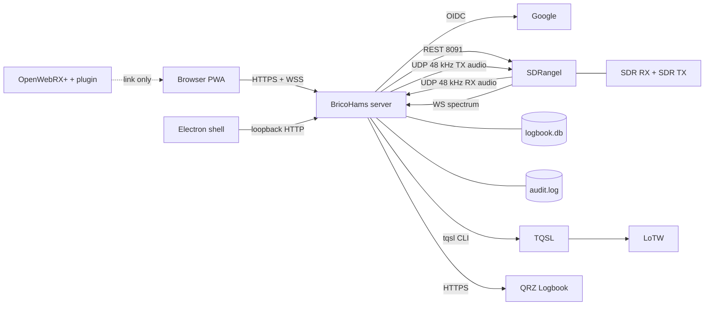
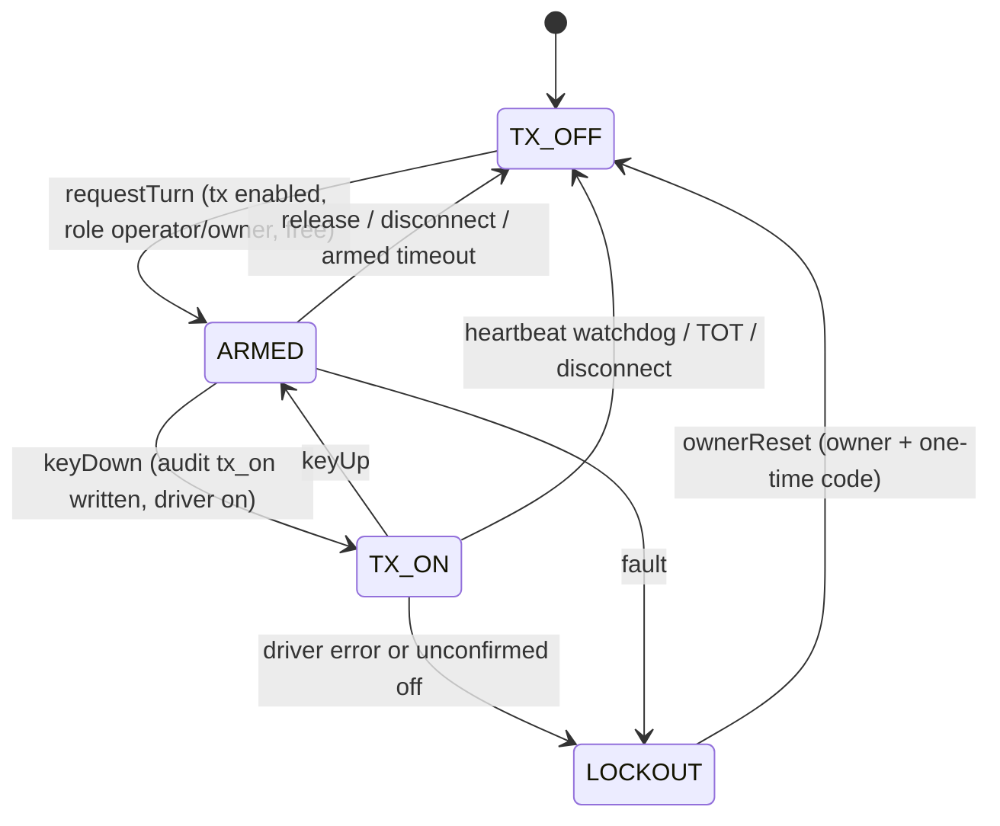
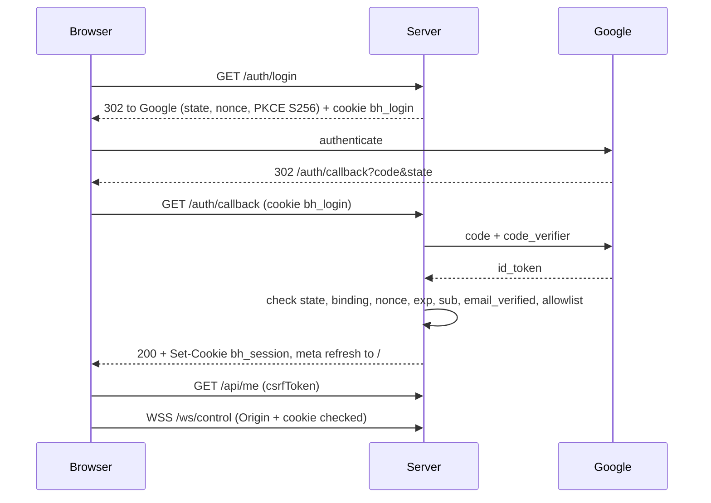
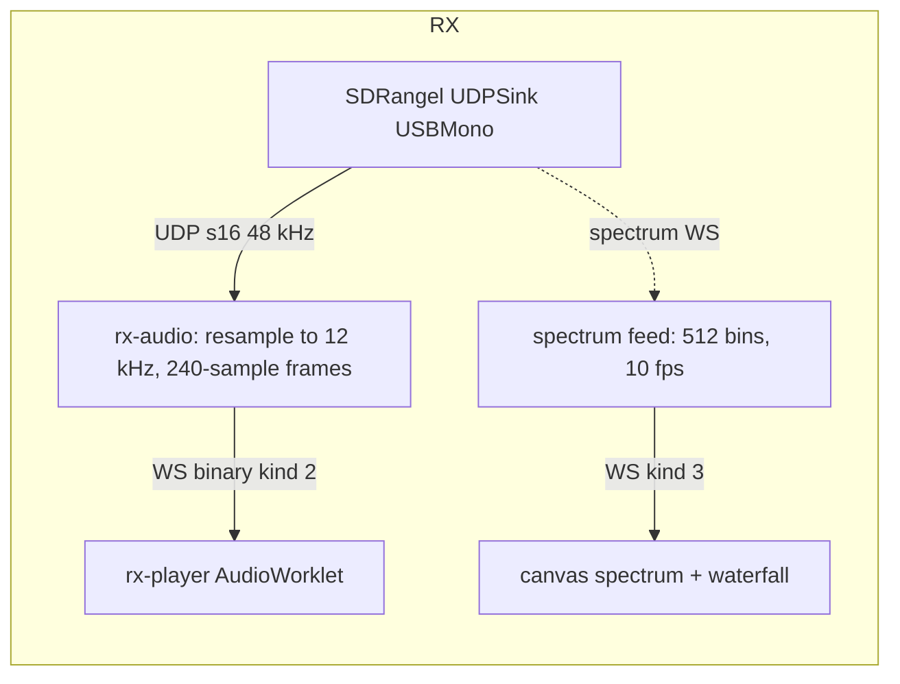
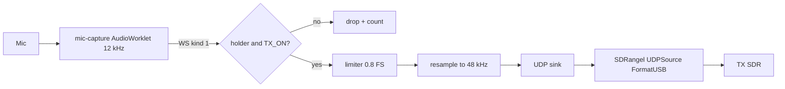
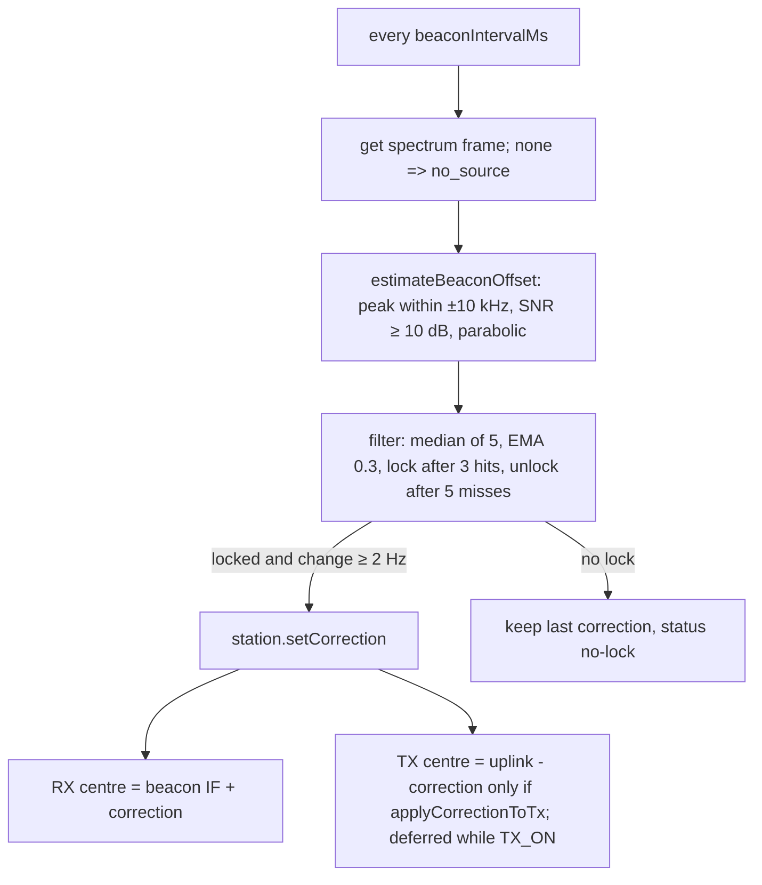
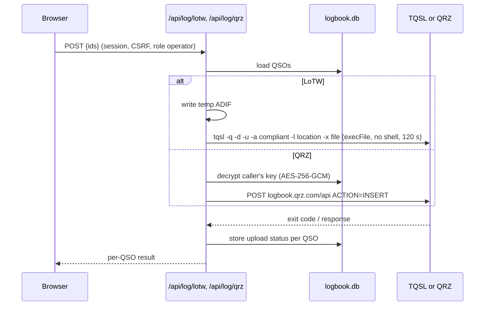

# Architecture

> Español: visión de usuario en [docs/help/index.md](help/index.md). Design spec (Spanish): [superpowers/specs/2026-11-08-qo100-station-design.md](superpowers/specs/2026-11-08-qo100-station-design.md).

BricoHams is one Node.js process (`src/server/index.js`) that sits between browsers and a local SDRangel instance.
SDRangel does all DSP and talks to the SDR hardware; BricoHams adds authentication, the PTT safety logic, tuning/beacon correction, audio transport and the logbook.

> Neural diagram generated from the real imports: [architecture/README.md](architecture/README.md).

## Module map

| Path | Responsibility |
|---|---|
| `src/server/` | `config.js` (load + validate), `app.js` (`createApp`: HTTP, WS, security headers, wiring), `index.js` (CLI entry, signals) |
| `src/auth/` | Google OIDC login (`oidc.js`), flow + CSRF + roles (`index.js`), sessions (`sessions.js`), cookies (`cookies.js`) |
| `src/ptt/` | PTT state machine (`index.js`), JSON-lines audit log (`audit.js`) |
| `src/sdrangel/` | REST client (`client.js`), PTT driver (`ptt-driver.js`), in-process mock (`mock-server.js`) |
| `src/modes/` | Frequency maths, band plan, `station.js` (tune/mode/correction), decoders: `cw-decoder.js` (CW), `ft8-*.js` (FT8/FT4 decode, encode, synth), `slot-decoder.js`, `decode-service.js` (RX audio tap to WebSocket `decode` messages) |
| `src/beacon/` | Beacon peak estimator, filter and controller |
| `src/cluster/` | DX cluster client, spot parser/store, `.ics` calendar, routes (off by default) |
| `src/plugins/` | Static client-plugin resolver and signed webhook dispatcher (no server code plugins) |
| `src/webrtc/` | (historical name, **no WebRTC**) RX/TX audio over WSS, spectrum source/feed, binary frames |
| `src/log/` | SQLite logbook, ADIF, LoTW (TQSL), QRZ, secret box, HTTP routes |
| `src/web/public/` | PWA (vanilla JS, AudioWorklets, service worker, help page) |
| `electron/` | Desktop shell for Windows / desktop Linux |
| `plugins/openwebrx/` | Receive-only OpenWebRX+ plugin |
| `packaging/` | `.deb` build, systemd unit, `install.sh`, Windows notes |
| `test/` | `unit/`, `functional/`, `fixtures/` |

## Components

## PTT state machine

The carrier is cut before state, audit and events are updated. Details: [ADR 0005](adr/0005-ptt-fail-safe-state-machine.md).

## Login sequence

## Audio paths

`station.provision()` creates the UDPSink (RX set) and UDPSource (TX set); SSBMod is only used for CW (CWTone). The spectrum comes from the spectrum server of the RX device set. See ADR 0022. Fallback: loopback audio device.

## Beacon correction loop

## Log upload flow

## Data stores

| Store | Path (config key) | Content | Notes |
|---|---|---|---|
| Logbook | `logbook.path` (`./data/logbook.db`) | tables `qsos`, `user_secrets`, `migrations` | `node:sqlite`, WAL, opened lazily; backup this file |
| Station DB | `stationDbPath` (`./data/station.db`) | tables `memories`, `settings`, `recordings` | `node:sqlite`, lazily opened; backup this file |
| Recordings | `recording.dir` (`./data/recordings`) | `<sha256(email)[0:16]>/rec-*.wav`, 12 kHz mono s16le | mode 0600; capped per file and per user |
| Audit log | `auditLogPath` (`./data/audit.log`) | JSON lines of PTT events | append-only, mode 0600 |
| Sessions | memory | sessions and pending logins | lost on restart |
| Config | `BRICOHAMS_CONFIG` | JSON | no secrets |
| Secrets | environment | `GOOGLE_CLIENT_SECRET`, `BRICOHAMS_SECRETS_KEY` | `secrets.env` / `/etc/bricohams-qo100/env` |

## Configuration reference

File path: `BRICOHAMS_CONFIG` (default `./config.json`). Source of truth: `src/server/config.js`.

| Key | Default | Env override | Meaning |
|---|---|---|---|
| `port` | `8443` | `BRICOHAMS_PORT` | Listen port (0-65535) |
| `host` | `127.0.0.1` | `BRICOHAMS_HOST` | Listen address; non-loopback requires TLS |
| `tls.certPath`, `tls.keyPath` | none | `BRICOHAMS_TLS_CERT`, `BRICOHAMS_TLS_KEY` | PEM files; both or neither |
| `publicUrl` | `http(s)://localhost:<port>` | `BRICOHAMS_PUBLIC_URL` | External origin, no path; used for OAuth redirect, Host and Origin checks; https when TLS is on |
| `google.clientId` | required | `GOOGLE_CLIENT_ID` | OAuth client id |
| `google.issuer` | `https://accounts.google.com` | - | OIDC issuer |
| `allowlist[]` | required, non-empty | - | `{email, callsign, role}`, role `listener`/`operator`/`owner`, unique emails, at least one owner |
| `tx.enabled` | `false` | `BRICOHAMS_TX_ENABLED` | Master TX switch |
| `tx.totSeconds` | `600` | - | Time-out timer, 1-3600 |
| `tx.heartbeatTimeoutMs` | `2000` | - | Heartbeat loss limit, 200-2000; watchdog fires at 75 % |
| `tx.armedTimeoutSeconds` | `120` | - | Turn held without TX before release, 1-3600 |
| `sdrangel.baseUrl` | `http://127.0.0.1:8091` | `BRICOHAMS_SDRANGEL_URL` | SDRangel REST API |
| `station.lnbLoHz` | `9750000000` | - | LNB local oscillator (1e9-1.2e10) |
| `station.rxDeviceSet` | `0` | - | SDRangel device set index for RX |
| `station.txDeviceSet` | `1` | - | Device set for TX; must differ from RX |
| `station.applyCorrectionToTx` | `false` | - | Apply beacon correction to TX (needs a shared reference) |
| `station.beaconIntervalMs` | `1000` | - | Beacon loop period, 100-60000 |
| `audio.enabled` | `false` | - | Enable RX/TX audio, spectrum and beacon loop |
| `audio.rxUdp` | `127.0.0.1:9998` | - | UDP address/port of the SDRangel UDPSink (`udpAddress`/`udpPort`) and where BricoHams listens |
| `audio.txUdp` | `127.0.0.1:9999` | - | UDP address/port of the SDRangel UDPSource (FormatUSB, 48 kHz) |
| `audio.spectrumUrl` | `ws://127.0.0.1:8887` | - | SDRangel spectrum WS; `ws:` only on loopback, else `wss:` |
| `auditLogPath` | `./data/audit.log` | - | PTT audit file |
| `resetCodePath` | `<dir of auditLogPath>/ptt-reset-code` | - | One-time LOCKOUT reset code file (mode 0600) |
| `stationDbPath` | `./data/station.db` | - | SQLite file for memories, settings and recording index |
| `recording.enabled` | `true` | - | Master switch for RX recording (the owner may switch it off at run time, never on) |
| `recording.dir` | `./data/recordings` | - | WAV directory |
| `recording.maxFileMb` / `maxUserMb` | `100` / `1000` | - | Per-file and per-user caps (≥ 1; user cap ≥ file cap) |
| `logbook.path` | `./data/logbook.db` | - | SQLite file |
| `beacon.engine` | `bricohams` | - | `bricohams` (spectrum based) or `sdrangel-freqtracker` (FreqTracker channel) |
| `iq.enabled` / `dir` / `maxUserMb` / `maxSeconds` | `false` / `./data/iq` / `2000` / `600` | - | I/Q via SDRangel FileSink: master switch, BricoHams-managed recordings directory, limits |
| `cluster.enabled` / `host` / `port` / `callsign` / `postSpots` | `false` / - / `7300` / - / `false` | - | DX cluster telnet client (outbound only when enabled) |
| `calendar.enabled` / `url` / `refreshHours` / `maxKb` | `false` / `null` / `6` / `256` | - | `.ics` activity calendar |
| `webhooks.enabled`, `webhooks.endpoints[]` | `false`, `[]` | `secretEnv` names | `{url, events, secretEnv}`; secret ≥ 16 chars from env; `https` except loopback |
| `plugins.enabled` / `dir` | `[]` / `./plugins` | - | Client plugin names and directory |
| `logbook.lotw.tqslPath` / `stationLocation` | unset | - | Enables LoTW; location must not start with `-` |

Secrets (environment only): `GOOGLE_CLIENT_SECRET` (required), `BRICOHAMS_SECRETS_KEY` (optional; 32 bytes as 64 hex chars or base64; without it QRZ key storage returns 503). `google.clientSecret` in the file is rejected. `config.example.json` is a starting point (it binds `0.0.0.0` with TLS and enables audio).

## HTTP API

All JSON. Bodies max 4096 bytes with `Content-Type: application/json`. State-changing routes need header `X-CSRF-Token` (from `GET /api/me`). `Host` must match `publicUrl` (else 421). Auth failures: 401 `unauthenticated`, 403 `forbidden`/`csrf`.

| Route | Access | Purpose |
|---|---|---|
| `GET /api/health` | none | `{ok:true}` |
| `GET /auth/login` | none | Start Google login |
| `GET /auth/callback` | none | Finish login, set session cookie |
| `POST /auth/logout` | session + CSRF | End session, close its sockets (code 4401) |
| `GET /api/me` | any role | `{user, csrfToken}` |
| `GET /api/ptt` | any role | PTT snapshot |
| `POST /api/ptt/reset` | owner + CSRF + one-time code `{code}` | Clear LOCKOUT (code in `resetCodePath`, rotated on each LOCKOUT) |
| `GET /api/status` | any role | `{station, beacon, ptt}` |
| `GET /api/beacon` | any role | Beacon status |
| `POST /api/tune` | operator + CSRF | `{downlinkHz}` |
| `POST /api/mode` | operator + CSRF | `{mode}`; 409 `tx_active` while TX_ON |
| `GET /api/log`, `POST /api/log` | operator (+CSRF) | List (`limit`, `offset`, `call`) / add (409 `duplicate`, `force:true`) |
| `GET/PUT/DELETE /api/log/:id` | operator (+CSRF) | Read / edit / delete (own QSOs; owner any) |
| `GET /api/log/export.adi` | operator | ADIF download |
| `GET/PUT/DELETE /api/log/qrz-key` | operator (+CSRF for writes) | Write-only QRZ key; GET returns `{hasKey, canStore}` |
| `POST /api/log/lotw` | operator + CSRF | `{ids}` (max 100); 503 `lotw_not_configured`, 409 `lotw_busy` |
| `POST /api/log/qrz` | operator + CSRF | `{ids}` (max 100); 409 `qrz_key_missing` |
| `GET /api/bandplan` | any role | Band plan segments, markers, filter presets, AGC modes |
| `GET/POST /api/memories` | any role / operator + CSRF | Own + shared memories and QO-100 presets / add (201; 409 `duplicate_name`, `too_many_memories`) |
| `PUT/DELETE /api/memories/:id` | operator + CSRF | Edit / delete (own; shared ones only by owner; others' ids give 404) |
| `POST /api/memories/:id/recall` | operator + CSRF | Set mode (409 `tx_active` while keyed and the mode differs), tune, apply filter |
| `POST /api/rit` | operator + CSRF | `{ritHz?, xitHz?}` (±9999 Hz); RIT moves RX only, XIT moves TX only |
| `POST /api/txlock` | operator + CSRF | `{locked, txDownlinkHz?}`; `locked:true` = TX follows RX, `false` = split |
| `POST /api/filter` | operator + CSRF | `{preset}` for the current mode (400 `unknown_filter`) |
| `POST /api/rxdsp` | operator + CSRF | `{agc?, squelchDb?, noiseReduction?}` (squelch −100..0 dB or null) |
| `GET /api/recordings` | any role | Own recordings (owner: all), `policy`, `current` |
| `POST /api/recordings/start`, `/stop` | operator + CSRF | Record RX audio to WAV (403 `recording_disabled`, 409 `already_recording`, 413 `quota_exceeded`) |
| `PUT /api/recordings/policy` | owner + CSRF | `{enabled}`; cannot override `recording.enabled: false` |
| `GET /api/recordings/:id.wav`, `DELETE /api/recordings/:id` | operator (+CSRF for delete) | Download / delete own recording |
| `POST /api/notch` | operator + CSRF | `{enabled?, offsetHz?, widthHz?, auto?}`; state in `status.notch` (ADR 0019) |
| `GET /api/memories/export?format=json\|csv` | any role | Download own memories (JSON `schema`+`version`, CSV) |
| `POST /api/memories/import` | operator + CSRF | `{format, content, dryRun?}` max 256 KB; reports `imported`, `duplicates`, `invalid` |
| `GET /api/iq` | operator | Own I/Q recordings, `policy`, `current` (ADR 0020) |
| `POST /api/iq/start`, `/stop`, `/live` | operator + CSRF | Record I/Q via SDRangel FileSink / stop / back to live RX (403 `iq_disabled`, 409 `already_recording`, 413 `quota_exceeded`) |
| `POST /api/iq/:id/playback`, `DELETE /api/iq/:id` | operator + CSRF | Switch RX to FileInput playback / delete |
| `PUT /api/iq/policy` | owner + CSRF | `{enabled}`; cannot override `iq.enabled: false` |
| `GET /api/spots` | any role | Recent DX cluster spots and cluster state |
| `POST /api/spots` | operator + CSRF | `{dx, downlinkHz, comment?}`; 403 `posting_disabled` unless `cluster.postSpots` |
| `GET /api/calendar` | any role | Upcoming activities |
| `POST /api/calendar/refresh`, `/upload` | owner + CSRF | Fetch the configured `.ics` / `{content}` |
| `GET /api/plugins` | any role | `{enabled}` client plugin names (ADR 0018) |
| `GET /plugins/<name>/<file>` | session | Static files of enabled client plugins only |
| `GET /*` | none | Static PWA from `src/web/public` |

Station errors: 502 `sdrangel_unavailable` (with `kind`), 400 `bad_request` and station validation codes (`offset_out_of_range`, `tx_frequency_out_of_range`, `bad_tx_lock`, `unknown_filter`, `bad_dsp`, `bad_agc`, `bad_squelch`, `bad_noise_reduction`, `not_tuned`, `no_mode`). Memory and recording errors carry their own status (see above).

Station state (`status`) also reports `ritHz`, `xitHz`, `txFollowsRx`, `rxHz`, `txDownlinkHz`, `ownSignalOffsetHz` (TX downlink − RX, to monitor your own signal), `filter {name, available}` and `rxDsp`. XIT/split changes are applied to the TX channel only after the carrier drops (deferred while keyed).

## WebSocket protocol (`/ws/control`)

Upgrade requires a valid session (else 401), `Origin` equal to the `publicUrl` origin (else 403) and the right `Host`. Max message 4096 bytes. Closing the socket releases the PTT turn.

| Direction | Message | Meaning |
|---|---|---|
| client → server | `{type:'heartbeat'}` | Keep-alive; send every 500 ms while holding the turn |
| client → server | `{type:'turn'}` | Request the turn (ARMED) |
| client → server | `{type:'release'}` | Give the turn up |
| client → server | `{type:'ptt', down:bool}` | Key down / up |
| client → server | `{type:'subscribe', rxAudio?, spectrum?}` | Choose binary feeds |
| client → server | binary kind 1 (MIC) | s16le mono, 8/12/16/24/48 kHz, ≤ 0.1 s |
| server → client | `state` | `{state, txEnabled, holder:{callsign}, isHolder, lockoutReason}` |
| server → client | `beacon` | `{status, offsetHz, appliedHz, snrDb, reason}` |
| server → client | `caps` | `{rxAudio, spectrum, txAudio, totSeconds}` |
| server → client | `spots` / `spot` | `{spots:[…]}` on connect / `{spot:{spotter, dx, downlinkHz, comment, time}}` live (in-band only) |
| server → client | `result` | `{op, ok, reason}`; reasons `tx_disabled`, `lockout`, `forbidden`, `busy`, `no_turn`, `not_armed`, `audit_failed`, `driver_error`, `aborted` |
| server → client | `error` | `{error:'bad_message'|'unknown_type'}` |
| server → client | binary kind 2 (RX_AUDIO) | 12 kHz s16le, 240 samples |
| server → client | binary kind 3 (SPECTRUM) | 18-byte header + 512 bytes, dB = byte/2 − 140 |

Binary headers (little endian): audio `kind u8, flags u8, seq u16, sampleRate u32`; spectrum `kind u8, flags u8, seq u16, centerHz f64, binHz f32, count u16`.
