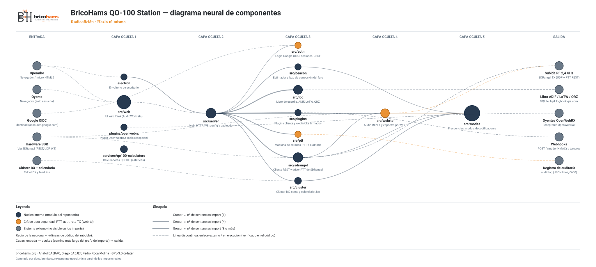

# Diagrama neural de componentes



## Qué muestra

Cada componente de la aplicación y del repositorio es una **neurona** (círculo) colocada en capas, de izquierda a derecha;
las **sinapsis** (curvas de Bézier) son las dependencias reales.

- **Entrada**: operador (navegador / micro HTML5), oyente, Google OIDC, hardware SDR vía SDRangel, clúster DX y calendario.
- **Capas ocultas**: módulos internos (`src/*`, `electron`, `plugins/openwebrx`, `services/qo100-calculators`), ordenados por el
  camino más largo del grafo de imports. `src/server` es el hub. `src/web` representa la UI web (`src/web/public`).
- **Salida**: subida RF 2,4 GHz (SDRangel TX), libro ADIF / LoTW / QRZ, oyentes OpenWebRX, webhooks y registro de auditoría.

## Cómo leerlo

| Elemento | Significado |
|---|---|
| Azul marino `#12263f` | Núcleo interno |
| Naranja `#e8871e` | Crítico para seguridad: `src/ptt`, `src/auth`, `src/webrtc` (ruta TX) |
| Gris `#5b6b7b` | Sistema externo |
| Radio | Proporcional a √(líneas de código del módulo) |
| Grosor de la sinapsis | Proporcional al número de sentencias `import` entre módulos |
| Línea discontinua | Enlace externo o en ejecución (HTTP/WS, UDP, telnet, `tqsl`…), verificado en el código y en [ARCHITECTURE.md](../ARCHITECTURE.md) |

Si un ciclo de imports impide ordenar dos módulos, la arista se dibuja igualmente y se lista en `neural-graph.json` (`cycles`).
El SVG respeta el modo oscuro del sistema (`prefers-color-scheme`).

## Regenerar

```sh
node docs/architecture/generate-neural.mjs
# o: npm run diagram
```

Escribe `neural-diagram.svg` y `neural-graph.json` (`nodes`, `edges`, `cycles`). La salida es determinista: mismo código, mismo SVG.

## Por qué se genera desde el código

Un diagrama dibujado a mano se desfasa en cuanto cambia un `import`. Aquí los módulos, tamaños y dependencias internas se leen
de los ficheros fuente (`src/**/*.js`, `electron/main.js`, `plugins/openwebrx/*.js`, `services/qo100-calculators/assets/*.js`),
así que el diagrama no puede contradecir al código. Solo los enlaces externos (SDRangel, Google, TQSL, QRZ, clúster DX…) están
declarados a mano en el generador, cada uno con la referencia al fichero que lo justifica. Las pruebas están en
`test/unit/neural-diagram.test.js`.

---
bricohams.org · Anatol EA5KAO, Diego EA5JEF, Pedro Roca Molina · GPL-3.0-or-later
