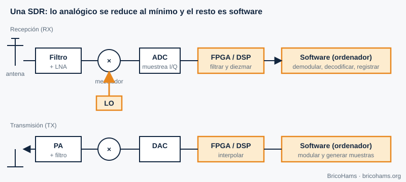

[ES](../es/00-prologo.md) · [EN](../en/00-prologo.md) · [FR](../fr/00-prologo.md) · [PT](../pt/00-prologo.md)

# Preface

*Figure 1: Building blocks of an SDR.*

Only a few years ago, listening to the QO-100 geostationary satellite required a chain of expensive, closed equipment. Today a dongle costing a few tens of euros, an LNB and a TV dish let you see the whole 500 kHz narrowband segment on screen and decode dozens of contacts at once. What changed is not the antenna: it is that **radio moved from the circuit to the algorithm**.

This manual aims to help you understand that algorithm well enough to debug your station, choose hardware sensibly and read the BricoHams code without fear.

## Who it is for

- Radio amateurs with a basic electronics background or the wish to acquire one.
- Builders ("do it yourself") who put together a dish, LNB, helix and SDR and want to know *why* they work.
- Students looking for DSP examples based on a real, reproducible case.

You don't need to know how to program, but the labs in [chapter 12](12-practicas.md) use Node.js (version 24) and are more rewarding if you dare to edit the examples.

## How it is organized

Chapters 2 to 10 follow the path of the signal, from the air to the decoded message: sampling, noise, modulation, hardware, time and carrier synchronization, coding, channel and OFDM. Chapter 11 brings everything together in the BricoHams station and chapter 12 proposes labs.

Each chapter ends with worked exercises. The QO-100 figures (frequencies, satellite transposition, LNB IF) come from the repository code, in [`src/modes/frequencies.js`](../../../src/modes/frequencies.js); the FT8 and FT4 parameters come from [`src/modes/ft8-constants.js`](../../../src/modes/ft8-constants.js).

## Conventions

- Decimal points in the text and in the code.
- "dB" are power ratios (10·log₁₀) unless stated otherwise; dBm, dBW and dBFS carry their reference.
- Values marked as *illustrative* are assumptions for practice, not measurements of your station.

## Honesty about sources

This text is original: it explains the concepts in our own words and with our own examples. Where a book covers a topic in more depth, we point to it as recommended reading (by chapter, without reproducing its content). Always verify operating parameters (beacon frequencies, power limits, band plan) against the official sources of AMSAT-DL and your national administration.

**Further reading:** Collins et al., Software-Defined Radio for Engineers, ch. 1
