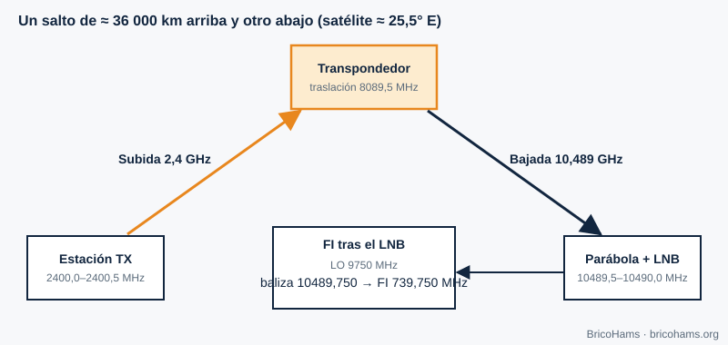

[ES](../es/01-que-es-sdr.md) · [EN](../en/01-que-es-sdr.md) · [FR](../fr/01-que-es-sdr.md) · [PT](../pt/01-que-es-sdr.md)

# 1. What Is a Software-Defined Radio?

## Objectives

- Tell which part of a radio is hardware and which part is software.
- Follow the QO-100 signal from the dish to the text of a message.
- Understand why an SDR sees the whole band at once.

## 1.1 The idea

In a classic radio, each function (filtering, demodulating, detecting) is a fixed analog circuit. In a **software-defined radio (SDR)** the hardware is reduced to the bare minimum: an antenna, an amplifier, a frequency converter and an **analog-to-digital converter (ADC)**. From there on everything is numbers. Switching from SSB to FT8 or CW requires no soldering: another program runs on the same samples.

*Figure 1: Building blocks of an SDR.*

The boundary between the analog and digital worlds keeps moving closer to the antenna. The limit is set by the ADCs (how many bits and how many samples per second) and the available processor.

## 1.2 The QO-100 chain

The signal we care about comes down from the satellite around 10.489 GHz. A cheap ADC cannot sample 10 GHz, so it is done in stages:

1. The **LNB** (low-noise block) amplifies and mixes with a 9750 MHz local oscillator. The 10 489.750 MHz beacon ends up at an **intermediate frequency (IF)** of 10 489.750 − 9750 = **739.750 MHz**.
2. A coaxial cable carries the IF to the SDR and, over the same cable, an injector (bias-T) powers the LNB.
3. The SDR shifts to baseband and samples, delivering complex **I/Q** samples at, for example, 2.4 million samples per second.
4. The software (SDRangel and, in this station, Node modules) filters, decimates, demodulates and decodes.

*Figure 17: The satellite link (uplink at 2400 MHz, downlink at 10 489 MHz).*

In the opposite direction, the uplink is at 2400.0–2400.5 MHz; the satellite shifts the signal by 8089.5 MHz and retransmits it between 10 489.5 and 10 490.0 MHz. That fixed relationship lets you compute the uplink frequency from the downlink: `uplink = downlink − 8089.5 MHz`.

## 1.3 What an SDR gains and loses

| Advantage | Cost |
|---|---|
| One device for many modes | Needs a computer and configured software |
| You see the whole QO-100 narrowband segment (500 kHz) at once | The ADC limits the dynamic range (chapter 5) |
| Upgradable: new modes without new hardware | Processing latency can be noticeable |
| Reproducible: you record I/Q and analyze it again | Time synchronization is your responsibility |

## 1.4 A numerical example

If the SDR samples at 600 kS/s complex, it sees 600 kHz of spectrum: more than the 500 kHz of the narrowband transponder. Each I/Q sample is two numbers; at 16 bits per component, the data rate is 600 000 × 2 × 2 bytes = 2.4 MB/s, about 8.6 GB per hour. That is why the station decimates early (chapter 2): FT8 works with 12 000 real samples per second, 200 times fewer than at 2.4 MS/s.

## How BricoHams does it

BricoHams **does not reinvent the radio engine**: it delegates heavy signal processing to SDRangel (decision in [`docs/adr/0001-sdrangel-as-engine.md`](../../adr/0001-sdrangel-as-engine.md)) and adds on top what is missing to operate QO-100 remotely and safely: PTT control, beacon-based correction, FT8/FT4/CW decoders, contact logging and a web interface.

- SDRangel client: [`src/sdrangel/client.js`](../../../src/sdrangel/client.js)
- QO-100 frequencies and conversions: [`src/modes/frequencies.js`](../../../src/modes/frequencies.js)
- Overview: [`docs/ARCHITECTURE.md`](../../ARCHITECTURE.md)

## Exercises

1. Compute the IF at the SDR if the LNB had a 9750 MHz oscillator and you wanted to receive 10 489.900 MHz.
2. Which uplink frequency corresponds to a downlink of 10 489.900 MHz?
3. An SDR samples at 2.4 MS/s with 8 bits per component. How many MB/s does it generate?

### Solutions

1. 10 489.900 − 9750 = **739.900 MHz**.
2. 10 489.900 − 8089.5 = **2400.400 MHz**.
3. 2 400 000 × 2 components × 1 byte = 4.8 MB/s.

**Further reading:** Collins et al., Software-Defined Radio for Engineers, ch. 1
