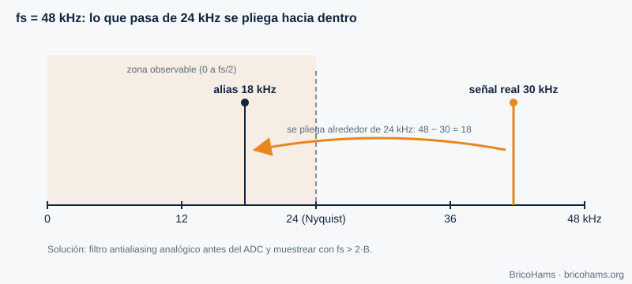
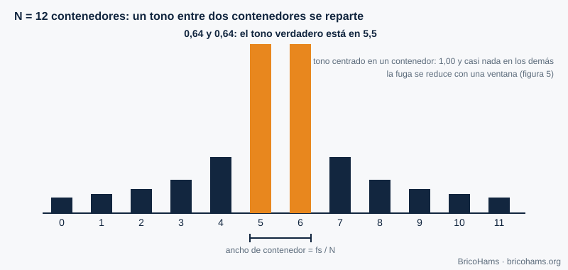
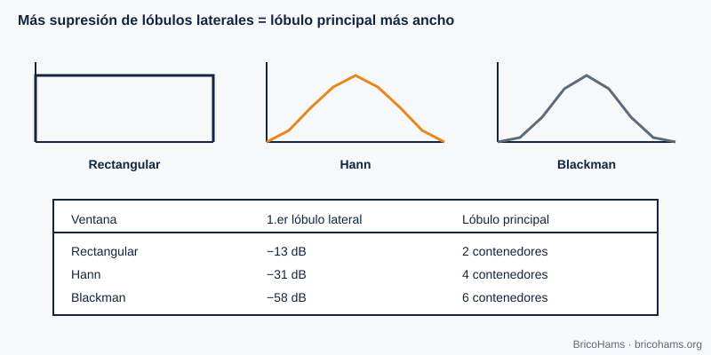
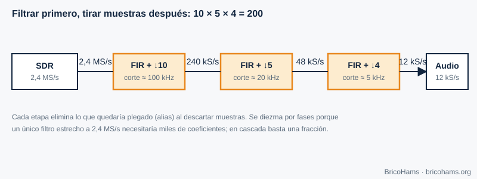

[ES](../es/02-senales-y-sistemas.md) · [EN](../en/02-senales-y-sistemas.md) · [FR](../fr/02-senales-y-sistemas.md) · [PT](../pt/02-senales-y-sistemas.md)

# 2. Signals and Systems

## Objectives

- Apply the Nyquist theorem and recognize aliasing.
- Work with I/Q signals and complex baseband.
- Interpret an FFT: resolution, leakage and windows.
- Design a decimation chain.

## 2.1 Sampling: turning continuous time into numbers

An ADC measures the signal voltage at regular intervals, every *T = 1/fs* seconds. If the signal contains components up to a maximum frequency *B*, **fs > 2B** is enough to reconstruct it (the **Nyquist** criterion). Below that, the high components "fold" onto the low ones and become confused with them: this is **aliasing**.

*Figure 2: Sampling and aliasing.*

**Example.** A 7 kHz sine wave sampled at 12 kHz (the working rate of FT8 decoders) exceeds the Nyquist limit of 6 kHz. It looks like one at |7 − 12| = **5 kHz**. That is why you always filter before lowering the rate.

## 2.2 Complex signals: I and Q

A real 2 kHz signal and a −2 kHz signal are indistinguishable in a real spectrum. A **complex signal** *x[n] = I[n] + j·Q[n]* does tell positive and negative frequencies apart, and occupies the spectrum from −fs/2 to +fs/2. A **direct-conversion** receiver (chapter 5) produces exactly that: I and Q are the projection onto two oscillators in quadrature.

*Figure 3: I/Q constellation.*

**Complex baseband** places the SDR's center at 0 Hz. A signal at +3 kHz from the center is *e^(j2π·3000·t)*; at −3 kHz, *e^(−j2π·3000·t)*. Changing the sign of the frequency is equivalent to conjugating the signal. This is how USB and LSB are told apart without ambiguity.

## 2.3 The FFT: seeing the spectrum

The **fast Fourier transform (FFT)** of *N* samples produces *N* bins spaced *fs/N* apart. It is the magnifying glass used to view the QO-100 spectrum.

*Figure 4: FFT bins.*

**Example.** The station's spectrum stream uses *fs* = 102 400 Hz and *N* = 1024: each bin measures 100 Hz. A perfectly centered tone falls into a single bin; one halfway between two bins is split between neighbors, and that is where the beacon's parabolic interpolation comes from (chapter 7).

The FFT's processing gain also helps: a tone concentrates its energy in one bin, while white noise is spread over all *N*. The signal-to-noise ratio *per bin* improves by about 10·log₁₀(N) dB; with N = 1024, 30 dB.

## 2.4 Windows

The FFT assumes the block repeats periodically. If the tone does not complete a whole number of cycles, **leakage** appears: energy in distant bins. Multiplying the block by a **window** smooths the edges and reduces leakage, at the cost of widening the main lobe.

*Figure 5: Comparison of windows.*

| Window | 1st sidelobe | Main lobe width |
|---|---|---|
| Rectangular | −13 dB | 2 bins |
| Hann | −31 dB | 4 bins |
| Blackman | −58 dB | 6 bins |

Rule of thumb: if you are looking for a weak signal close to a strong one (for example, a CW signal next to the beacon), use a window with low sidelobes.

## 2.5 Decimation

Lowering the sampling rate ("decimating") by a factor *M* means discarding *M−1* out of every *M* samples, **after** low-pass filtering so there is no aliasing. It is done in stages because a single very narrow filter at a high rate is very expensive.

*Figure 6: Decimation chain.*

**Example.** From 2.4 MS/s to 12 kS/s is a factor of 200 = 10 × 5 × 4: 2 400 000 → 240 000 → 48 000 → 12 000 samples per second.

## How BricoHams does it

- The decoders' FFT lives in [`src/modes/ft8-fft.js`](../../../src/modes/ft8-fft.js) and builds the waterfall in [`src/modes/ft8-decode.js`](../../../src/modes/ft8-decode.js).
- The working rate of FT8 and FT4 is `SAMPLE_RATE = 12000` ([`ft8-constants.js`](../../../src/modes/ft8-constants.js)).
- Resampling of the receiver audio is in [`src/webrtc/resample.js`](../../../src/webrtc/resample.js).
- Spectrum frames (bins in dB) are interpreted in [`src/webrtc/spectrum.js`](../../../src/webrtc/spectrum.js).

## Exercises

1. An 8 kHz signal is sampled at 12 kHz. At what frequency does it appear?
2. What resolution does a 4096-point FFT have at 12 kS/s?
3. How many points do you need to resolve 6.25 Hz with fs = 12 kHz?
4. With 100 Hz bins, a tone appears 740 Hz from the first bin. In which bin is its peak and what fraction of a bin is left to interpolate?

### Solutions

1. |8 − 12| = **4 kHz** (alias).
2. 12 000 / 4096 ≈ **2.93 Hz** per bin.
3. N = fs / Δf = 12 000 / 6.25 = **1920** samples (exactly the duration of one FT8 symbol: 0.16 s).
4. 740 / 100 = 7.4 → bin 7 (at +0.4 bins); parabolic interpolation refines the 0.4.

**Further reading:** Collins et al., Software-Defined Radio for Engineers, ch. 2
