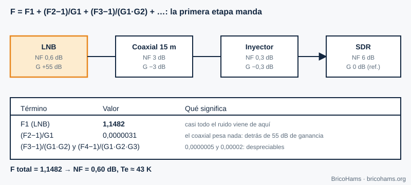
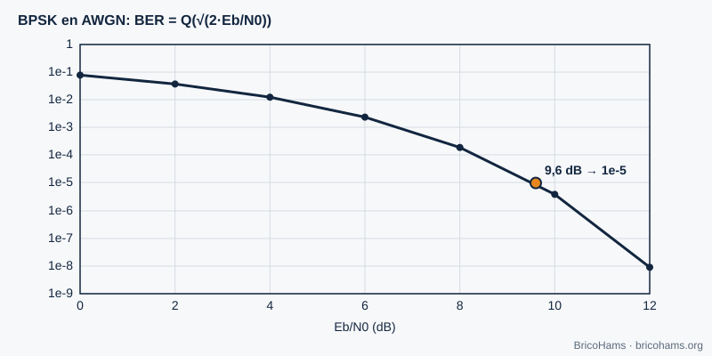
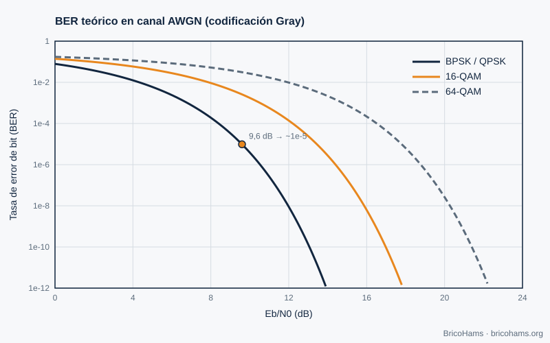
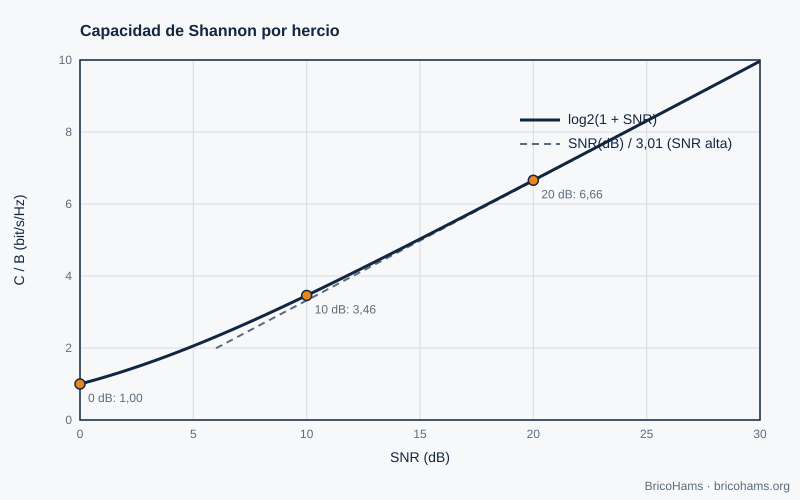

[ES](../es/03-ruido-y-probabilidad.md) · [EN](../en/03-ruido-y-probabilidad.md) · [FR](../fr/03-ruido-y-probabilidad.md) · [PT](../pt/03-ruido-y-probabilidad.md)

# 3. Noise and Probability

## Objectives

- Compute thermal noise power in a given bandwidth.
- Relate SNR, C/N0 and Eb/N0.
- Apply the Friis formula to the LNB → coax → SDR line.
- Read a BER curve and know what limits a channel's capacity.

## 3.1 Thermal noise

Every conductor at temperature *T* generates white noise of density *N0 = k·T*, with the Boltzmann constant *k* = 1.38·10⁻²³ J/K. At 290 K, *N0* = −174 dBm/Hz. The power in a bandwidth *B* is *N = N0 + 10·log₁₀(B)*:

| Bandwidth | Noise power at 290 K |
|---|---|
| 6.25 Hz (FT8 symbol) | −166 dBm |
| 2.7 kHz (SSB) | −139.7 dBm |
| 500 kHz (NB transponder) | −117 dBm |

The narrower the filter, the less noise gets in. That is why FT8 can decode signals the ear cannot distinguish.

## 3.2 SNR, C/N0 and Eb/N0

- **SNR** = signal power / noise power, *in a specific bandwidth*. Without the bandwidth, the figure means nothing.
- **C/N0** (dB·Hz) = SNR + 10·log₁₀(B): a bandwidth-independent measure.
- **Eb/N0** = energy per bit over noise density = C/N0 − 10·log₁₀(R_b), with *R_b* the bit rate.

**Example (illustrative).** A signal with C/N0 = 40 dB·Hz and a rate of 50 bit/s has Eb/N0 = 40 − 17 = **23 dB**.

For FT8, a threshold of about −21 dB SNR measured in 2500 Hz is usually quoted. In the width of one symbol (6.25 Hz) that is −21 + 10·log₁₀(2500/6.25) = −21 + 26 = **+5 dB** of Es/N0, that is, on the order of 0 dB per information bit after coding. This is the magic of combining a narrow bandwidth with error correction (chapter 8).

## 3.3 Noise figure and the Friis formula

The **noise figure (NF)** measures how much noise a component adds above the thermal level. A cascade of stages has

*F = F₁ + (F₂−1)/G₁ + (F₃−1)/(G₁G₂) + …*

with *F* and *G* as linear values. The equivalent noise temperature is *Te = 290·(F−1)*.

*Figure 7: Friis cascade (LNB → coax → bias-T → SDR).*

**Example.** LNB with NF 0.6 dB and gain 55 dB; coax with 3 dB loss; injector with 0.3 dB; SDR with NF 6 dB. The LNB contributes F₁ = 1.1482; the rest adds less than 0.00003. Total: NF ≈ **0.60 dB**, *Te* ≈ **43 K**. Moral: the only thing that matters is the LNB, as long as its gain is high. That is why it is mounted on the dish and not at the SDR.

### From noise to signal: link budget

C/N0 = EIRP − free-space loss − atmospheric losses + G/T − 10·log₁₀(k).

With a slant range of 38 000 km at 10.489 GHz, the free-space loss is 20·log₁₀(4π·d/λ) ≈ **204.5 dB** (λ = 2.858 cm). A 90 cm dish with efficiency 0.55 has ≈ 37.3 dBi. With *Tsys* = 60 K of antenna + 43 K of receiver = 103 K (20.1 dBK), G/T ≈ 17.2 dB/K. −10·log₁₀(k) = +228.6 dBW/K/Hz.

## 3.4 BER and Eb/N0

The **bit error rate (BER)** of BPSK in Gaussian noise is *Q(√(2·Eb/N0))*. At 9.6 dB it is ≈ 10⁻⁵; each extra dB of Eb/N0 lowers the BER by almost an order of magnitude once we are in the "waterfall" region.

*Figure 8: BER of BPSK versus Eb/N0.*

Figure 23 compares BPSK/QPSK, 16-QAM and 64-QAM (denser modulations need more Eb/N0 for the same BER).

*Figure 23: Theoretical BER of BPSK, 16-QAM and 64-QAM.*

## 3.5 Shannon limit

No system exceeds the capacity *C = B·log₂(1 + SNR)*. With SNR = 0 dB (signal power = noise power), *C/B* = 1 bit/s/Hz; with 10 dB, 3.46; with 20 dB, 6.66; with 30 dB, 9.97.

*Figure 24: Shannon capacity as a function of SNR.*

Capacity grows only logarithmically with power: doubling the power (+3 dB) adds barely ≈ 1 bit/s/Hz at high SNR. Hence, on QO-100 it makes more sense to improve G/T (bigger dish, better LNB) than to add power indiscriminately.

## How BricoHams does it

The folder [`services/qo100-calculators/`](../../../services/qo100-calculators/README.md) includes an **LNB lineup** calculator that applies exactly Friis and the link budget:

- [`assets/qo100-math.js`](../../../services/qo100-calculators/assets/qo100-math.js): `cascade`, `lnbLineup`, `fsplDb`, `dishGain`.
- [`demo.html`](../../../services/qo100-calculators/demo.html): interface (serve it over HTTP to open it).
- The noise figure also decides how to set the gain in SDRangel (chapter 5).

## Exercises

1. Compute the noise power of a 2.5 kHz channel at 290 K.
2. What is *Te* of an LNB with NF = 0.8 dB?
3. A link has C/N0 = 50 dB·Hz. What SNR is there in 2.7 kHz?
4. What Eb/N0 is needed for BPSK at BER 10⁻⁵?

### Solutions

1. −174 + 10·log₁₀(2500) = −174 + 34 = **−140 dBm**.
2. F = 10^0.08 = 1.202 → *Te* = 290 × 0.202 ≈ **58.6 K**.
3. 50 − 10·log₁₀(2700) = 50 − 34.3 = **15.7 dB**.
4. Approximately **9.6 dB**.

**Further reading:** Collins et al., Software-Defined Radio for Engineers, ch. 3
