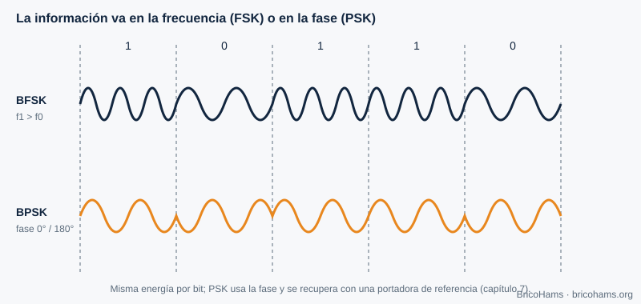
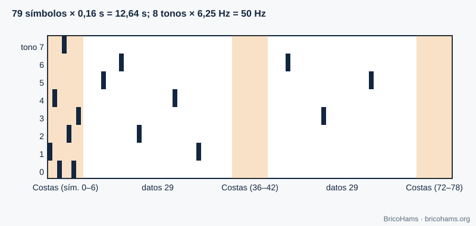
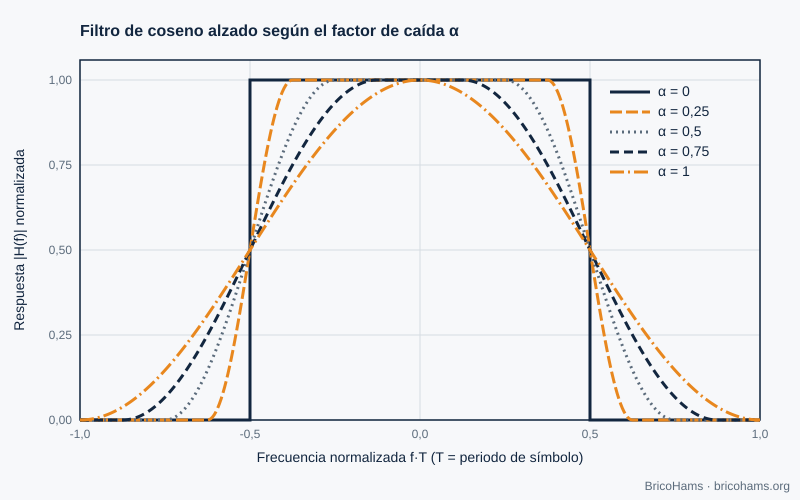

[ES](../es/04-modulacion-digital.md) · [EN](../en/04-modulacion-digital.md) · [FR](../fr/04-modulacion-digital.md) · [PT](../pt/04-modulacion-digital.md)

# 4. Digital Modulation

## Objectives

- Explain how FSK and PSK encode bits in frequency and phase.
- Understand the structure of FT8 (8-GFSK), FT4 and CW.
- Understand why pulses are shaped (raised cosine, Gaussian filter).

## 4.1 Message → waveform

To modulate is to modify a parameter of a carrier according to the data. With three parameters (amplitude, frequency, phase) you get the ASK/OOK, FSK and PSK families.

*Figure 9: FSK and PSK waveforms.*

- **FSK**: each symbol is a different tone. It is robust and easy to detect without knowing the carrier phase (non-coherent detection).
- **PSK**: each symbol is a phase. In BPSK there are two phases (0° and 180°) and one bit per symbol; in QPSK, four phases and two bits. It requires carrier recovery (chapter 7).
- **QAM** combines amplitude and phase: more bits per symbol at the cost of more Eb/N0 (figure 23 in chapter 3).

## 4.2 The constellation

Each symbol is a point in the I/Q plane. Noise draws a cloud around each point; if the cloud crosses the boundary between decisions, an error occurs.

*Figure 3: I/Q constellations.*

## 4.3 FT8 and FT4: multi-tone FSK

**FT8** transmits 8 tones spaced 6.25 Hz apart. Each symbol lasts 0.16 s, that is, 1/0.16 = 6.25 symbols per second, and the tone spacing equals the symbol rate: the tones are orthogonal. Each symbol encodes 3 bits. The complete message is 79 symbols (12.64 s), with a total width of 8 × 6.25 = **50 Hz**.

*Figure 10: FT8 tone and time grid.*

The "G" in *8-GFSK* means that the transition between tones is smoothed with a Gaussian filter (parameter BT = 2.0 in this repository) so that the spectrum does not widen because of abrupt jumps.

**FT4** is faster: 4 tones, 0.048 s symbols (20.83 Hz spacing), 105 symbols and 7.5 s slots. It costs more SNR and occupies more bandwidth (≈ 83 Hz).

## 4.4 CW

Telegraphy is the simplest modulation: carrier on or off (OOK). Good *keying* softens the edges so the spectrum does not "click". Speed is measured in words per minute: at 20 wpm a dot lasts 60 ms (with the word PARIS as the reference).

## 4.5 The BPSK beacon

The QO-100 NB beacon is a narrow carrier with low-rate modulation. For BricoHams only its **frequency** matters: it is used as an absolute reference (chapter 7).

## 4.6 Pulse shaping

A rectangular pulse of duration *T* has a *sinc* spectrum with lobes that extend very far. To occupy less bandwidth without generating **intersymbol interference (ISI)**, the **raised cosine** is used, with roll-off factor α (0 to 1). Its frequency response is flat in the center, falls smoothly between *(1−α)/2T* and *(1+α)/2T*, and is zero outside: the bandwidth is *(1+α)/T*.

*Figure 26: Raised-cosine pulse and spectrum.*

With α = 0.25 and 1200 symbols/s, the bandwidth is 1.25 × 1200 = 1500 Hz. In practice the raised cosine is split into two "roots": one in the transmitter and one in the receiver (matched filter), which together give a full raised cosine.

## How BricoHams does it

- Protocol constants: [`src/modes/ft8-constants.js`](../../../src/modes/ft8-constants.js) (`PROTOCOLS` for FT8 and FT4).
- Synthesis of a message's waveform: `synthSlot` in [`src/modes/ft8-encode.js`](../../../src/modes/ft8-encode.js).
- CW decoding: [`src/modes/cw-decoder.js`](../../../src/modes/cw-decoder.js).
- Usage guide: [`docs/help/operar-digitales.md`](../../help/operar-digitales.md) and [`docs/help/operar-cw.md`](../../help/operar-cw.md).

## Exercises

1. How many symbols per second does FT4 transmit?
2. What bandwidth does a 100-baud signal occupy with raised cosine α = 0.5?
3. How many bits does each FT8 symbol carry and how many data symbols are there?
4. A CW dot lasts 80 ms. How many wpm is that?

### Solutions

1. 1 / 0.048 ≈ **20.8 symbols/s**.
2. (1 + 0.5) × 100 = **150 Hz**.
3. **3 bits** per symbol; there are 58 data symbols (174 bits) plus 21 synchronization symbols.
4. dot = 1.2 / wpm → wpm = 1.2 / 0.08 = **15 wpm**.

**Further reading:** Collins et al., Software-Defined Radio for Engineers, ch. 4
