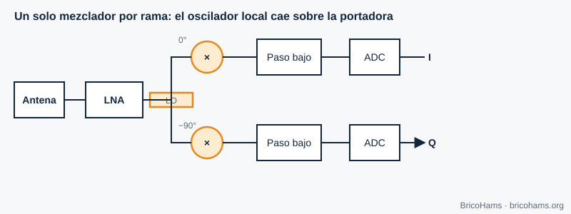
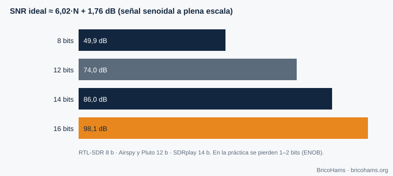

[ES](../es/05-hardware-sdr.md) · [EN](../en/05-hardware-sdr.md) · [FR](../fr/05-hardware-sdr.md) · [PT](../pt/05-hardware-sdr.md)

# 5. SDR Hardware

## Objectives

- Compare zero-IF and low-IF architectures.
- Relate ADC bits to dynamic range.
- Recognize local-oscillator leakage and I/Q imbalance.
- Understand the role of the clock (TCXO, GPSDO) and choose an SDR from `hardware/bom/components.csv`.

## 5.1 Architectures

**Zero-IF (direct conversion).** A local oscillator at the frequency of interest is multiplied by the signal in two branches 90° out of phase. After a low-pass filter and two ADCs, I and Q come out. This is the architecture of most SDRs (the RTL-SDR is not one: it uses low IF; the ADALM-Pluto with the AD9363 is).

*Figure 11: Zero-IF receiver.*

**Low-IF.** The oscillator sits slightly to the side of the signal, which ends up at a small intermediate frequency where the ADC samples it. It avoids the DC problems of zero-IF but needs to reject the image frequency.

| | Zero-IF | Low-IF |
|---|---|---|
| Bandwidth | High (separate I and Q) | Lower |
| Typical problem | DC, I/Q imbalance, LO leakage | Image frequency |
| Complexity | Low | Medium |

## 5.2 Analog-to-digital converter

An *N*-bit ADC offers at most 2^N levels. For a full-scale sine wave, the quantization signal-to-noise ratio is ≈ **6.02·N + 1.76 dB**.

*Figure 12: ADC dynamic range.*

| Bits | Theoretical range |
|---|---|
| 8 | 49.9 dB |
| 12 | 74.0 dB |
| 14 | 86.0 dB |
| 16 | 98.1 dB |

The real range is lower (the ADC's own noise, ENOB). An 8-bit RTL-SDR copes poorly with a strong signal close to a weak one (for example, a TV station next to QO-100); a 14-bit SDRplay does considerably better. On QO-100 the IF contains the satellite band, where the beacon is much stronger than a weak FT8 signal: dynamic range matters.

## 5.3 Zero-IF imperfections

- **LO leakage:** part of the oscillator shows up at the output as a spike at 0 Hz of the I/Q spectrum. It is corrected by subtracting the DC component or by offsetting the center a few kHz.
- **I/Q imbalance:** the two branches are not identical (gain difference ε and phase difference φ). An *image* of each signal appears at the opposite frequency. Image rejection ≈ 10·log₁₀(4 / (ε² + φ²)): with ε = 1 % and φ = 1° (0.01745 rad), 4 / (0.0001 + 0.000305) ≈ 9877 → ≈ **40 dB**.
- **DC offset:** the ADC has a residual level; it also shows up at 0 Hz.

## 5.4 The clock: TCXO and GPSDO

All the SDR's frequencies derive from a crystal. An error of *p* ppm shifts a signal at *f* by *p·f·10⁻⁶* Hz. A 1 ppm crystal at 739.75 MHz would be 740 Hz; in the LNB oscillator, at 9750 MHz, 1 ppm is **9.75 kHz**. That is why the LNB drift (and not the SDR's) dominates on QO-100 (chapter 7).

- **TCXO**: temperature-compensated crystal (±0.5 to ±2 ppm).
- **GPSDO**: GPS-disciplined oscillator (parts of 10⁻⁹ to 10⁻¹¹); sharing the reference between TX and RX avoids relative drifts.

## 5.5 The SDRs in this project

The full list is in [`hardware/bom/components.csv`](../../../hardware/bom/components.csv); the comparison is in [`hardware/bom/comparison.md`](../../../hardware/bom/comparison.md).

| Use | Examples from the list | Notes |
|---|---|---|
| IF RX | RTL-SDR Blog V3/V4 (8 bits), Airspy Mini/R2 (12 bits), SDRplay RSP1B (14 bits) | 0.5–1 ppm TCXO; the dongle's bias-T does not replace the injector |
| 2.4 GHz TX | ADALM-Pluto (AD9363, 12 bits, ≈ 20 MHz bandwidth), HackRF One (8 bits), LimeSDR Mini 2.0, USRP B200mini-i (AD9364, 56 MHz, 10 MHz input) | Output power is low: you need a PA, a filter and a meter |
| HF alternative | Hermes Lite 2 | Only with a transverter; do not connect the LNB IF to its input |

The Pluto's AD9363 is an integrated transceiver that officially covers 325–3800 MHz, so 2.4 GHz is no problem; its low-accuracy oscillator is compensated by BricoHams's beacon correction. These brands appear as technical examples and do not imply any link with BricoHams.

## How BricoHams does it

- It configures the SDR through SDRangel: [`src/sdrangel/client.js`](../../../src/sdrangel/client.js).
- It computes the oscillator offsets in [`src/modes/frequencies.js`](../../../src/modes/frequencies.js) (`downlinkToIf`, `ifToDownlink`).
- It compensates the LNB drift using the beacon: [`src/beacon/index.js`](../../../src/beacon/index.js).
- Hardware guide: [`hardware/README.md`](../../../hardware/README.md) and [`docs/help/equipos-y-programas.md`](../../help/equipos-y-programas.md).

## Exercises

1. What theoretical dynamic range does a 10-bit ADC have?
2. A 25 MHz oscillator with 2 ppm: how much does it shift at 739.75 MHz?
3. What is the image rejection with ε = 2 % and φ = 2°?
4. Which LNB LO corresponds to an IF of 739.75 MHz for 10 489.75 MHz?

### Solutions

1. 6.02 × 10 + 1.76 = **62 dB**.
2. 2 ppm × 739.75 MHz = **1.48 kHz**.
3. ε² = 0.0004; φ = 0.0349 rad → φ² = 0.00122; sum = 0.00162; 4 / 0.00162 = 2469 → **≈ 34 dB**.
4. 10 489.75 − 739.75 = **9750 MHz**.

**Further reading:** Collins et al., Software-Defined Radio for Engineers, ch. 5
