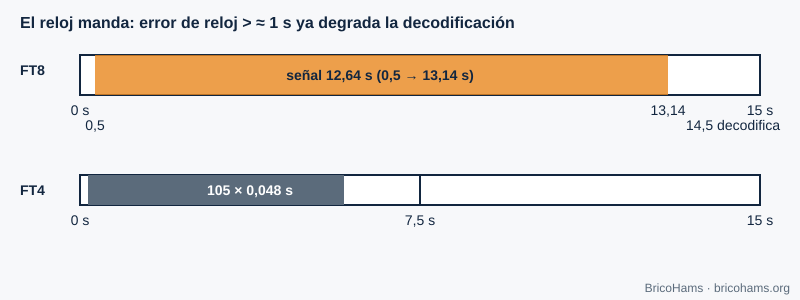

[ES](../es/06-sincronizacion-de-tiempo.md) · [EN](../en/06-sincronizacion-de-tiempo.md) · [FR](../fr/06-sincronizacion-de-tiempo.md) · [PT](../pt/06-sincronizacion-de-tiempo.md)

# 6. Timing Synchronization

## Objectives

- Understand what symbol synchronization is and why it has to be done.
- Compute the time structure of FT8 and FT4.
- Know why your computer's UTC clock is part of the station.

## 6.1 Three levels of time

1. **Sample**: the ADC clock sets when each sample is taken.
2. **Symbol**: you must know *at which sample* each symbol starts; if the receiver samples right between two symbols, noise and intersymbol interference increase.
3. **Frame or slot**: you must know when the complete message starts.

Classic receivers adjust the sampling instant with a tracking loop (a timing-error detector that measures whether the sample falls early or late relative to the symbol center). Fixed-slot modes such as FT8 solve the problem differently: a **coarse first adjustment from the UTC clock** and a **fine one by correlation** with a synchronization sequence (chapter 8).

## 6.2 FT8 and FT4 slots

FT8 transmits in 15 s slots aligned with seconds 0, 15, 30 and 45 of each UTC minute. The signal starts 0.5 s after the start of the slot and lasts 79 × 0.16 = 12.64 s. The decoder starts at about 14.5 s. FT4 uses 7.5 s slots: 105 symbols × 0.048 s = 5.04 s of signal.

*Figure 22: FT8 and FT4 slots aligned to UTC.*

The receiver does not know exactly when the sender started: its clock has an error. It searches by correlation for the time offset *dt* (in seconds) and reports it along with the message. With a well-adjusted clock, *dt* should be close to 0; if all your contacts show a similar *dt*, the offset is yours.

**Example.** At 12 kS/s, an error of 0.1 s is 1200 samples, a little over half a symbol (1920 samples). An error of 1 s is equivalent to 12 000 samples (6.25 symbols): the Costas block ends up so displaced that fine synchronization no longer finds it in its place.

## 6.3 UTC and NTP

A PC synchronized by **NTP** typically has an error of tens of milliseconds: more than enough. An unsynchronized PC can drift seconds per week. On a remote station, the server's clock is the one that matters. Network latency (WebRTC, WebSocket) does not change the decoding clock; it only delays the picture the user sees.

QO-100 adds a propagation delay of ≈ 0.25 s per hop (≈ 36 000 km up and the same down, at the speed of light). FT8 tolerates it without problem, but it matters in voice conversations.

## How BricoHams does it

- `utcSlot` computes the UTC slot for FT8 and FT4 in [`src/modes/decoders.js`](../../../src/modes/decoders.js).
- The slot decoder (in a separate thread so it does not block the server): [`src/modes/slot-decoder.js`](../../../src/modes/slot-decoder.js) and [`src/modes/decode-service.js`](../../../src/modes/decode-service.js).
- The timing of each decode (`dtSec`) is computed by [`src/modes/ft8-decode.js`](../../../src/modes/ft8-decode.js).
- Clock recommendation in [`docs/help/solucion-de-problemas.md`](../../help/solucion-de-problemas.md).

## Exercises

1. How many samples are there in an FT8 slot at 12 kS/s?
2. How many samples does an FT4 symbol last at 12 kS/s?
3. If your clock is 0.8 s slow, by how many FT8 symbols are you shifted?
4. How long does the signal take to go from the station to the satellite and back down to another ground station?

### Solutions

1. 15 × 12 000 = **180 000** samples.
2. 0.048 × 12 000 = **576** samples.
3. 0.8 / 0.16 = **5 symbols**.
4. ≈ 36 000 km × 2 / 300 000 km/s ≈ **0.24–0.26 s** (more because of the geometry).

**Further reading:** Collins et al., Software-Defined Radio for Engineers, ch. 6
