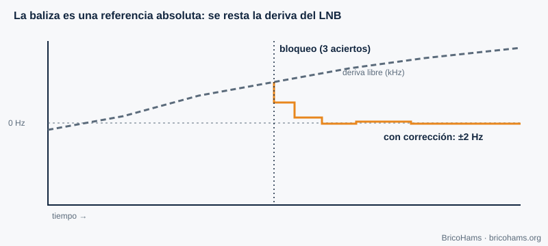
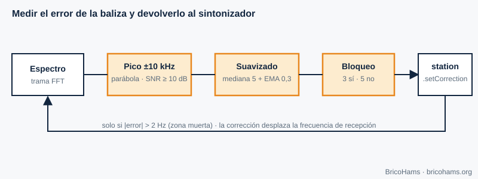

[ES](../es/07-sincronizacion-de-portadora.md) · [EN](../en/07-sincronizacion-de-portadora.md) · [FR](../fr/07-sincronizacion-de-portadora.md) · [PT](../pt/07-sincronizacion-de-portadora.md)

# 7. Carrier Synchronization

## Objectives

- Understand why a frequency offset appears and how large it is on QO-100.
- Explain how a beacon serves as an absolute reference.
- Follow the `src/beacon/` algorithm step by step.

## 7.1 Frequency offset

Transmitter and receiver use different oscillators. If the receiver tunes to *f₀* but the carrier arrives at *f₀ + Δf*, the baseband signal rotates at Δf hertz. With BPSK or QPSK, that rotation destroys the decision: *Δf* (and the phase) must be estimated and corrected before demodulating.

On QO-100 there are three sources of offset:

| Source | Order of magnitude |
|---|---|
| LNB oscillator (9750 MHz) | 1 ppm ≈ 9.75 kHz; cheap LNBs drift tens or hundreds of kHz with temperature |
| SDR oscillator (739.75 MHz) | 1 ppm ≈ 740 Hz (less with a TCXO) |
| Transmitting station's oscillator | Same, at 2.4 GHz |
| GEO satellite Doppler | Very small (chapter 9) |

*Figure 13: LNB drift and beacon-based correction.*

## 7.2 Recovery techniques

- **Phase-locked loop (PLL) or Costas loop**: a controlled oscillator that chases the carrier phase with feedback. It works for PSK at low noise.
- **Open-loop estimation**: raising the signal to the power *M* removes the PSK modulation and leaves a tone at *M·Δf* that is measured with an FFT.
- **Pilot or beacon**: a known signal at a known frequency lets you measure the error directly.

FT8 and FT4 use non-coherent FSK and tolerate offsets of tens of hertz because the decoder searches for the tone; but in a two-way station what weighs most is that the **LNB drifts** (it changes where you see the others) and that your **transmission** lands where it should. The beacon solves both.

## 7.3 The beacon as carrier recovery

QO-100 NB radiates a very stable continuous carrier that the satellite generates from its own reference. If the LNB and the SDR are off, that beacon is **not where it should be**: the measured offset is exactly the accumulated error of the entire receive chain.

*Figure 20: Beacon correction loop.*

The algorithm in [`src/beacon/index.js`](../../../src/beacon/index.js) consists of three pieces:

1. **`estimateBeaconOffset`** (pure function). It receives a spectrum in dB, the center frequency, the bin width and the expected beacon frequency. It defines a ±10 kHz window around the expected position, looks for the maximum, computes the SNR as *peak − median of the window* and requires ≥ 10 dB. It discards maxima at the edge of the window. With the three bins around the peak (a, b, c) it does **parabolic interpolation**: δ = 0.5·(a−c)/(a−2b+c), limited to ±0.5 bins. The peak frequency is *center + (bin + δ − N/2)·binHz*; the offset is the difference from the expected one.
2. **`createBeaconFilter`**. It turns noisy measurements into a stable estimate: the median of the last 5 detections (discards outliers), an exponential moving average with α = 0.3 (smooths), and hysteresis: **lock** after 3 consecutive detections and **loss of lock** after 5 consecutive failures. That way an isolated failure does not make the state oscillate.
3. **`createBeaconController`**. On every spectrum frame it calls the two previous functions; if there is lock and the change exceeds the **dead zone** of 2 Hz, it calls `station.setCorrection(offsetHz, 'beacon')`. If lock is lost, it keeps the last correction (*holdover*) and flags `no-lock`.

**Example.** A 1024-bin spectrum with *binHz* = 100 Hz centered at 739.75 MHz (the expected beacon falls in bin 512). Peak in bin 520, equal neighbors → δ = 0 → offset = 8 bins × 100 Hz = **+800 Hz**. The controller shifts the receive center by +800 Hz and, when the transmitter is idle, the transmit center by −800 Hz (the correction is applied consistently on both sides).

The reasons for the chosen method are in [`docs/adr/0008-beacon-correction-method.md`](../../adr/0008-beacon-correction-method.md).

## How BricoHams does it

- Algorithm and API: [`src/beacon/index.js`](../../../src/beacon/index.js) and its [`README`](../../../src/beacon/README.md).
- Applying the correction to the station: `setCorrection` in [`src/modes/station.js`](../../../src/modes/station.js).
- Source of the spectrum frames: [`src/webrtc/spectrum.js`](../../../src/webrtc/spectrum.js).
- Tests: [`test/unit/beacon.test.js`](../../../test/unit/beacon.test.js).
- Caution: the repository's default beacon frequency is 10 489.750 MHz and is configurable; confirm it with the official AMSAT-DL sources before relying on it.

## Exercises

1. With *binHz* = 100 and a peak in bin 507 (expected 512), what is the offset?
2. Neighbors a, b, c = −62, −55, −60 dB. What is δ?
3. How many good measurements are needed to lock? And bad ones to release?
4. Why the median before the average?

### Solutions

1. (507 − 512) × 100 = **−500 Hz**.
2. δ = 0.5·(−62 − (−60)) / (−62 − 2·(−55) − 60) = 0.5·(−2)/(−12) ≈ **+0.083 bin** (≈ 8 Hz).
3. 3 and 5 respectively.
4. The median discards *outliers* (a spurious peak) that would bias the average.

**Further reading:** Collins et al., Software-Defined Radio for Engineers, ch. 7
