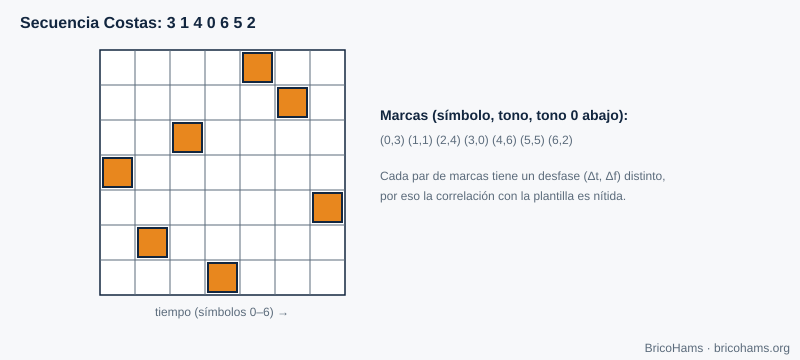
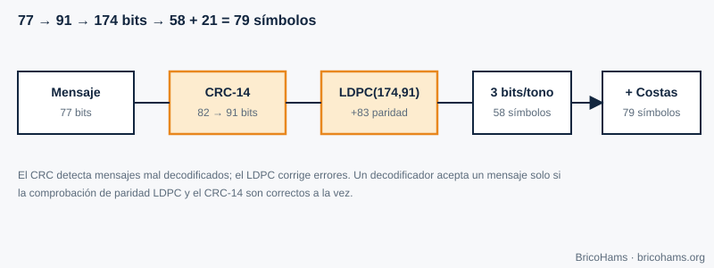
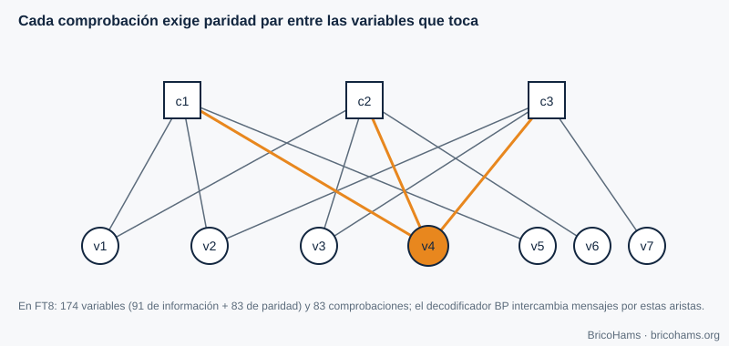

[ES](../es/08-tramas-y-codificacion.md) · [EN](../en/08-tramas-y-codificacion.md) · [FR](../fr/08-tramas-y-codificacion.md) · [PT](../pt/08-tramas-y-codificacion.md)

# 8. Frames and Coding

## Objectives

- Explain what synchronization words and Costas arrays are for.
- Compute a CRC and understand what it detects.
- Describe how an LDPC code corrects errors and what the Tanner graph is.
- Follow the path of an FT8 message from 77 bits to 79 symbols.

## 8.1 Frame synchronization

Even though the UTC clock gives an idea of when the slot starts, the receiver must locate the start and frequency of the message precisely. A known pattern (a **synchronization word**) is included and correlated with the received signal. A good pattern has an autocorrelation with a single strong peak.

FT8 uses three blocks of 7 symbols, at positions 0–6, 36–42 and 72–78, following a **Costas array**: the tone sequence 3, 1, 4, 0, 6, 5, 2.

*Figure 14: Costas array.*

In a Costas array, for every pair of marks the relative displacement (time, frequency) is unique. That is why, if the template is shifted by one symbol or one tone, almost all the marks miss: the correlation peak is sharp on both axes (time and frequency) at once. 21 of the 79 symbols are synchronization.

## 8.2 Error detection: CRC

A **CRC (cyclic redundancy check)** divides the message, seen as a binary polynomial, by a generator polynomial and appends the remainder. The receiver repeats the computation: if it does not match, the message is damaged. FT8 uses a **14-bit CRC** with polynomial `0x2757` over 82 bits (the 77 of the message plus 5 zeros), and appends the 14 bits at the end: 77 + 14 = 91 bits.

A 14-bit CRC lets a random corrupt message through with probability 2⁻¹⁴ ≈ 6·10⁻⁵ (1 in 16 384). That is small, but with hundreds of candidates per slot it is not zero; so it is worth also checking that the decoded text makes sense.

*Figure 16: Encoding flow (message → CRC → LDPC → symbols).*

## 8.3 Error correction: LDPC (174, 91)

An (*n*, *k*) block code turns *k* information bits into *n* transmitted bits. With *n* = 174 and *k* = 91, the **rate** is 91/174 ≈ 0.52: almost twice as many bits are sent, but with that redundancy the receiver can reconstruct the message even with many wrong bits.

An **LDPC code** is defined by a sparse parity-check matrix *H* (few ones). Each row is a **parity equation**: the bits it touches must sum to zero (modulo 2). FT8 has 83 equations (174 − 91) and each bit takes part in exactly 3 of them.

The **Tanner graph** draws that matrix: variable nodes (bits), check nodes (equations) and one edge for each 1 in *H*.

*Figure 15: Tanner graph.*

**Belief-propagation (BP) decoding.** The demodulator does not deliver hard zeros and ones, but **probabilities** (log-likelihood ratios, LLR) for each bit. Messages are exchanged along the edges: each variable tells its checks what it believes; each check tells the variables what value they should have for the parity to work out. After several iterations, the beliefs converge; if all checks are satisfied and the CRC matches, the message is valid.

**Example.** FT8 advertises decodes down to ≈ −21 dB SNR in 2.5 kHz (a rough value; it depends on the implementation). An uncoded scheme would need considerably more SNR for an acceptable BER (chapter 3): the redundancy buys several dB of threshold.

## 8.4 From bit to tone

The 174 bits are grouped three by three: 58 data symbols, each with 8 possible tones. With the 21 Costas symbols, that makes 79 symbols of 0.16 s. FT4 follows the same principle with 87 data symbols, 4×4 Costas symbols and an XOR scrambling mask (to avoid repeated patterns).

## How BricoHams does it

- Tables and dimensions: [`src/modes/ft8-tables.js`](../../../src/modes/ft8-tables.js) (`LDPC_N = 174`, `LDPC_K = 91`, `LDPC_M = 83`).
- CRC and LDPC (`computeCrc`, `addCrc`, `encode174`, `ldpcCheck`, `bpDecode`): [`src/modes/ft8-ldpc.js`](../../../src/modes/ft8-ldpc.js).
- Packing the message text into 77 bits: [`src/modes/ft8-message.js`](../../../src/modes/ft8-message.js).
- Tests: [`test/unit/ft8.test.js`](../../../test/unit/ft8.test.js).

## Exercises

1. What fraction of FT8 symbols are synchronization?
2. How many parity bits does LDPC(174, 91) add?
3. If the bit error probability is 0.1, what is the probability that 3 consecutive bits are correct?
4. Why can't a CRC correct errors while an LDPC can?

### Solutions

1. 21 / 79 ≈ **26.6 %**.
2. 174 − 91 = **83**.
3. 0.9³ = **0.729**.
4. A CRC only offers a summary to check against; it lacks enough structured redundancy to locate the errors. LDPC spreads the redundancy over overlapping equations that make it possible to estimate which bits are wrong.

**Further reading:** Collins et al., Software-Defined Radio for Engineers, ch. 8
