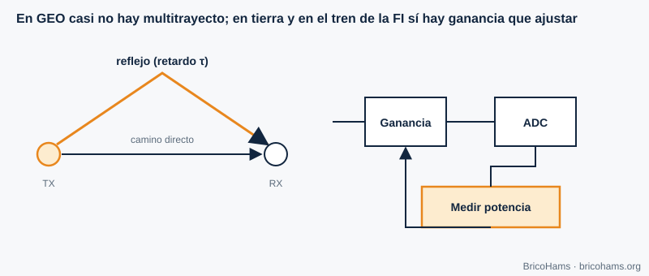

[ES](../es/09-canal-y-ecualizacion.md) · [EN](../en/09-canal-y-ecualizacion.md) · [FR](../fr/09-canal-y-ecualizacion.md) · [PT](../pt/09-canal-y-ecualizacion.md)

# 9. Channel and Equalization

## Objectives

- Describe the QO-100 channel and compare it with a terrestrial one.
- Estimate the Doppler of a geostationary satellite.
- Understand multipath, equalization and automatic gain control (AGC).

## 9.1 An almost ideal channel

The QO-100 link is line-of-sight, with a transponder in geostationary orbit about 36 000 km away. The channel closely resembles an **AWGN channel** (additive white Gaussian noise): fixed attenuation, constant delay and noise. Its real impairments are small:

- **Atmospheric attenuation and rain** at 10.489 GHz: from tenths of a dB up to a few dB in heavy rain.
- **Pointing loss** (chapter 11).
- **Polarization**: a poorly oriented LNB and feed lose signal.
- **Interference** from terrestrial links, and transponder saturation by strong signals.

## 9.2 Doppler in geostationary orbit

The Doppler shift is *Δf = f·v/c*. A GEO satellite is not perfectly still: its small daily inclination oscillations produce radial velocities of at most the order of meters per second. With *v* = 1 m/s (illustrative):

- at 10.489 GHz: Δf ≈ 10.489·10⁹ / 3·10⁸ ≈ **35 Hz**;
- at 2.4 GHz: ≈ **8 Hz**.

Compared with the ±kHz drift of the LNB, it is negligible, and that is why BricoHams only measures the beacon correction and does not compute Doppler ephemerides. On LEO satellites (hundreds of km), by contrast, Doppler reaches tens of kHz.

## 9.3 Multipath and equalization

On the ground, the signal arrives along paths with different delays; the copies add with different phases and produce **frequency-selective fading**. An **equalizer** estimates the channel response (with a training pattern or blindly) and applies an inverse filter. On QO-100 the space path has no significant multipath; the only possible echo is a reflection near the dish.

*Figure 27: Multipath and AGC.*

## 9.4 Automatic gain control

**AGC** adjusts the receiver gain so the signal makes good use of the ADC range: not so low that it is lost in the quantization noise, not so high that it saturates. On QO-100, AGC can be a trap: the strong beacon makes the gain drop and reduces the weak signal. SDR receivers therefore use manual gain or AGC with slow time constants.

**Example.** If the beacon arrives at −50 dBFS and the noise at −90 dBFS, there is 40 dB of margin above the noise and 50 dB up to saturation; an FT8 signal at −85 dBFS survives. If you raise the gain by 20 dB, the beacon goes to −30 dBFS: it still fits, but a strong neighbor (an SSB signal 10 dB stronger) would already come close to saturation.

## How BricoHams does it

- The station does not use Doppler: it only corrects using the beacon ([`src/beacon/`](../../../src/beacon/README.md)).
- Receive level and audio are normalized in [`src/webrtc/rx-audio.js`](../../../src/webrtc/rx-audio.js).
- The receive profile (filter and DSP): [`src/modes/rx-profile.js`](../../../src/modes/rx-profile.js).
- Channel details in the guide [`docs/help/qo100-fundamentos.md`](../../help/qo100-fundamentos.md).

## Exercises

1. Δf at 10.489 GHz with *v* = 3 m/s.
2. What round-trip delay in voice (with a single hop)?
3. Why isn't fast AGC used on the QO-100 IF?
4. Two copies with delays 0 and 1 µs. At what frequency does the first null fall?

### Solutions

1. 3 × 35 = **≈ 105 Hz**.
2. Each hop ≈ 0.25 s; round trip ≈ **0.5 s**.
3. The much stronger beacon would make the AGC lower the gain of the whole spectrum and weak signals would be lost.
4. A null occurs when the delay is half a cycle: 1/(2 × 1 µs) = **500 kHz**.

**Further reading:** Collins et al., Software-Defined Radio for Engineers, ch. 9
