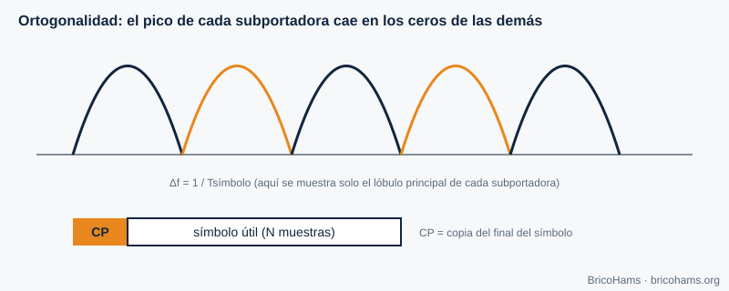
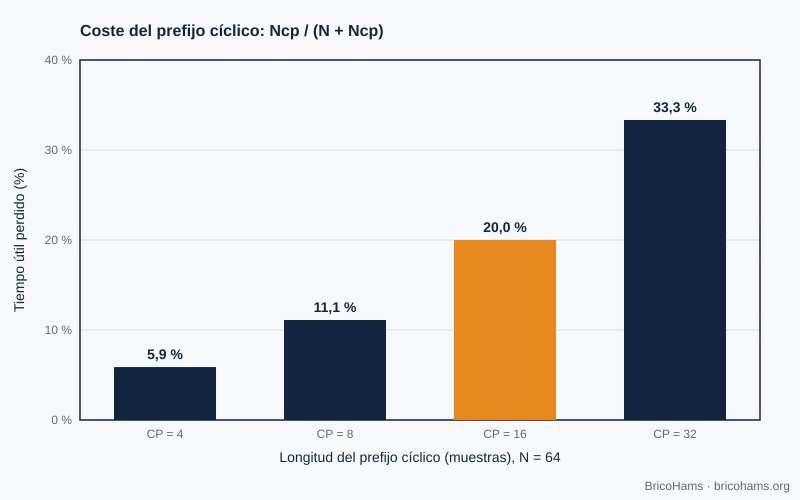

[ES](../es/10-ofdm.md) · [EN](../en/10-ofdm.md) · [FR](../fr/10-ofdm.md) · [PT](../pt/10-ofdm.md)

# 10. OFDM

## Objectives

- Understand the idea of orthogonal subcarriers and the cyclic prefix.
- Compute the cost of the prefix.
- Know why the QO-100 narrowband transponder does not use OFDM and where it does appear (wideband, DATV).

## 10.1 The idea

A wideband signal suffers frequency-selective fading. OFDM spreads the data over many narrow, slow **subcarriers**, so that each one sees an almost flat channel. The subcarriers are spaced exactly *Δf = 1/T* apart (with *T* the useful symbol duration), so the peak of each falls at the zeros of the others (**orthogonality**) and they do not interfere even though their spectra overlap.

*Figure 28: OFDM subcarriers.*

The transmitter generates all the subcarriers at once with an *N*-point **inverse FFT**; the receiver separates them with an FFT. That explains why OFDM is practical in software.

## 10.2 Cyclic prefix

Before each symbol, the end of the symbol itself is copied (the **cyclic prefix, CP**). If the multipath delay is shorter than the CP, intersymbol interference disappears and the channel reduces to one complex factor per subcarrier, easy to equalize. The cost is efficiency: the overhead is *CP / (N + CP)*.

*Figure 25: Cyclic prefix overhead in OFDM.*

With *N* = 64:

| CP | Overhead |
|---|---|
| 4 | 5.9 % |
| 8 | 11.1 % |
| 16 | **20 %** |
| 32 | 33.3 % |

## 10.3 And QO-100?

- **Narrowband (NB, 500 kHz)**: its signals (SSB, CW, FT8) are narrow (≤ 3 kHz) and the space channel is flat; there is no frequency selectivity for OFDM to compensate. FT8 is, moreover, far more efficient with its 50 Hz-wide FSK and a strong code.
- **Wideband (WB, ≈ 8 MHz)**: carries amateur digital television (DATV) with the DVB-S2 satellite television standard, which uses **single-carrier modulation** (QPSK/8PSK) and a longer LDPC. OFDM appears mainly in terrestrial broadcasting (DVB-T) or in Wi-Fi. Check the current information from AMSAT-DL and BATC for the parameters in force.

The general lesson is one of engineering: you choose the modulation that fits the channel. In a nearly AWGN, power-limited channel, a single carrier with good coding is simpler and more efficient.

## How BricoHams does it

BricoHams does not implement OFDM. The wideband part is outside the scope of the repository; the station focuses on the narrowband transponder. What relates to the spectrum:

- IF spectrum display: [`src/webrtc/spectrum.js`](../../../src/webrtc/spectrum.js) and [`src/web/public/scope-math.js`](../../../src/web/public/scope-math.js).
- NB band plan: [`src/modes/bandplan.js`](../../../src/modes/bandplan.js).
- The FFT used by the FT8/FT4 decoders: [`src/modes/ft8-fft.js`](../../../src/modes/ft8-fft.js).

## Exercises

1. With *N* = 64 and CP = 16, how many samples does each transmitted symbol have?
2. If the symbol lasts 3.2 µs useful, what is Δf?
3. What is the overhead with *N* = 128 and CP = 16?
4. Why doesn't FT8 need an equalizer?

### Solutions

1. 64 + 16 = **80**.
2. 1 / 3.2 µs = **312.5 kHz**.
3. 16 / 144 = **11.1 %**.
4. Each tone lasts 0.16 s and the channel is flat over 50 Hz; non-coherent energy detection does not need to estimate the response.

**Further reading:** Collins et al., Software-Defined Radio for Engineers, ch. 10
