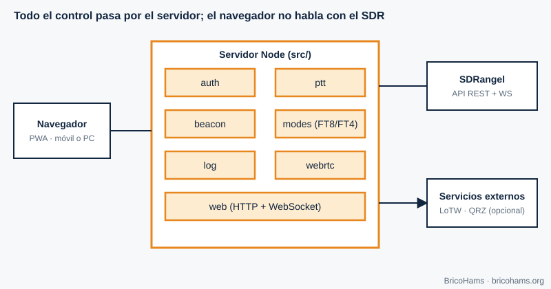
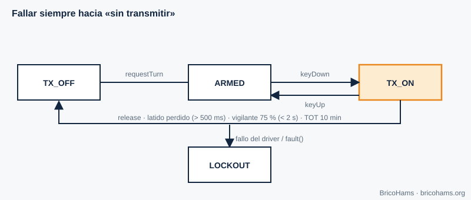
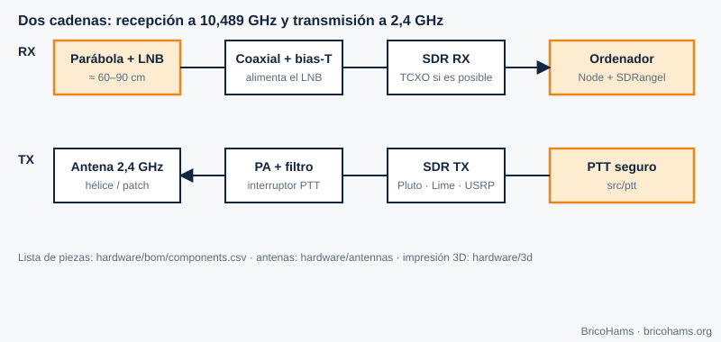

[ES](../es/11-aplicaciones-qo100.md) · [EN](../en/11-aplicaciones-qo100.md) · [FR](../fr/11-aplicaciones-qo100.md) · [PT](../pt/11-aplicaciones-qo100.md)

# 11. QO-100 Applications: The BricoHams Station

## Objectives

- See how all the concepts fit together in a complete station.
- Get to know each BricoHams module, its responsibility and its safety.
- Find your bearings for building your own station with the `hardware/` folder.

## 11.1 Architecture

*Figure 18: BricoHams architecture.*

The browser (a PWA) never talks to the SDR: the Node server (`src/`) does, orchestrating SDRangel through its REST API and WebSocket. Authentication uses Google (OpenID Connect) and a list of authorized users; all traffic is encrypted.

| Module | Responsibility | Code |
|---|---|---|
| `auth` | Sign-in (OIDC), sessions, roles | [`src/auth/`](../../../src/auth/) |
| `ptt` | Exclusive turn, heartbeat, maximum TX time, audit | [`src/ptt/`](../../../src/ptt/README.md) |
| `beacon` | Beacon correction (chapter 7) | [`src/beacon/`](../../../src/beacon/README.md) |
| `modes` | Tuning, FT8/FT4/CW, RIT/XIT, memories | [`src/modes/`](../../../src/modes/README.md) |
| `sdrangel` | Client and PTT driver towards SDRangel | [`src/sdrangel/`](../../../src/sdrangel/index.js) |
| `webrtc` | RX/TX audio and spectrum frames | [`src/webrtc/`](../../../src/webrtc/index.js) |
| `log` | Station log, ADIF, LoTW and QRZ | [`src/log/`](../../../src/log/index.js) |
| `web` | PWA interface | [`src/web/public/`](../../../src/web/public/index.html) |

## 11.2 Safe PTT

Transmitting incorrectly can damage equipment, interfere with the rest of the transponder or breach your license. The state machine in [`src/ptt/`](../../../src/ptt/index.js) is designed to **fail towards "do not transmit"**.

*Figure 19: PTT state machine.*

- Only one holder of the turn at a time.
- The browser sends a **heartbeat every 500 ms**; if it stops arriving, a watchdog cuts transmission before the time limit expires (at 75 %, always under 2 s).
- **TOT** (time-out timer, the maximum transmission time): 10 minutes by default.
- If the driver does not confirm "off", the state moves to **LOCKOUT**; only an owner with a single-use code can leave it.
- Every transmission is logged; if it cannot be logged, it does not transmit.

Rationale: [`docs/adr/0005-ptt-fail-safe-state-machine.md`](../../adr/0005-ptt-fail-safe-state-machine.md).

## 11.3 Beacon correction

The `beacon` module measures the spectrum every few seconds and, if it detects the beacon with enough SNR, corrects the receive and transmit frequencies. In this way the cheap LNB becomes, in practice, a stable reference.

## 11.4 Contact logging: ADIF, LoTW and QRZ

Each contact is stored in SQLite (Node's `node:sqlite` module). It is exported in **ADIF 3.1** with the satellite fields required by LoTW (`PROP_MODE=SAT`, `SAT_NAME=QO-100`, 13 cm uplink and 3 cm downlink bands). The LoTW upload uses the TQSL tool (the user manages the certificate) and the QRZ Logbook upload uses its API with a key stored encrypted. Details: [`docs/help/log-lotw-qrz.md`](../../help/log-lotw-qrz.md).

## 11.5 Public listening with OpenWebRX

The [`plugins/openwebrx/`](../../../plugins/openwebrx/README.md) plugin adds markers and offset help to OpenWebRX+, is **receive-only** and has no path towards transmission.

## 11.6 Calculators

To size your station: dish, LNB, helix, pointing and LNB drift are computed in [`services/qo100-calculators/`](../../../services/qo100-calculators/README.md).

## 11.7 Build your station

*Figure 21: Station build map.*

1. **Receive**: dish (≥ 80 cm recommended), LNB (ideally with a TCXO), coax, bias injector, an SDR from the list. Guide: [`docs/help/construir-tu-estacion.md`](../../help/construir-tu-estacion.md), [`hardware/antennas/dish.md`](../../../hardware/antennas/dish.md) and [`hardware/antennas/lnb-y-referencias.md`](../../../hardware/antennas/lnb-y-referencias.md).
2. **Transmit**: TX SDR, attenuator, linear PA with filter, helix antenna ([`helix-2g4.md`](../../../hardware/antennas/helix-2g4.md)) or patch ([`poty-patch.md`](../../../hardware/antennas/poty-patch.md)); 3D-printed parts in [`hardware/3d/`](../../../hardware/3d/README.md).
3. **Measurements before radiating**: a power meter and a dummy load are essential. Start at minimum power and verify your signal on the receiver.
4. **Software installation**: [`docs/help/instalacion-linux.md`](../../help/instalacion-linux.md), [`instalacion-windows.md`](../../help/instalacion-windows.md) or [`instalacion-raspberry-pi.md`](../../help/instalacion-raspberry-pi.md).
5. **First start-up**: [`docs/help/primera-puesta-en-marcha.md`](../../help/primera-puesta-en-marcha.md).

SDRangel, OpenWebRX+, TQSL, QRZ and the hardware makers are independent projects and companies; BricoHams only interoperates with them and none of them endorses it.

## Exercises

1. Why does the server, and not the browser, control the SDR?
2. With `heartbeatTimeoutMs` = 2000 ms, when does the watchdog cut transmission?
3. If the beacon drifts +1500 Hz and the dead zone is 2 Hz, is it corrected? What is applied to the TX?
4. Which fields make an ADIF valid for satellites in LoTW?

### Solutions

1. So that credentials, PTT control and safety logic do not depend on a client that may fail or be tampered with.
2. At 75 %: **1.5 s**.
3. Yes (1500 > 2). RX = IF + 1500 Hz; TX = nominal uplink − 1500 Hz (when idle).
4. `PROP_MODE=SAT`, `SAT_NAME=QO-100`, `BAND`, `BAND_RX`, `FREQ` and `FREQ_RX`.

**Further reading:** Collins et al., Software-Defined Radio for Engineers, ch. 11
