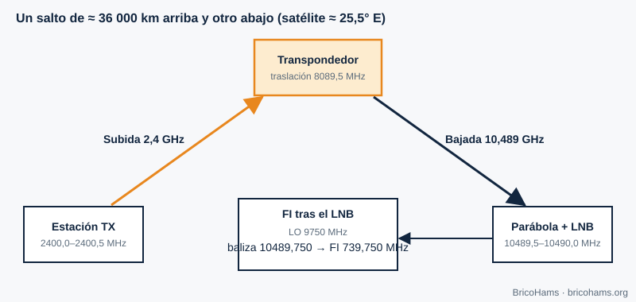

[ES](../es/01-que-es-sdr.md) · [EN](../en/01-que-es-sdr.md) · [FR](../fr/01-que-es-sdr.md) · [PT](../pt/01-que-es-sdr.md)

# 1. ¿Qué es una radio definida por software?

## Objetivos

- Distinguir qué parte de una radio es hardware y qué parte es software.
- Seguir la señal de QO-100 desde el plato hasta el texto de un mensaje.
- Entender por qué una SDR ve toda la banda a la vez.

## 1.1 La idea

En una radio clásica, cada función (filtrar, demodular, detectar) es un circuito analógico fijo. En una **radio definida por software (SDR)** el hardware se reduce a lo imprescindible: una antena, un amplificador, un conversor de frecuencia y un **conversor analógico-digital (ADC)**. A partir de ahí todo son números. Cambiar de SSB a FT8 o a CW no requiere soldar nada: se ejecuta otro programa sobre las mismas muestras.

La frontera entre el mundo analógico y el digital se desplaza cada vez más hacia la antena. El límite lo marcan los ADC (cuántos bits y cuántas muestras por segundo) y el procesador disponible.

## 1.2 La cadena de QO-100

La señal que nos interesa baja del satélite en torno a 10,489 GHz. Un ADC barato no puede muestrear 10 GHz, así que se hace en etapas:

1. El **LNB** (bloque de bajo ruido) amplifica y mezcla con un oscilador local de 9750 MHz. La baliza de 10 489,750 MHz queda en una **frecuencia intermedia (FI)** de 10 489,750 − 9750 = **739,750 MHz**.
2. Un cable coaxial lleva la FI al SDR y, por el mismo cable, un inyector (bias-T) alimenta el LNB.
3. El SDR traslada a banda base y muestrea, entregando muestras complejas **I/Q** a, por ejemplo, 2,4 millones de muestras por segundo.
4. El software (SDRangel y, en esta estación, módulos Node) filtra, diezma, demodula y decodifica.

En sentido contrario, la subida va a 2400,0–2400,5 MHz; el satélite desplaza la señal 8089,5 MHz y la retransmite entre 10 489,5 y 10 490,0 MHz. Esa relación fija permite calcular la frecuencia de subida a partir de la de bajada: `uplink = downlink − 8089,5 MHz`.

## 1.3 Qué gana y qué pierde una SDR

| Ventaja | Coste |
|---|---|
| Un solo equipo para muchos modos | Necesita un ordenador y software configurado |
| Ves toda la banda estrecha de QO-100 (500 kHz) a la vez | El ADC limita la dinámica (capítulo 5) |
| Actualizable: nuevos modos sin hardware | La latencia del procesado puede ser notable |
| Reproducible: grabas I/Q y lo vuelves a analizar | La sincronización de tiempo es tu responsabilidad |

## 1.4 Un ejemplo numérico

Si el SDR muestrea a 600 kS/s complejas, ve 600 kHz de espectro: más que los 500 kHz del transpondedor de banda estrecha. Cada muestra I/Q son dos números; a 16 bits por componente, el flujo es 600 000 × 2 × 2 bytes = 2,4 MB/s, unos 8,6 GB por hora. Por eso la estación diezma pronto (capítulo 2): FT8 trabaja con 12 000 muestras reales por segundo, 200 veces menos que a 2,4 MS/s.

## Cómo lo hace BricoHams

BricoHams **no reinventa el motor de radio**: delega el procesado de señal pesado en SDRangel (decisión en [`docs/adr/0001-sdrangel-as-engine.md`](../../adr/0001-sdrangel-as-engine.md)) y añade encima lo que falta para operar QO-100 de forma remota y segura: control de PTT, corrección por baliza, decodificadores FT8/FT4/CW, registro de contactos y una interfaz web.

- Cliente de SDRangel: [`src/sdrangel/client.js`](../../../src/sdrangel/client.js)
- Frecuencias y conversiones QO-100: [`src/modes/frequencies.js`](../../../src/modes/frequencies.js)
- Visión general: [`docs/ARCHITECTURE.md`](../../ARCHITECTURE.md)

## Ejercicios

1. Calcula la FI en el SDR si el LNB tuviera un oscilador de 9750 MHz y quisieras recibir 10 489,900 MHz.
2. ¿Qué frecuencia de subida corresponde a una bajada de 10 489,900 MHz?
3. Un SDR muestrea a 2,4 MS/s con 8 bits por componente. ¿Cuántos MB/s genera?

### Soluciones

1. 10 489,900 − 9750 = **739,900 MHz**.
2. 10 489,900 − 8089,5 = **2400,400 MHz**.
3. 2 400 000 × 2 componentes × 1 byte = 4,8 MB/s.

**Lectura recomendada:** Collins et al., *Software-Defined Radio for Engineers*, cap. 1 (Introduction to Software-Defined Radio).
