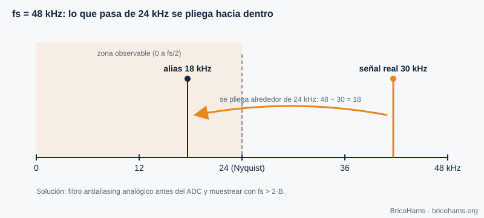
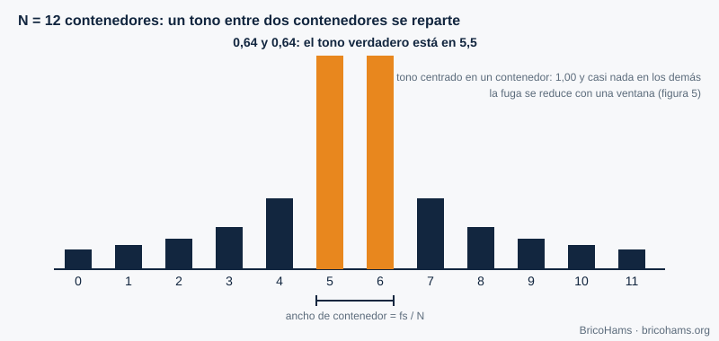
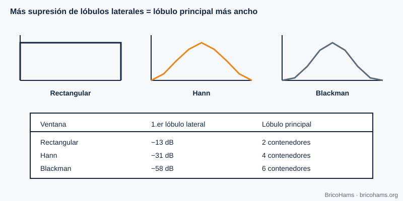
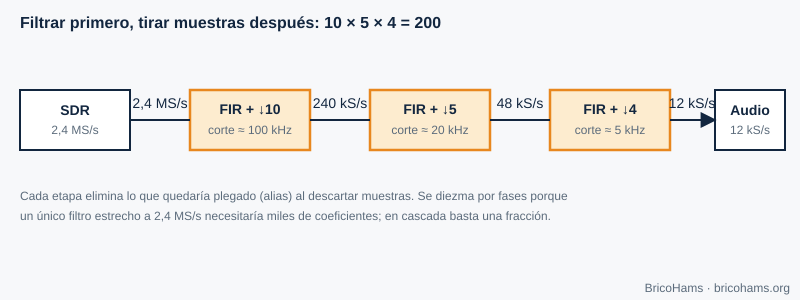

[ES](../es/02-senales-y-sistemas.md) · [EN](../en/02-senales-y-sistemas.md) · [FR](../fr/02-senales-y-sistemas.md) · [PT](../pt/02-senales-y-sistemas.md)

# 2. Señales y sistemas

## Objetivos

- Aplicar el teorema de Nyquist y reconocer el aliasing.
- Manejar señales I/Q y la banda base compleja.
- Interpretar una FFT: resolución, fugas y ventanas.
- Diseñar una cadena de diezmado.

## 2.1 Muestrear: convertir tiempo continuo en números

Un ADC mide la tensión de la señal a intervalos regulares, cada *T = 1/fs* segundos. Si la señal contiene componentes hasta una frecuencia máxima *B*, basta con **fs > 2B** para poder reconstruirla (criterio de **Nyquist**). Por debajo, las componentes altas se «pliegan» sobre las bajas y se confunden con ellas: es el **aliasing**.

**Ejemplo.** Una senoidal de 7 kHz muestreada a 12 kHz (frecuencia de trabajo de los decodificadores FT8) supera el límite de Nyquist de 6 kHz. Se ve como una de |7 − 12| = **5 kHz**. Por eso antes de bajar la tasa siempre se filtra.

## 2.2 Señales complejas: I y Q

Una señal real de 2 kHz y otra de −2 kHz son indistinguibles en un espectro real. Una **señal compleja** *x[n] = I[n] + j·Q[n]* sí distingue frecuencias positivas y negativas, y ocupa el espectro de −fs/2 a +fs/2. Un receptor de **conversión directa** (capítulo 5) produce justo eso: I y Q son la proyección sobre dos osciladores en cuadratura.

La **banda base compleja** coloca el centro del SDR en 0 Hz. Una señal a +3 kHz del centro es *e^(j2π·3000·t)*; a −3 kHz, *e^(−j2π·3000·t)*. Cambiar el signo de la frecuencia equivale a conjugar la señal. Así se distinguen USB y LSB sin ambigüedad.

## 2.3 La FFT: ver el espectro

La **transformada rápida de Fourier (FFT)** de *N* muestras produce *N* contenedores (bins) separados *fs/N*. Es la lupa con la que se ve el espectro de QO-100.

**Ejemplo.** El flujo espectral de la estación usa *fs* = 102 400 Hz y *N* = 1024: cada bin mide 100 Hz. Un tono perfectamente centrado cae en un solo bin; uno a medio camino entre dos bins se reparte entre vecinos, y de ahí sale la interpolación parabólica de la baliza (capítulo 7).

La ganancia de procesado de la FFT también ayuda: un tono concentra su energía en un bin, mientras el ruido blanco se reparte por los *N*. La relación señal a ruido *por bin* mejora unos 10·log₁₀(N) dB; con N = 1024, 30 dB.

## 2.4 Ventanas

La FFT supone que el bloque se repite periódicamente. Si el tono no completa un número entero de ciclos, aparecen **fugas** (leakage): energía en bins lejanos. Multiplicar el bloque por una **ventana** suaviza los bordes y reduce las fugas, a costa de ensanchar el lóbulo principal.

| Ventana | 1.er lóbulo lateral | Anchura del lóbulo principal |
|---|---|---|
| Rectangular | −13 dB | 2 bins |
| Hann | −31 dB | 4 bins |
| Blackman | −58 dB | 6 bins |

Regla práctica: si buscas una señal débil cerca de una fuerte (por ejemplo, una señal CW junto a la baliza), usa una ventana con lóbulos laterales bajos.

## 2.5 Diezmado

Bajar la tasa de muestreo («diezmar») por un factor *M* es tirar *M−1* de cada *M* muestras, **después** de filtrar paso bajo para que no haya aliasing. Se hace por etapas porque un único filtro muy estrecho a tasa alta es carísimo.

**Ejemplo.** De 2,4 MS/s a 12 kS/s hay un factor 200 = 10 × 5 × 4: 2 400 000 → 240 000 → 48 000 → 12 000 muestras por segundo.

## Cómo lo hace BricoHams

- La FFT de los decodificadores vive en [`src/modes/ft8-fft.js`](../../../src/modes/ft8-fft.js) y construye la cascada (waterfall) en [`src/modes/ft8-decode.js`](../../../src/modes/ft8-decode.js).
- La tasa de trabajo de FT8 y FT4 es `SAMPLE_RATE = 12000` ([`ft8-constants.js`](../../../src/modes/ft8-constants.js)).
- El remuestreo del audio del receptor está en [`src/webrtc/resample.js`](../../../src/webrtc/resample.js).
- Las tramas de espectro (bins en dB) se interpretan en [`src/webrtc/spectrum.js`](../../../src/webrtc/spectrum.js).

## Ejercicios

1. Una señal de 8 kHz se muestrea a 12 kHz. ¿A qué frecuencia aparece?
2. ¿Qué resolución tiene una FFT de 4096 puntos a 12 kS/s?
3. ¿Cuántos puntos necesitas para resolver 6,25 Hz con fs = 12 kHz?
4. Con bins de 100 Hz, un tono aparece a 740 Hz del primer bin. ¿En qué bin está su pico y qué fracción de bin queda por interpolar?

### Soluciones

1. |8 − 12| = **4 kHz** (alias).
2. 12 000 / 4096 ≈ **2,93 Hz** por bin.
3. N = fs / Δf = 12 000 / 6,25 = **1920** muestras (es justo la duración de un símbolo FT8: 0,16 s).
4. 740 / 100 = 7,4 → el bin 7 (a +0,4 bins); la interpolación parabólica afina el 0,4.

**Lectura recomendada:** Collins et al., *Software-Defined Radio for Engineers*, cap. 2 (Signals and Systems).
