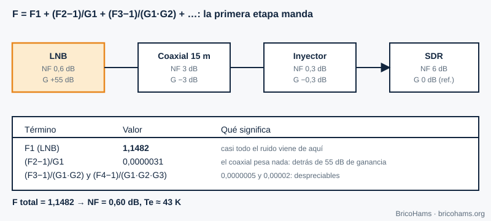
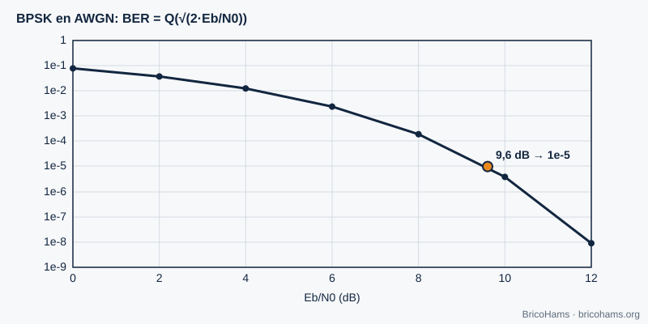
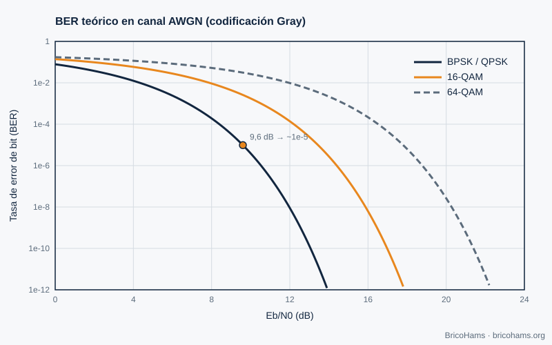
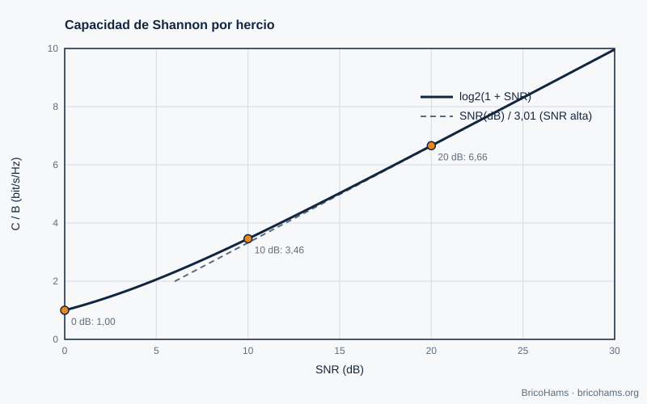

# 3. Ruido y probabilidad

## Objetivos

- Calcular la potencia de ruido térmico en un ancho de banda dado.
- Relacionar SNR, C/N0 y Eb/N0.
- Aplicar la fórmula de Friis a la línea LNB → coaxial → SDR.
- Leer una curva de BER y saber qué limita la capacidad de un canal.

## 3.1 Ruido térmico

Todo conductor a temperatura *T* genera ruido blanco de densidad *N0 = k·T*, con la constante de Boltzmann *k* = 1,38·10⁻²³ J/K. A 290 K, *N0* = −174 dBm/Hz. La potencia en un ancho de banda *B* es *N = N0 + 10·log₁₀(B)*:

| Ancho de banda | Potencia de ruido a 290 K |
|---|---|
| 6,25 Hz (símbolo FT8) | −166 dBm |
| 2,7 kHz (SSB) | −139,7 dBm |
| 500 kHz (transpondedor NB) | −117 dBm |

Cuanto más estrecho el filtro, menos ruido entra. Por eso FT8 llega a decodificar señales que el oído no distingue.

## 3.2 SNR, C/N0 y Eb/N0

- **SNR** = potencia de señal / potencia de ruido, *en un ancho de banda concreto*. Sin el ancho, la cifra no significa nada.
- **C/N0** (dB·Hz) = SNR + 10·log₁₀(B): una medida independiente del ancho.
- **Eb/N0** = energía por bit sobre densidad de ruido = C/N0 − 10·log₁₀(R_b), con *R_b* la velocidad de bit.

**Ejemplo (ilustrativo).** Una señal con C/N0 = 40 dB·Hz y una velocidad de 50 bit/s tiene Eb/N0 = 40 − 17 = **23 dB**.

Para FT8 se suele citar un umbral de unos −21 dB de SNR medido en 2500 Hz. En el ancho de un símbolo (6,25 Hz) eso son −21 + 10·log₁₀(2500/6,25) = −21 + 26 = **+5 dB** de Es/N0, es decir, un orden de magnitud de 0 dB por bit de información tras la codificación. Es la magia de combinar un ancho estrecho con corrección de errores (capítulo 8).

## 3.3 Figura de ruido y fórmula de Friis

La **figura de ruido (NF)** mide cuánto ruido añade un componente por encima del térmico. Una cascada de etapas tiene

*F = F₁ + (F₂−1)/G₁ + (F₃−1)/(G₁G₂) + …*

con *F* y *G* en lineal. La temperatura equivalente de ruido es *Te = 290·(F−1)*.

**Ejemplo.** LNB con NF 0,6 dB y ganancia 55 dB; coaxial con 3 dB de pérdida; inyector con 0,3 dB; SDR con NF 6 dB. El LNB aporta F₁ = 1,1482; el resto suma menos de 0,00003. Total: NF ≈ **0,60 dB**, *Te* ≈ **43 K**. Moraleja: lo único que importa es el LNB, siempre que su ganancia sea alta. Por eso se instala en el plato y no en el SDR.

### Del ruido a la señal: presupuesto de enlace

C/N0 = EIRP − pérdida de espacio libre − pérdidas atmosféricas + G/T − 10·log₁₀(k).

Con una distancia oblicua de 38 000 km a 10,489 GHz, la pérdida de espacio libre es 20·log₁₀(4π·d/λ) ≈ **204,5 dB** (λ = 2,858 cm). Un plato de 90 cm con eficiencia 0,55 tiene ≈ 37,3 dBi. Con *Tsys* = 60 K de antena + 43 K del receptor = 103 K (20,1 dBK), G/T ≈ 17,2 dB/K. −10·log₁₀(k) = +228,6 dBW/K/Hz.

## 3.4 BER y Eb/N0

La **tasa de error de bit (BER)** de BPSK en ruido gaussiano es *Q(√(2·Eb/N0))*. A 9,6 dB es ≈ 10⁻⁵; cada dB extra de Eb/N0 baja la BER en casi un orden de magnitud cuando ya estamos en la zona de «cascada».

La figura 23 compara BPSK/QPSK, 16-QAM y 64-QAM (modulaciones más densas necesitan más Eb/N0 para la misma BER).

## 3.5 Límite de Shannon

Ningún sistema supera la capacidad *C = B·log₂(1 + SNR)*. Con SNR = 0 dB (potencia de señal = potencia de ruido), *C/B* = 1 bit/s/Hz; con 10 dB, 3,46; con 20 dB, 6,66; con 30 dB, 9,97.

La capacidad crece solo logarítmicamente con la potencia: duplicar la potencia (+3 dB) añade apenas ≈ 1 bit/s/Hz a alta SNR. De ahí que, en QO-100, tiene más sentido mejorar G/T (plato mayor, mejor LNB) que añadir potencia sin criterio.

## Cómo lo hace BricoHams

La carpeta [`services/qo100-calculators/`](../../../services/qo100-calculators/README.md) incluye una calculadora de **línea del LNB** que aplica exactamente Friis y el presupuesto de enlace:

- [`assets/qo100-math.js`](../../../services/qo100-calculators/assets/qo100-math.js): `cascade`, `lnbLineup`, `fsplDb`, `dishGain`.
- [`demo.html`](../../../services/qo100-calculators/demo.html): interfaz (sírvela por HTTP para abrirla).
- La figura de ruido también decide cómo configurar la ganancia en SDRangel (capítulo 5).

## Ejercicios

1. Calcula la potencia de ruido de un canal de 2,5 kHz a 290 K.
2. ¿Cuál es *Te* de un LNB con NF = 0,8 dB?
3. Un enlace tiene C/N0 = 50 dB·Hz. ¿Qué SNR hay en 2,7 kHz?
4. ¿Qué Eb/N0 hace falta para BPSK a BER 10⁻⁵?

### Soluciones

1. −174 + 10·log₁₀(2500) = −174 + 34 = **−140 dBm**.
2. F = 10^0,08 = 1,202 → *Te* = 290 × 0,202 ≈ **58,6 K**.
3. 50 − 10·log₁₀(2700) = 50 − 34,3 = **15,7 dB**.
4. Aproximadamente **9,6 dB**.

**Lectura recomendada:** Collins et al., *Software-Defined Radio for Engineers*, cap. 3 (Probability in Communications).
