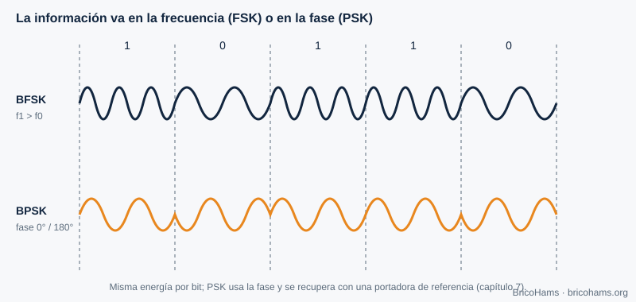
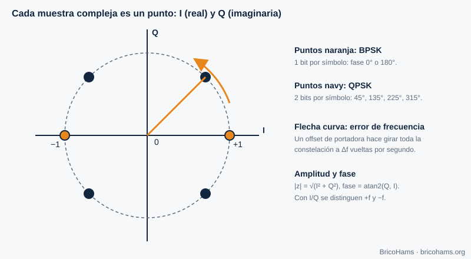
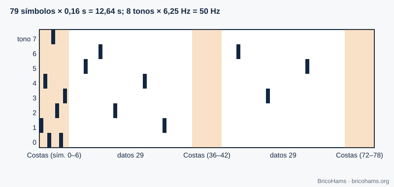
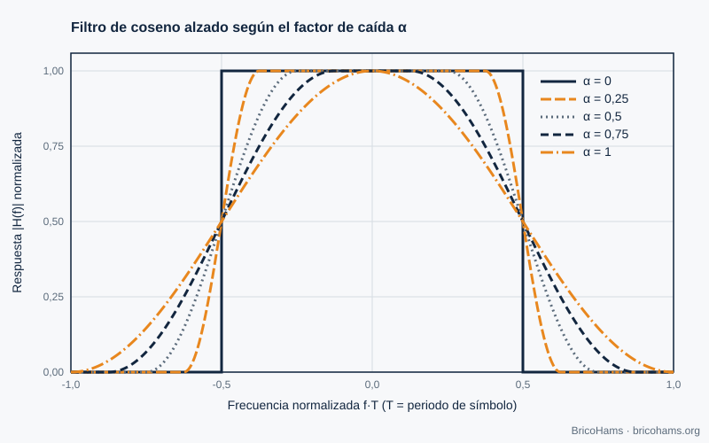

[ES](../es/04-modulacion-digital.md) · [EN](../en/04-modulacion-digital.md) · [FR](../fr/04-modulacion-digital.md) · [PT](../pt/04-modulacion-digital.md)

# 4. Modulación digital

## Objetivos

- Explicar cómo FSK y PSK codifican bits en frecuencia y fase.
- Entender la estructura de FT8 (8-GFSK), FT4 y CW.
- Entender por qué se conforman los pulsos (coseno alzado, filtro gaussiano).

## 4.1 Mensaje → onda

Modular es modificar un parámetro de una portadora según los datos. Con tres parámetros (amplitud, frecuencia, fase) salen las familias ASK/OOK, FSK y PSK.

- **FSK**: cada símbolo es un tono distinto. Es robusta y sencilla de detectar sin conocer la fase de la portadora (detección no coherente).
- **PSK**: cada símbolo es una fase. En BPSK hay dos fases (0° y 180°) y un bit por símbolo; en QPSK, cuatro fases y dos bits. Necesita recuperar la portadora (capítulo 7).
- **QAM** combina amplitud y fase: más bits por símbolo con más Eb/N0 (figura 23 del capítulo 3).

## 4.2 La constelación

Cada símbolo es un punto del plano I/Q. El ruido dibuja una nube alrededor de cada punto; si la nube cruza la frontera entre decisiones, hay error.

## 4.3 FT8 y FT4: FSK de tonos múltiples

**FT8** transmite 8 tonos separados 6,25 Hz. Cada símbolo dura 0,16 s, es decir, 1/0,16 = 6,25 símbolos por segundo, y la separación entre tonos es igual a la velocidad de símbolo: los tonos son ortogonales. Cada símbolo codifica 3 bits. El mensaje completo son 79 símbolos (12,64 s), con un ancho total de 8 × 6,25 = **50 Hz**.

La «G» de *8-GFSK* significa que la transición entre tonos se suaviza con un filtro gaussiano (parámetro BT = 2,0 en este repositorio) para que el espectro no se ensanche con los saltos bruscos.

**FT4** es más rápido: 4 tonos, símbolos de 0,048 s (separación 20,83 Hz), 105 símbolos y franjas de 7,5 s. Cuesta más SNR y ocupa más ancho (≈ 83 Hz).

## 4.4 CW

La telegrafía es la modulación más simple: portadora encendida o apagada (OOK). Un buen *keying* suaviza los flancos para que el espectro no «chasquee». La velocidad se mide en palabras por minuto: a 20 wpm un punto dura 60 ms (con la palabra PARIS como referencia).

## 4.5 La baliza BPSK

La baliza de QO-100 NB es una portadora estrecha, con modulación de baja velocidad. Para BricoHams solo importa su **frecuencia**: se usa como referencia absoluta (capítulo 7).

## 4.6 Conformado de pulsos

Un pulso rectangular de duración *T* tiene un espectro *sinc* con lóbulos que se extienden muy lejos. Para ocupar menos ancho sin generar **interferencia entre símbolos (ISI)** se usa el **coseno alzado**, con factor de caída α (0 a 1). Su respuesta en frecuencia es plana en el centro, cae suavemente entre *(1−α)/2T* y *(1+α)/2T*, y vale cero fuera: el ancho es *(1+α)/T*.

Con α = 0,25 y 1200 símbolos/s, el ancho es 1,25 × 1200 = 1500 Hz. En la práctica el coseno alzado se divide en dos «raíces»: una en el transmisor y otra en el receptor (filtro adaptado), que juntas dan un coseno alzado completo.

## Cómo lo hace BricoHams

- Constantes de protocolo: [`src/modes/ft8-constants.js`](../../../src/modes/ft8-constants.js) (`PROTOCOLS` para FT8 y FT4).
- Síntesis de la onda de un mensaje: `synthSlot` en [`src/modes/ft8-encode.js`](../../../src/modes/ft8-encode.js).
- Decodificación CW: [`src/modes/cw-decoder.js`](../../../src/modes/cw-decoder.js).
- Guía de uso: [`docs/help/operar-digitales.md`](../../help/operar-digitales.md) y [`docs/help/operar-cw.md`](../../help/operar-cw.md).

## Ejercicios

1. ¿Cuántos símbolos por segundo transmite FT4?
2. ¿Qué ancho ocupa una señal de 100 baudios con coseno alzado α = 0,5?
3. ¿Cuántos bits transporta cada símbolo FT8 y cuántos símbolos de datos hay?
4. Un punto CW dura 80 ms. ¿A cuántas wpm va?

### Soluciones

1. 1 / 0,048 ≈ **20,8 símbolos/s**.
2. (1 + 0,5) × 100 = **150 Hz**.
3. **3 bits** por símbolo; hay 58 símbolos de datos (174 bits) más 21 de sincronismo.
4. dit = 1,2 / wpm → wpm = 1,2 / 0,08 = **15 wpm**.

**Lectura recomendada:** Collins et al., *Software-Defined Radio for Engineers*, cap. 4 (Digital Communications Fundamentals).
