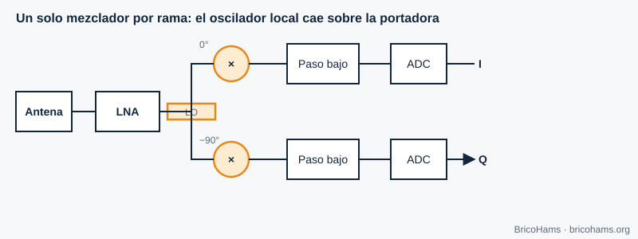
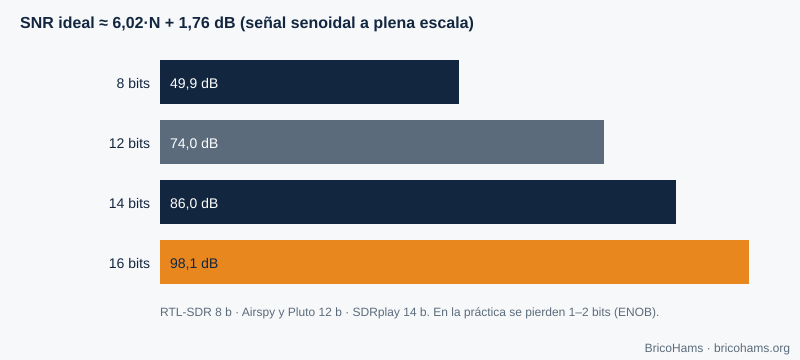

[ES](../es/05-hardware-sdr.md) · [EN](../en/05-hardware-sdr.md) · [FR](../fr/05-hardware-sdr.md) · [PT](../pt/05-hardware-sdr.md)

# 5. Hardware SDR

## Objetivos

- Comparar arquitecturas de FI cero y de FI baja.
- Relacionar bits del ADC con rango dinámico.
- Reconocer fugas del oscilador local y desequilibrio I/Q.
- Entender el papel del reloj (TCXO, GPSDO) y elegir SDR de `hardware/bom/components.csv`.

## 5.1 Arquitecturas

**FI cero (conversión directa).** Un oscilador local en la frecuencia de interés se multiplica por la señal en dos ramas desfasadas 90°. Tras un filtro paso bajo y dos ADC salen I y Q. Es la arquitectura de la mayoría de los SDR (RTL-SDR no lo es: usa FI baja; ADALM-Pluto con el AD9363 sí).

**FI baja.** El oscilador cae algo al lado de la señal, y esta queda en una frecuencia intermedia pequeña, donde el ADC la muestrea. Evita los problemas de continua de la FI cero pero necesita rechazar la frecuencia imagen.

| | FI cero | FI baja |
|---|---|---|
| Ancho de banda | Alto (I y Q separados) | Menor |
| Problema típico | DC, desequilibrio I/Q, fuga del LO | Frecuencia imagen |
| Complejidad | Baja | Media |

## 5.2 Convertidor analógico-digital

Un ADC de *N* bits ofrece como máximo 2^N niveles. Para una senoidal a plena escala, la relación señal a ruido de cuantización es ≈ **6,02·N + 1,76 dB**.

| Bits | Rango teórico |
|---|---|
| 8 | 49,9 dB |
| 12 | 74,0 dB |
| 14 | 86,0 dB |
| 16 | 98,1 dB |

El rango real es menor (el ruido propio del ADC, ENOB). Un RTL-SDR de 8 bits tolera mal una señal fuerte cerca de una débil (por ejemplo, una emisora de TV junto a QO-100); un SDRplay de 14 bits lo hace bastante mejor. En QO-100 la FI contiene la banda del satélite, donde la baliza es mucho más fuerte que una señal de FT8 débil: la dinámica importa.

## 5.3 Imperfecciones de FI cero

- **Fuga del LO (LO leakage):** una parte del oscilador aparece en la salida como un pico en 0 Hz del espectro I/Q. Se corrige restando la componente continua o desplazando el centro unos kHz.
- **Desequilibrio I/Q:** las dos ramas no son idénticas (diferencia de ganancia ε y de fase φ). Aparece una *imagen* de cada señal en la frecuencia opuesta. Rechazo de imagen ≈ 10·log₁₀(4 / (ε² + φ²)): con ε = 1 % y φ = 1° (0,01745 rad), 4 / (0,0001 + 0,000305) ≈ 9877 → ≈ **40 dB**.
- **Offset de continua (DC):** el ADC tiene un nivel residual; también se ve en 0 Hz.

## 5.4 El reloj: TCXO y GPSDO

Todas las frecuencias del SDR derivan de un cristal. Un error de *p* ppm desplaza una señal a *f* en *p·f·10⁻⁶* Hz. Un cristal de 1 ppm en 739,75 MHz sería 740 Hz; en el oscilador del LNB, a 9750 MHz, 1 ppm son **9,75 kHz**. Por eso la deriva del LNB (y no la del SDR) es la que domina en QO-100 (capítulo 7).

- **TCXO**: cristal con compensación de temperatura (±0,5 a ±2 ppm).
- **GPSDO**: oscilador disciplinado con GPS (decimales de 10⁻⁹ a 10⁻¹¹); compartir la referencia entre TX y RX evita derivas relativas.

## 5.5 Los SDR de este proyecto

La lista completa está en [`hardware/bom/components.csv`](../../../hardware/bom/components.csv); la comparativa, en [`hardware/bom/comparison.md`](../../../hardware/bom/comparison.md).

| Uso | Ejemplos de la lista | Notas |
|---|---|---|
| RX de la FI | RTL-SDR Blog V3/V4 (8 bits), Airspy Mini/R2 (12 bits), SDRplay RSP1B (14 bits) | TCXO de 0,5–1 ppm; el bias-T del dongle no sustituye al inyector |
| TX 2,4 GHz | ADALM-Pluto (AD9363, 12 bits, ≈ 20 MHz de ancho), HackRF One (8 bits), LimeSDR Mini 2.0, USRP B200mini-i (AD9364, 56 MHz, entrada de 10 MHz) | La potencia de salida es baja: hace falta PA, filtro y medidor |
| Alternativa HF | Hermes Lite 2 | Solo con transverter; no conectes la FI del LNB a su entrada |

El AD9363 de la Pluto es un transceptor integrado que cubre oficialmente 325–3800 MHz, así que 2,4 GHz entra sin problema; su oscilador de baja precisión se compensa con la corrección por baliza de BricoHams. Estas marcas aparecen como ejemplos técnicos y no implican ningún vínculo con BricoHams.

## Cómo lo hace BricoHams

- Configura el SDR a través de SDRangel: [`src/sdrangel/client.js`](../../../src/sdrangel/client.js).
- Calcula los desplazamientos de oscilador en [`src/modes/frequencies.js`](../../../src/modes/frequencies.js) (`downlinkToIf`, `ifToDownlink`).
- Compensa la deriva del LNB con la baliza: [`src/beacon/index.js`](../../../src/beacon/index.js).
- Guía de hardware: [`hardware/README.md`](../../../hardware/README.md) y [`docs/help/equipos-y-programas.md`](../../help/equipos-y-programas.md).

## Ejercicios

1. ¿Qué rango dinámico teórico tiene un ADC de 10 bits?
2. Un oscilador de 25 MHz con 2 ppm: ¿cuánto se desplaza a 739,75 MHz?
3. ¿Cuál es el rechazo de imagen con ε = 2 % y φ = 2°?
4. ¿Qué LO de LNB corresponde a una FI de 739,75 MHz para 10 489,75 MHz?

### Soluciones

1. 6,02 × 10 + 1,76 = **62 dB**.
2. 2 ppm × 739,75 MHz = **1,48 kHz**.
3. ε² = 0,0004; φ = 0,0349 rad → φ² = 0,00122; suma = 0,00162; 4 / 0,00162 = 2469 → **≈ 34 dB**.
4. 10 489,75 − 739,75 = **9750 MHz**.

**Lectura recomendada:** Collins et al., *Software-Defined Radio for Engineers*, cap. 5 (Understanding SDR Hardware).
