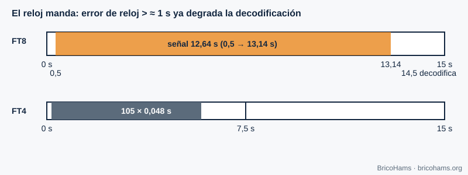

[ES](../es/06-sincronizacion-de-tiempo.md) · [EN](../en/06-sincronizacion-de-tiempo.md) · [FR](../fr/06-sincronizacion-de-tiempo.md) · [PT](../pt/06-sincronizacion-de-tiempo.md)

# 6. Sincronización de tiempo

## Objetivos

- Entender qué es la sincronización de símbolo y por qué hay que hacerla.
- Calcular la estructura temporal de FT8 y FT4.
- Saber por qué el reloj UTC de tu ordenador es parte de la estación.

## 6.1 Tres niveles de tiempo

1. **Muestra**: el reloj del ADC fija cuándo se toma cada muestra.
2. **Símbolo**: hay que saber *en qué muestra* empieza cada símbolo; si el receptor muestrea justo entre dos símbolos, el ruido y la interferencia entre símbolos aumentan.
3. **Trama o franja**: hay que saber cuándo empieza el mensaje completo.

Los receptores clásicos ajustan el instante de muestreo con un lazo de seguimiento (detector de error de temporización que mide si la muestra cae adelantada o retrasada respecto al centro del símbolo). Los modos de franja fija como FT8 resuelven el problema de otra forma: un **primer ajuste grueso por el reloj UTC** y uno **fino por correlación** con una secuencia de sincronismo (capítulo 8).

## 6.2 Franjas FT8 y FT4

FT8 transmite en franjas de 15 s alineadas con los segundos 0, 15, 30 y 45 de cada minuto UTC. La señal empieza 0,5 s después del inicio y dura 79 × 0,16 = 12,64 s. El decodificador arranca hacia los 14,5 s. FT4 usa franjas de 7,5 s: 105 símbolos × 0,048 s = 5,04 s de señal.

El receptor no conoce exactamente cuándo empezó el emisor: su reloj tiene error. Busca por correlación el desfase temporal *dt* (en segundos) y lo informa junto al mensaje. Con un reloj bien ajustado, *dt* debería estar cerca de 0; si todos tus contactos muestran un *dt* similar, el desajuste es tuyo.

**Ejemplo.** A 12 kS/s, el error de 0,1 s son 1200 muestras, algo más de media muestra de símbolo (1920 muestras). Un error de 1 s equivale a 12 000 muestras (6,25 símbolos): el bloque Costas queda tan desplazado que la sincronización fina deja de encontrarlo en su sitio.

## 6.3 UTC y NTP

Un PC sincronizado por **NTP** suele tener un error de decenas de milisegundos: de sobra. Un PC sin sincronizar puede derivar segundos por semana. En una estación remota, el reloj del servidor es el que importa. Latencia de red (WebRTC, WebSocket) no cambia el reloj de decodificación, solo retrasa la imagen que ve el usuario.

QO-100 añade un retardo de propagación de ≈ 0,25 s por salto (≈ 36 000 km arriba y otro tanto abajo, a la velocidad de la luz). FT8 lo tolera sin problema, pero importa en conversaciones por voz.

## Cómo lo hace BricoHams

- `utcSlot` calcula la franja UTC de FT8 y FT4 en [`src/modes/decoders.js`](../../../src/modes/decoders.js).
- El decodificador de franja (en hilo aparte para no bloquear el servidor): [`src/modes/slot-decoder.js`](../../../src/modes/slot-decoder.js) y [`src/modes/decode-service.js`](../../../src/modes/decode-service.js).
- El tiempo de cada decodificación (`dtSec`) lo calcula [`src/modes/ft8-decode.js`](../../../src/modes/ft8-decode.js).
- Recomendación de reloj en [`docs/help/solucion-de-problemas.md`](../../help/solucion-de-problemas.md).

## Ejercicios

1. ¿Cuántas muestras hay en una franja FT8 a 12 kS/s?
2. ¿Cuántas muestras dura un símbolo FT4 a 12 kS/s?
3. Si tu reloj atrasa 0,8 s, ¿cuántos símbolos FT8 desplazas?
4. ¿Cuánto tarda la señal en ir de la estación al satélite y volver a otra estación en tierra?

### Soluciones

1. 15 × 12 000 = **180 000** muestras.
2. 0,048 × 12 000 = **576** muestras.
3. 0,8 / 0,16 = **5 símbolos**.
4. ≈ 36 000 km × 2 / 300 000 km/s ≈ **0,24–0,26 s** (más por la geometría).

**Lectura recomendada:** Collins et al., *Software-Defined Radio for Engineers*, cap. 6 (Timing Synchronization).
