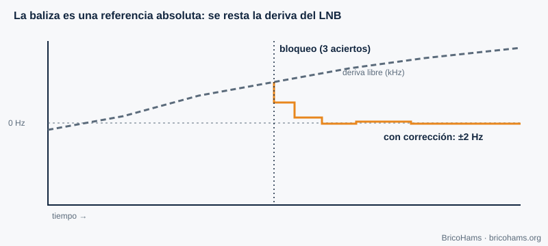
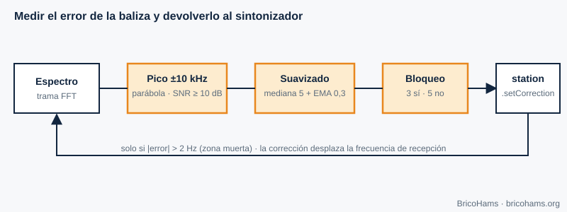

[ES](../es/07-sincronizacion-de-portadora.md) · [EN](../en/07-sincronizacion-de-portadora.md) · [FR](../fr/07-sincronizacion-de-portadora.md) · [PT](../pt/07-sincronizacion-de-portadora.md)

# 7. Sincronización de portadora

## Objetivos

- Entender por qué aparece un desvío de frecuencia y cuánto vale en QO-100.
- Explicar cómo una baliza sirve como referencia absoluta.
- Seguir paso a paso el algoritmo de `src/beacon/`.

## 7.1 Desvío de frecuencia

Transmisor y receptor usan osciladores distintos. Si el receptor sintoniza *f₀* pero la portadora llega en *f₀ + Δf*, la señal en banda base gira a Δf hercios. Con BPSK o QPSK, esa rotación destruye la decisión: hay que estimar y corregir *Δf* (y la fase) antes de demodular.

En QO-100 hay tres fuentes de desvío:

| Fuente | Orden de magnitud |
|---|---|
| Oscilador del LNB (9750 MHz) | 1 ppm ≈ 9,75 kHz; LNB baratos derivan decenas o cientos de kHz con la temperatura |
| Oscilador del SDR (739,75 MHz) | 1 ppm ≈ 740 Hz (menos con TCXO) |
| Oscilador de la estación emisora | ídem, a 2,4 GHz |
| Doppler del satélite GEO | muy pequeño (capítulo 9) |

## 7.2 Técnicas de recuperación

- **Lazo de enganche de fase (PLL) o de Costas**: un oscilador controlado que persigue la fase de la portadora con realimentación. Sirve para PSK con ruido bajo.
- **Estimación en bucle abierto**: elevar la señal a la potencia *M* elimina la modulación PSK y deja un tono en *M·Δf* que se mide con una FFT.
- **Piloto o baliza**: una señal conocida a frecuencia conocida permite medir el error directamente.

FT8 y FT4 usan FSK no coherente y toleran desvíos de decenas de hercios porque el decodificador busca el tono; pero en una estación bidireccional lo que pesa es que el **LNB derive** (cambia donde ves a los demás) y que tu **transmisión** caiga donde debe. La baliza resuelve ambas cosas.

## 7.3 La baliza como recuperación de portadora

QO-100 NB radia una portadora continua muy estable que el satélite genera con su propia referencia. Si el LNB y el SDR están desviados, esa baliza **no está donde debería**: el desfase medido es exactamente el error acumulado de toda la cadena de recepción.

El algoritmo de [`src/beacon/index.js`](../../../src/beacon/index.js) se compone de tres piezas:

1. **`estimateBeaconOffset`** (función pura). Recibe un espectro en dB, la frecuencia central, el ancho de bin y la frecuencia esperada de la baliza. Define una ventana de ±10 kHz alrededor de la posición esperada, busca el máximo, calcula la SNR como *pico − mediana de la ventana* y exige ≥ 10 dB. Descarta máximos en el borde de la ventana. Con los tres bins alrededor del pico (a, b, c) hace **interpolación parabólica**: δ = 0,5·(a−c)/(a−2b+c), limitado a ±0,5 bins. La frecuencia del pico es *centro + (bin + δ − N/2)·binHz*; el desvío es la diferencia con la esperada.
2. **`createBeaconFilter`**. Convierte medidas ruidosas en una estimación estable: mediana de las últimas 5 detecciones (descarta valores atípicos), media móvil exponencial con α = 0,3 (suaviza), y una histéresis: **bloqueo** tras 3 detecciones seguidas y **pérdida de bloqueo** tras 5 fallos seguidos. Así un fallo aislado no hace oscilar el estado.
3. **`createBeaconController`**. En cada trama de espectro llama a las dos funciones anteriores; si hay bloqueo y el cambio supera la **zona muerta** de 2 Hz, llama a `station.setCorrection(offsetHz, 'beacon')`. Si se pierde el bloqueo, mantiene la última corrección (*holdover*) y marca `no-lock`.

**Ejemplo.** Espectro de 1024 bins con *binHz* = 100 Hz centrado en 739,75 MHz (la baliza esperada cae en el bin 512). Pico en el bin 520, vecinos iguales → δ = 0 → desvío = 8 bins × 100 Hz = **+800 Hz**. El controlador desplaza el centro de recepción en +800 Hz y, cuando el emisor está inactivo, el de transmisión en −800 Hz (la corrección se aplica de forma consistente a los dos lados).

Las razones del método elegido están en [`docs/adr/0008-beacon-correction-method.md`](../../adr/0008-beacon-correction-method.md).

## Cómo lo hace BricoHams

- Algoritmo y API: [`src/beacon/index.js`](../../../src/beacon/index.js) y su [`README`](../../../src/beacon/README.md).
- Aplicación de la corrección a la estación: `setCorrection` en [`src/modes/station.js`](../../../src/modes/station.js).
- Origen de las tramas de espectro: [`src/webrtc/spectrum.js`](../../../src/webrtc/spectrum.js).
- Pruebas: [`test/unit/beacon.test.js`](../../../test/unit/beacon.test.js).
- Cuidado: la frecuencia de baliza por defecto del repositorio es 10 489,750 MHz y es configurable; confírmala con las fuentes oficiales de AMSAT-DL antes de depender de ella.

## Ejercicios

1. Con *binHz* = 100 y pico en el bin 507 (esperado 512), ¿cuál es el desvío?
2. Vecinos a, b, c = −62, −55, −60 dB. ¿Cuánto vale δ?
3. ¿Cuántas medidas buenas hacen falta para engancharse? ¿Y malas para soltarse?
4. ¿Por qué la mediana antes de la media?

### Soluciones

1. (507 − 512) × 100 = **−500 Hz**.
2. δ = 0,5·(−62 − (−60)) / (−62 − 2·(−55) − 60) = 0,5·(−2)/(−12) ≈ **+0,083 bin** (≈ 8 Hz).
3. 3 y 5 respectivamente.
4. La mediana descarta *outliers* (un pico espurio) que sesgarían la media.

**Lectura recomendada:** Collins et al., *Software-Defined Radio for Engineers*, cap. 7 (Carrier Synchronization).
