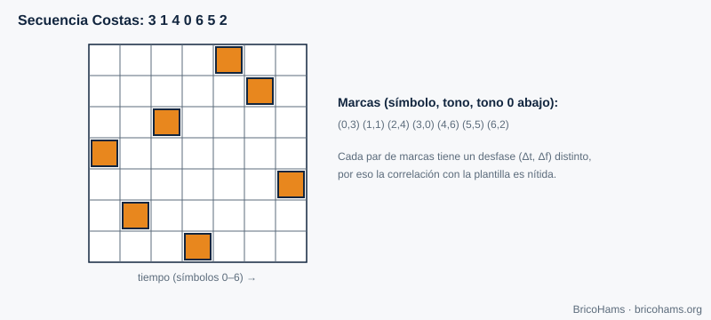
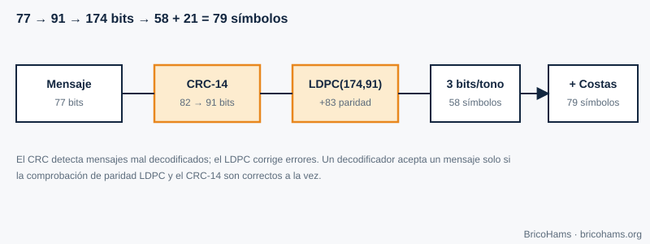
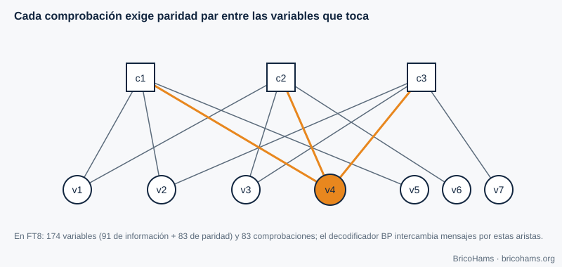

# 8. Tramas y codificación

## Objetivos

- Explicar para qué sirven las palabras de sincronismo y las matrices Costas.
- Calcular un CRC y entender qué detecta.
- Describir cómo un código LDPC corrige errores y qué es el grafo de Tanner.
- Seguir el camino de un mensaje FT8 de 77 bits a 79 símbolos.

## 8.1 Sincronismo de trama

Aunque el reloj UTC dé una idea de cuándo empieza la franja, el receptor debe localizar con precisión el inicio y la frecuencia del mensaje. Se incluye un patrón conocido (una **palabra de sincronismo**) y se correlaciona con la señal recibida. Un buen patrón tiene una autocorrelación con un único pico fuerte.

FT8 usa tres bloques de 7 símbolos, en las posiciones 0–6, 36–42 y 72–78, siguiendo una **matriz Costas**: la secuencia de tonos 3, 1, 4, 0, 6, 5, 2.

En una matriz Costas, para cada par de marcas el desplazamiento relativo (tiempo, frecuencia) es único. Por eso, si se desplaza la plantilla un símbolo o un tono, casi todas las marcas fallan: el pico de correlación es nítido en ambos ejes (tiempo y frecuencia) a la vez. 21 de los 79 símbolos son sincronismo.

## 8.2 Detección de errores: CRC

Un **CRC (comprobación de redundancia cíclica)** divide el mensaje, visto como un polinomio binario, por un polinomio generador y añade el resto. El receptor repite la cuenta: si no coincide, el mensaje está dañado. FT8 usa un **CRC de 14 bits** con el polinomio `0x2757` sobre 82 bits (los 77 del mensaje más 5 ceros), y añade los 14 bits al final: 77 + 14 = 91 bits.

Un CRC de 14 bits deja pasar un mensaje corrupto aleatorio con probabilidad 2⁻¹⁴ ≈ 6·10⁻⁵ (1 entre 16 384). Es poco, pero con cientos de candidatos por franja no es cero; por eso conviene comprobar también que el texto decodificado tenga sentido.

## 8.3 Corrección de errores: LDPC (174, 91)

Un código de bloque (*n*, *k*) convierte *k* bits de información en *n* bits transmitidos. Con *n* = 174 y *k* = 91, la **tasa** es 91/174 ≈ 0,52: se envía casi el doble de bits, pero con esa redundancia el receptor puede reconstruir el mensaje aun con muchos bits erróneos.

Un **código LDPC** se define por una matriz de comprobación de paridad *H* dispersa (pocos unos). Cada fila es una **ecuación de paridad**: los bits que toca deben sumar cero (módulo 2). FT8 tiene 83 ecuaciones (174 − 91) y cada bit participa en exactamente 3 de ellas.

El **grafo de Tanner** dibuja esa matriz: nodos de variable (bits), nodos de comprobación (ecuaciones) y una arista por cada 1 de *H*.

**Decodificación por propagación de creencias (BP).** El demodulador no entrega ceros y unos duros, sino **probabilidades** (razones de verosimilitud logarítmica, LLR) para cada bit. Se intercambian mensajes por las aristas: cada variable avisa a sus comprobaciones de lo que cree; cada comprobación dice a las variables qué valor deberían tener para que la paridad cuadre. Tras varias iteraciones, las creencias convergen; si todas las comprobaciones se cumplen y el CRC coincide, el mensaje es válido.

**Ejemplo.** FT8 anuncia decodificaciones hasta ≈ −21 dB de SNR en 2,5 kHz (valor orientativo; depende de la implementación). Un esquema sin codificación necesitaría bastante más SNR para una BER aceptable (capítulo 3): la redundancia compra varios dB de umbral.

## 8.4 Del bit al tono

Los 174 bits se agrupan de 3 en 3: 58 símbolos de datos, cada uno con 8 tonos posibles. Con los 21 símbolos Costas son 79 símbolos de 0,16 s. FT4 sigue el mismo principio con 87 símbolos de datos, 4×4 símbolos Costas y una máscara XOR de aleatorización (para evitar patrones repetidos).

## Cómo lo hace BricoHams

- Tablas y dimensiones: [`src/modes/ft8-tables.js`](../../../src/modes/ft8-tables.js) (`LDPC_N = 174`, `LDPC_K = 91`, `LDPC_M = 83`).
- CRC y LDPC (`computeCrc`, `addCrc`, `encode174`, `ldpcCheck`, `bpDecode`): [`src/modes/ft8-ldpc.js`](../../../src/modes/ft8-ldpc.js).
- Empaquetado del texto del mensaje en 77 bits: [`src/modes/ft8-message.js`](../../../src/modes/ft8-message.js).
- Pruebas: [`test/unit/ft8.test.js`](../../../test/unit/ft8.test.js).

## Ejercicios

1. ¿Qué fracción de los símbolos FT8 son sincronismo?
2. ¿Cuántos bits de paridad añade LDPC(174, 91)?
3. Si la probabilidad de error de bit es 0,1, ¿qué probabilidad hay de que 3 bits seguidos estén bien?
4. ¿Por qué un CRC no puede corregir errores pero un LDPC sí?

### Soluciones

1. 21 / 79 ≈ **26,6 %**.
2. 174 − 91 = **83**.
3. 0,9³ = **0,729**.
4. El CRC solo ofrece un resumen para comprobar; no tiene redundancia suficiente estructurada para localizar los errores. LDPC distribuye la redundancia en ecuaciones solapadas que permiten estimar qué bits fallan.

**Lectura recomendada:** Collins et al., *Software-Defined Radio for Engineers*, cap. 8 (Frame Synchronization and Channel Coding).
