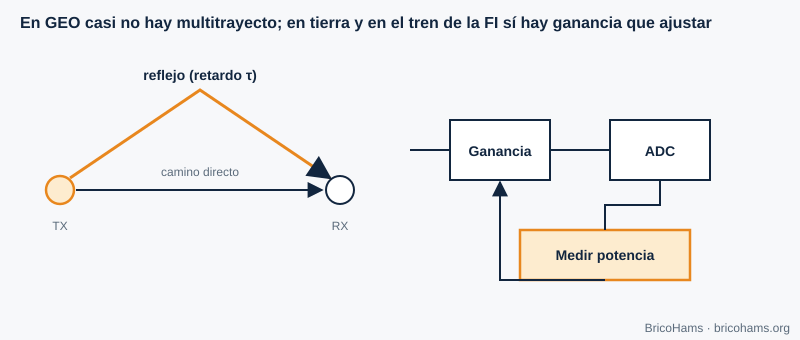

# 9. Canal y ecualización

## Objetivos

- Describir el canal de QO-100 y compararlo con uno terrestre.
- Estimar el Doppler de un satélite geoestacionario.
- Entender multitrayecto, ecualización y control automático de ganancia (AGC).

## 9.1 Un canal casi ideal

El enlace QO-100 es de línea de vista, con un transpondedor en órbita geoestacionaria a unos 36 000 km. El canal se parece mucho a un **canal AWGN** (ruido blanco gaussiano aditivo): atenuación fija, retardo constante y ruido. Sus impedimentos reales son pequeños:

- **Atenuación atmosférica y lluvia** a 10,489 GHz: de décimas a pocos dB en lluvia intensa.
- **Pérdida por apuntado** (capítulo 11).
- **Polarización**: un LNB y un feed mal orientados pierden señal.
- **Interferencias** de enlaces terrestres, y la saturación del transpondedor por señales fuertes.

## 9.2 Doppler en órbita geoestacionaria

El desplazamiento Doppler es *Δf = f·v/c*. Un satélite GEO no está del todo quieto: sus pequeñas oscilaciones diarias de inclinación producen velocidades radiales del orden de metros por segundo como mucho. Con *v* = 1 m/s (ilustrativo):

- a 10,489 GHz: Δf ≈ 10,489·10⁹ / 3·10⁸ ≈ **35 Hz**;
- a 2,4 GHz: ≈ **8 Hz**.

Frente a los ±kHz de deriva del LNB, es despreciable, y por eso BricoHams solo mide la corrección por baliza y no calcula efemérides Doppler. En satélites LEO (cientos de km), en cambio, el Doppler llega a decenas de kHz.

## 9.3 Multitrayecto y ecualización

En tierra, la señal llega por caminos con distintos retardos; sus copias se suman con fases distintas y producen **desvanecimientos selectivos en frecuencia**. Un **ecualizador** estima la respuesta del canal (con un patrón de entrenamiento o a ciegas) y aplica un filtro inverso. En QO-100 el trayecto espacial no tiene multitrayecto significativo; el único eco posible es el reflejo cercano al plato.

## 9.4 Control automático de ganancia

El **AGC** ajusta la ganancia del receptor para que la señal use bien el rango del ADC: ni tan baja que se pierda en el ruido de cuantización, ni tan alta que sature. En QO-100 el AGC puede ser una trampa: la baliza, fuerte, hace bajar la ganancia y reduce la señal débil. Los receptores SDR usan, por eso, ganancia manual o AGC con constantes de tiempo lentas.

**Ejemplo.** Si la baliza llega a −50 dBFS y el ruido a −90 dBFS, hay 40 dB de margen sobre el ruido y 50 dB hasta la saturación; una señal FT8 a −85 dBFS sobrevive. Si subes la ganancia 20 dB, la baliza pasa a −30 dBFS: aún cabe, pero un vecino fuerte (una señal SSB de 10 dB más) ya acercaría la saturación.

## Cómo lo hace BricoHams

- La estación no usa Doppler: solo corrige por baliza ([`src/beacon/`](../../../src/beacon/README.md)).
- El nivel de recepción y el audio se normalizan en [`src/webrtc/rx-audio.js`](../../../src/webrtc/rx-audio.js).
- El perfil de recepción (filtro y DSP): [`src/modes/rx-profile.js`](../../../src/modes/rx-profile.js).
- Detalles del canal en la guía [`docs/help/qo100-fundamentos.md`](../../help/qo100-fundamentos.md).

## Ejercicios

1. Δf a 10,489 GHz con *v* = 3 m/s.
2. ¿Qué retardo de ida y vuelta en voz (con un único salto)?
3. ¿Por qué no se usa AGC rápido en la FI de QO-100?
4. Dos copias con retardos 0 y 1 µs. ¿A qué frecuencia cae el primer nulo?

### Soluciones

1. 3 × 35 = **≈ 105 Hz**.
2. Cada salto ≈ 0,25 s; ida y vuelta ≈ **0,5 s**.
3. La baliza, mucho más fuerte, haría que el AGC bajara la ganancia de todo el espectro y las señales débiles se perderían.
4. Nulo cuando el retardo es medio ciclo: 1/(2 × 1 µs) = **500 kHz**.

**Lectura recomendada:** Collins et al., *Software-Defined Radio for Engineers*, cap. 9 (Channel Estimation and Equalization).
