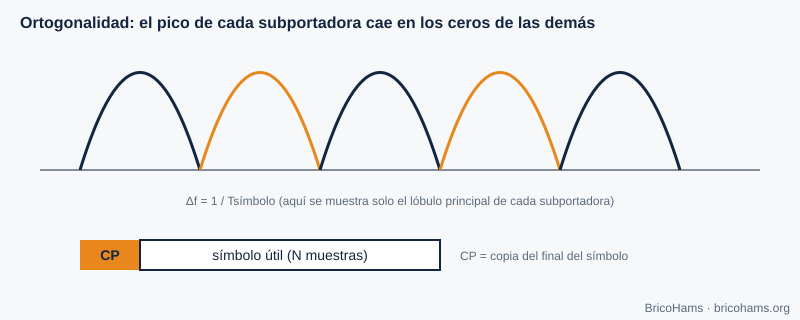
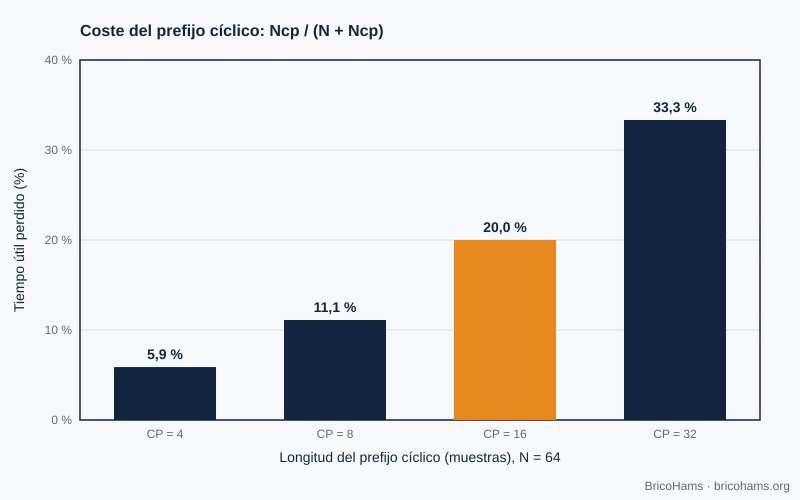

[ES](../es/10-ofdm.md) · [EN](../en/10-ofdm.md) · [FR](../fr/10-ofdm.md) · [PT](../pt/10-ofdm.md)

# 10. OFDM

## Objetivos

- Entender la idea de las subportadoras ortogonales y del prefijo cíclico.
- Calcular el coste del prefijo.
- Saber por qué la banda estrecha de QO-100 no usa OFDM y dónde sí aparece (banda ancha, DATV).

## 10.1 La idea

Una señal de banda ancha sufre desvanecimientos selectivos en frecuencia. OFDM reparte los datos en muchas **subportadoras** estrechas y lentas, de modo que cada una ve un canal casi plano. Las subportadoras están separadas exactamente *Δf = 1/T* (siendo *T* la duración útil del símbolo), así los máximos de cada una caen en los ceros de las demás (**ortogonalidad**) y no se interfieren aunque se solapen sus espectros.

El transmisor genera todas las subportadoras de una vez con una **FFT inversa** de *N* puntos; el receptor las separa con una FFT. Eso explica por qué OFDM es práctico en software.

## 10.2 Prefijo cíclico

Antes de cada símbolo se copia el final del propio símbolo (**prefijo cíclico, CP**). Si el retardo del multitrayecto es menor que el CP, la interferencia entre símbolos desaparece y el canal se reduce a un factor complejo por subportadora, fácil de ecualizar. El coste es eficiencia: la sobrecarga es *CP / (N + CP)*.

Con *N* = 64:

| CP | Sobrecarga |
|---|---|
| 4 | 5,9 % |
| 8 | 11,1 % |
| 16 | **20 %** |
| 32 | 33,3 % |

## 10.3 ¿Y QO-100?

- **Banda estrecha (NB, 500 kHz)**: sus señales (SSB, CW, FT8) son estrechas (≤ 3 kHz) y el canal espacial es plano; no hay selectividad en frecuencia que compense con OFDM. FT8 es, además, mucho más eficiente con su FSK de 50 Hz de ancho y un código fuerte.
- **Banda ancha (WB, ≈ 8 MHz)**: transporta televisión digital de aficionado (DATV) con el estándar de televisión por satélite DVB-S2, que usa **modulación de portadora única** (QPSK/8PSK) y un LDPC más largo. OFDM aparece sobre todo en transmisiones terrestres (DVB-T) o en Wi-Fi. Consulta la información actual de AMSAT-DL y BATC para los parámetros vigentes.

La lección general es de ingeniería: se elige la modulación que encaja con el canal. En un canal casi AWGN, de potencia limitada, una portadora única con buena codificación es más simple y más eficiente.

## Cómo lo hace BricoHams

BricoHams no implementa OFDM. La parte de banda ancha queda fuera del alcance del repositorio; la estación se centra en la banda estrecha. Lo relacionado con el espectro:

- Visualización del espectro de FI: [`src/webrtc/spectrum.js`](../../../src/webrtc/spectrum.js) y [`src/web/public/scope-math.js`](../../../src/web/public/scope-math.js).
- Plan de banda de la NB: [`src/modes/bandplan.js`](../../../src/modes/bandplan.js).
- La FFT que usan los decodificadores FT8/FT4: [`src/modes/ft8-fft.js`](../../../src/modes/ft8-fft.js).

## Ejercicios

1. Con *N* = 64 y CP = 16, ¿cuántas muestras tiene cada símbolo transmitido?
2. Si el símbolo dura 3,2 µs útiles, ¿cuánto vale Δf?
3. ¿Cuál es la sobrecarga con *N* = 128 y CP = 16?
4. ¿Por qué FT8 no necesita ecualizador?

### Soluciones

1. 64 + 16 = **80**.
2. 1 / 3,2 µs = **312,5 kHz**.
3. 16 / 144 = **11,1 %**.
4. Cada tono dura 0,16 s y el canal es plano en 50 Hz; la detección no coherente por energía no necesita estimar la respuesta.

**Lectura recomendada:** Collins et al., *Software-Defined Radio for Engineers*, cap. 10 (Orthogonal Frequency Division Multiplexing).
