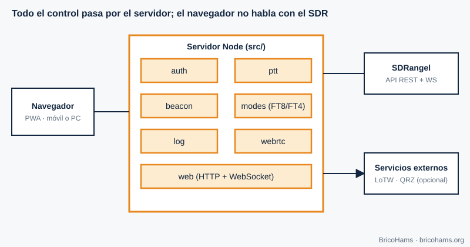
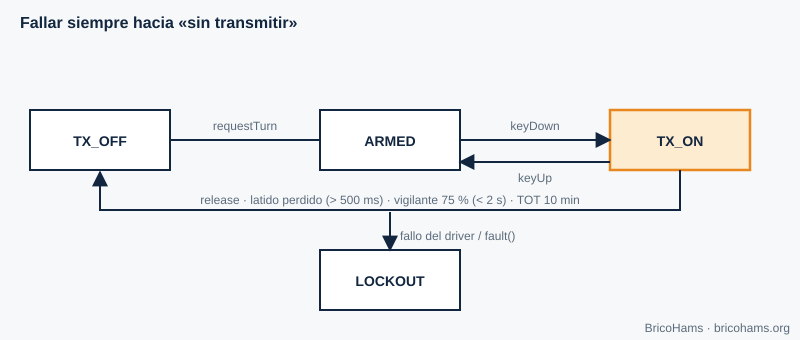
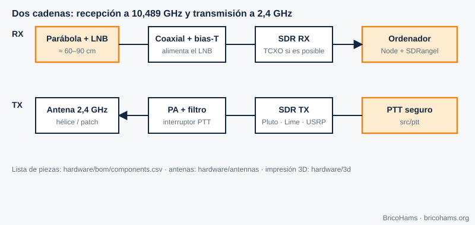

[ES](../es/11-aplicaciones-qo100.md) · [EN](../en/11-aplicaciones-qo100.md) · [FR](../fr/11-aplicaciones-qo100.md) · [PT](../pt/11-aplicaciones-qo100.md)

# 11. Aplicaciones en QO-100: la estación BricoHams

## Objetivos

- Ver cómo se integran todos los conceptos en una estación completa.
- Conocer cada módulo de BricoHams, su responsabilidad y su seguridad.
- Orientarte para construir tu propia estación con la carpeta `hardware/`.

## 11.1 Arquitectura

El navegador (una PWA) nunca habla con el SDR: lo hace el servidor Node (`src/`), que orquesta SDRangel mediante su API REST y su WebSocket. Autenticación con Google (OpenID Connect) y lista de usuarios autorizados; todo el tráfico va cifrado.

| Módulo | Responsabilidad | Código |
|---|---|---|
| `auth` | Inicio de sesión (OIDC), sesiones, roles | [`src/auth/`](../../../src/auth/) |
| `ptt` | Turno exclusivo, latido, tiempo máximo de TX, auditoría | [`src/ptt/`](../../../src/ptt/README.md) |
| `beacon` | Corrección por baliza (capítulo 7) | [`src/beacon/`](../../../src/beacon/README.md) |
| `modes` | Sintonía, FT8/FT4/CW, RIT/XIT, memorias | [`src/modes/`](../../../src/modes/README.md) |
| `sdrangel` | Cliente y driver de PTT hacia SDRangel | [`src/sdrangel/`](../../../src/sdrangel/index.js) |
| `webrtc` | Audio de RX/TX y tramas de espectro | [`src/webrtc/`](../../../src/webrtc/index.js) |
| `log` | Libro de guardia, ADIF, LoTW y QRZ | [`src/log/`](../../../src/log/index.js) |
| `web` | Interfaz PWA | [`src/web/public/`](../../../src/web/public/index.html) |

## 11.2 PTT con seguridad

Transmitir mal puede dañar equipos, interferir al resto del transpondedor o incumplir la licencia. La máquina de estados de [`src/ptt/`](../../../src/ptt/index.js) está diseñada para **fallar hacia «no transmitir»**.

- Un único titular del turno a la vez.
- El navegador envía un **latido cada 500 ms**; si deja de llegar, un vigilante corta antes de que venza el tiempo límite (al 75 %, siempre por debajo de 2 s).
- **TOT** (tiempo máximo de transmisión): por defecto 10 minutos.
- Si el driver no confirma «apagado», el estado pasa a **LOCKOUT**; solo un propietario con un código de un solo uso puede salir de él.
- Cada transmisión queda registrada; si no se puede registrar, no se transmite.

Racional: [`docs/adr/0005-ptt-fail-safe-state-machine.md`](../../adr/0005-ptt-fail-safe-state-machine.md).

## 11.3 Corrección por baliza

El módulo `beacon` mide el espectro cada pocos segundos y, si detecta la baliza con SNR suficiente, corrige la frecuencia de recepción y transmisión. Así el LNB barato se convierte, en la práctica, en una referencia estable.

## 11.4 Registro de contactos: ADIF, LoTW y QRZ

Cada contacto se guarda en SQLite (módulo `node:sqlite` de Node). Se exporta en **ADIF 3.1** con los campos de satélite necesarios para LoTW (`PROP_MODE=SAT`, `SAT_NAME=QO-100`, bandas 13 cm de subida y 3 cm de bajada). La subida a LoTW usa la herramienta TQSL (el certificado lo gestiona el usuario) y la de QRZ Logbook usa su API con una clave guardada cifrada. Detalles: [`docs/help/log-lotw-qrz.md`](../../help/log-lotw-qrz.md).

## 11.5 Escucha pública con OpenWebRX

El plugin de [`plugins/openwebrx/`](../../../plugins/openwebrx/README.md) añade marcadores y ayuda de desplazamiento a OpenWebRX+, es de **solo recepción** y no tiene ninguna ruta hacia la transmisión.

## 11.5b Notch, I/Q, spots, memorias y plugins

La estación incluye notch/auto-notch, grabación I/Q delegada en SDRangel, clúster DX y calendario de actividad, importación/exportación de memorias y una API de plugins acotada. Todo lo que contacta con el exterior está desactivado por defecto y nada de ello puede transmitir; ver [funciones avanzadas](../../help/funciones-avanzadas.md).

## 11.6 Calculadoras

Para dimensionar tu estación: plato, LNB, helix, apuntado y deriva del LNB se calculan en [`services/qo100-calculators/`](../../../services/qo100-calculators/README.md).

## 11.7 Construye tu estación

1. **Recepción**: plato (≥ 80 cm recomendado), LNB (idealmente con TCXO), coaxial, inyector de polarización, SDR de la lista. Guía: [`docs/help/construir-tu-estacion.md`](../../help/construir-tu-estacion.md), [`hardware/antennas/dish.md`](../../../hardware/antennas/dish.md) y [`hardware/antennas/lnb-y-referencias.md`](../../../hardware/antennas/lnb-y-referencias.md).
2. **Transmisión**: SDR de TX, atenuador, PA lineal con filtro, antena de hélice ([`helix-2g4.md`](../../../hardware/antennas/helix-2g4.md)) o parche ([`poty-patch.md`](../../../hardware/antennas/poty-patch.md)); piezas impresas en 3D en [`hardware/3d/`](../../../hardware/3d/README.md).
3. **Medidas antes de radiar**: medidor de potencia y carga artificial son imprescindibles. Empieza con la potencia mínima y verifica tu señal en el receptor.
4. **Instalación del software**: [`docs/help/instalacion-linux.md`](../../help/instalacion-linux.md), [`instalacion-windows.md`](../../help/instalacion-windows.md) o [`instalacion-raspberry-pi.md`](../../help/instalacion-raspberry-pi.md).
5. **Primer arranque**: [`docs/help/primera-puesta-en-marcha.md`](../../help/primera-puesta-en-marcha.md).

SDRangel, OpenWebRX+, TQSL, QRZ y los fabricantes de hardware son proyectos y empresas independientes; BricoHams solo interopera con ellos y ninguno lo avala.

## Ejercicios

1. ¿Por qué el servidor, y no el navegador, controla el SDR?
2. Con `heartbeatTimeoutMs` = 2000 ms, ¿cuándo corta el vigilante?
3. Si la baliza se desvía +1500 Hz y la zona muerta es 2 Hz, ¿se corrige? ¿Qué se aplica al TX?
4. ¿Qué campos hacen que un ADIF sea válido para satélites en LoTW?

### Soluciones

1. Para que las credenciales, el control del PTT y la lógica de seguridad no dependan de un cliente que pueda fallar o ser manipulado.
2. Al 75 %: **1,5 s**.
3. Sí (1500 > 2). RX = FI + 1500 Hz; TX = subida nominal − 1500 Hz (cuando está inactivo).
4. `PROP_MODE=SAT`, `SAT_NAME=QO-100`, `BAND`, `BAND_RX`, `FREQ` y `FREQ_RX`.

**Lectura recomendada:** Collins et al., *Software-Defined Radio for Engineers*, cap. 11 (Applications for Software-Defined Radio).
