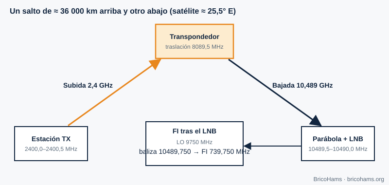

[ES](../es/01-que-es-sdr.md) · [EN](../en/01-que-es-sdr.md) · [FR](../fr/01-que-es-sdr.md) · [PT](../pt/01-que-es-sdr.md)

# 1. Qu'est-ce qu'une radio logicielle ?

## Objectifs

- Distinguer ce qui relève du matériel et ce qui relève du logiciel dans une radio.
- Suivre le signal de QO-100 depuis la parabole jusqu'au texte d'un message.
- Comprendre pourquoi une SDR voit toute la bande à la fois.

## 1.1 L'idée

Dans une radio classique, chaque fonction (filtrer, démoduler, détecter) est un circuit analogique fixe. Dans une **radio logicielle (SDR)**, le matériel se réduit à l'essentiel : une antenne, un amplificateur, un convertisseur de fréquence et un **convertisseur analogique-numérique (CAN)**. À partir de là, tout n'est que nombres. Passer de la SSB au FT8 ou au CW n'exige aucune soudure : on exécute un autre programme sur les mêmes échantillons.

*Figure 1 : Blocs d'une SDR.*

La frontière entre le monde analogique et le monde numérique se déplace de plus en plus vers l'antenne. La limite est fixée par les CAN (combien de bits et combien d'échantillons par seconde) et par le processeur disponible.

## 1.2 La chaîne QO-100

Le signal qui nous intéresse descend du satellite autour de 10,489 GHz. Un CAN bon marché ne peut pas échantillonner 10 GHz ; on procède donc par étapes :

1. Le **LNB** (bloc à faible bruit) amplifie et mélange avec un oscillateur local de 9750 MHz. La balise de 10 489,750 MHz se retrouve sur une **fréquence intermédiaire (FI)** de 10 489,750 − 9750 = **739,750 MHz**.
2. Un câble coaxial amène la FI jusqu'à la SDR et, par le même câble, un injecteur (bias-T) alimente le LNB.
3. La SDR ramène le signal en bande de base et l'échantillonne, fournissant des échantillons complexes **I/Q** à, par exemple, 2,4 millions d'échantillons par seconde.
4. Le logiciel (SDRangel et, dans cette station, des modules Node) filtre, décime, démodule et décode.

*Figure 17 : Liaison par satellite.*

Dans l'autre sens, la liaison montante est à 2400,0–2400,5 MHz ; le satellite décale le signal de 8089,5 MHz et le retransmet entre 10 489,5 et 10 490,0 MHz. Cette relation fixe permet de calculer la fréquence montante à partir de la descendante : `uplink = downlink − 8089,5 MHz`.

## 1.3 Ce que gagne et perd une SDR

| Avantage | Coût |
|---|---|
| Un seul équipement pour de nombreux modes | Nécessite un ordinateur et un logiciel configuré |
| On voit toute la bande étroite de QO-100 (500 kHz) à la fois | Le CAN limite la dynamique (chapitre 5) |
| Évolutif : de nouveaux modes sans matériel | La latence du traitement peut être notable |
| Reproductible : on enregistre l'I/Q et on le réanalyse | La synchronisation temporelle est de votre responsabilité |

## 1.4 Un exemple numérique

Si la SDR échantillonne à 600 kS/s complexes, elle voit 600 kHz de spectre : plus que les 500 kHz du transpondeur à bande étroite. Chaque échantillon I/Q représente deux nombres ; à 16 bits par composante, le débit est de 600 000 × 2 × 2 octets = 2,4 Mo/s, soit environ 8,6 Go par heure. C'est pourquoi la station décime tôt (chapitre 2) : le FT8 travaille avec 12 000 échantillons réels par seconde, 200 fois moins qu'à 2,4 MS/s.

## Comment BricoHams le fait

BricoHams **ne réinvente pas le moteur radio** : il délègue le traitement du signal lourd à SDRangel (décision dans [`docs/adr/0001-sdrangel-as-engine.md`](../../adr/0001-sdrangel-as-engine.md)) et ajoute par-dessus ce qui manque pour exploiter QO-100 à distance et en sécurité : commande du PTT, correction par la balise, décodeurs FT8/FT4/CW, journal de trafic et interface web.

- Client SDRangel : [`src/sdrangel/client.js`](../../../src/sdrangel/client.js)
- Fréquences et conversions QO-100 : [`src/modes/frequencies.js`](../../../src/modes/frequencies.js)
- Vue d'ensemble : [`docs/ARCHITECTURE.md`](../../ARCHITECTURE.md)

## Exercices

1. Calculez la FI à la SDR si le LNB avait un oscillateur de 9750 MHz et que vous vouliez recevoir 10 489,900 MHz.
2. Quelle fréquence montante correspond à une descendante de 10 489,900 MHz ?
3. Une SDR échantillonne à 2,4 MS/s avec 8 bits par composante. Quel débit en Mo/s cela génère-t-il ?

### Solutions

1. 10 489,900 − 9750 = **739,900 MHz**.
2. 10 489,900 − 8089,5 = **2400,400 MHz**.
3. 2 400 000 × 2 composantes × 1 octet = 4,8 Mo/s.

Lecture recommandée : Collins et al., Software-Defined Radio for Engineers, ch. 1
