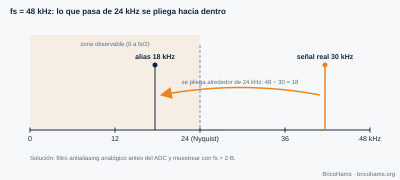
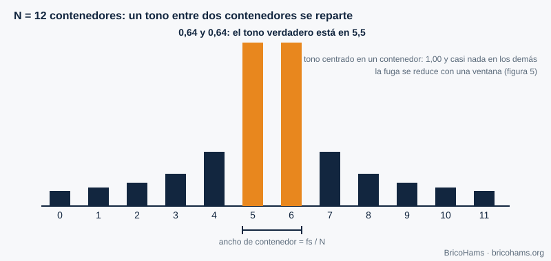
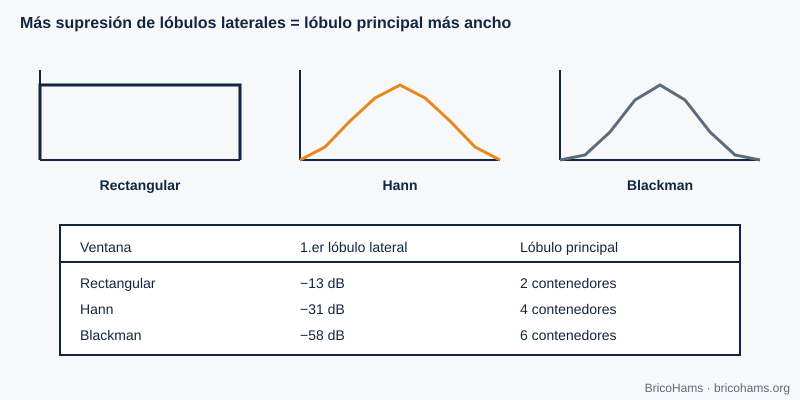
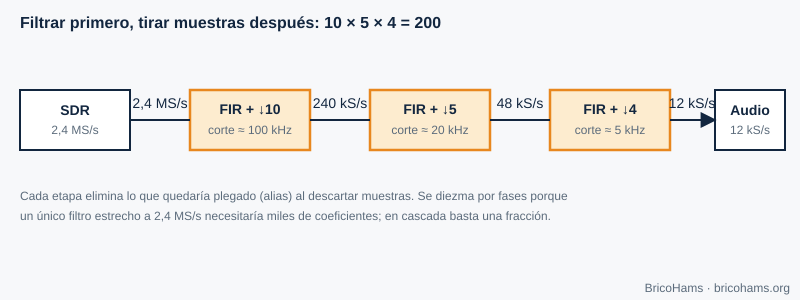

[ES](../es/02-senales-y-sistemas.md) · [EN](../en/02-senales-y-sistemas.md) · [FR](../fr/02-senales-y-sistemas.md) · [PT](../pt/02-senales-y-sistemas.md)

# 2. Signaux et systèmes

## Objectifs

- Appliquer le théorème de Nyquist et reconnaître le repliement (aliasing).
- Manipuler les signaux I/Q et la bande de base complexe.
- Interpréter une FFT : résolution, fuites et fenêtres.
- Concevoir une chaîne de décimation.

## 2.1 Échantillonner : convertir le temps continu en nombres

Un CAN mesure la tension du signal à intervalles réguliers, toutes les *T = 1/fs* secondes. Si le signal contient des composantes jusqu'à une fréquence maximale *B*, il suffit de **fs > 2B** pour pouvoir le reconstruire (critère de **Nyquist**). En dessous, les composantes hautes se « replient » sur les basses et se confondent avec elles : c'est le **repliement** (aliasing).

*Figure 2 : Échantillonnage et repliement (aliasing).*

**Exemple.** Une sinusoïde de 7 kHz échantillonnée à 12 kHz (fréquence de travail des décodeurs FT8) dépasse la limite de Nyquist de 6 kHz. Elle apparaît comme une sinusoïde de |7 − 12| = **5 kHz**. C'est pourquoi on filtre toujours avant de baisser la fréquence d'échantillonnage.

## 2.2 Signaux complexes : I et Q

Un signal réel de 2 kHz et un autre de −2 kHz sont indiscernables dans un spectre réel. Un **signal complexe** *x[n] = I[n] + j·Q[n]* distingue, lui, les fréquences positives et négatives, et occupe le spectre de −fs/2 à +fs/2. Un récepteur à **conversion directe** (chapitre 5) produit précisément cela : I et Q sont la projection sur deux oscillateurs en quadrature.

*Figure 3 : Constellation I/Q.*

La **bande de base complexe** place le centre de la SDR à 0 Hz. Un signal à +3 kHz du centre s'écrit *e^(j2π·3000·t)* ; à −3 kHz, *e^(−j2π·3000·t)*. Changer le signe de la fréquence revient à conjuguer le signal. C'est ainsi qu'on distingue USB et LSB sans ambiguïté.

## 2.3 La FFT : voir le spectre

La **transformée de Fourier rapide (FFT)** de *N* échantillons produit *N* cases (bins) espacées de *fs/N*. C'est la loupe avec laquelle on observe le spectre de QO-100.

*Figure 4 : Cases (bins) de la FFT.*

**Exemple.** Le flux spectral de la station utilise *fs* = 102 400 Hz et *N* = 1024 : chaque bin mesure 100 Hz. Un ton parfaitement centré tombe dans un seul bin ; un ton à mi-chemin entre deux bins se répartit entre les voisins, d'où l'interpolation parabolique de la balise (chapitre 7).

Le gain de traitement de la FFT aide aussi : un ton concentre son énergie dans un bin, tandis que le bruit blanc se répartit sur les *N*. Le rapport signal sur bruit *par bin* s'améliore d'environ 10·log₁₀(N) dB ; avec N = 1024, 30 dB.

## 2.4 Fenêtres

La FFT suppose que le bloc se répète périodiquement. Si le ton ne réalise pas un nombre entier de cycles, des **fuites** (leakage) apparaissent : de l'énergie dans des bins éloignés. Multiplier le bloc par une **fenêtre** adoucit les bords et réduit les fuites, au prix d'un élargissement du lobe principal.

*Figure 5 : Comparaison de fenêtres.*

| Fenêtre | 1er lobe latéral | Largeur du lobe principal |
|---|---|---|
| Rectangulaire | −13 dB | 2 bins |
| Hann | −31 dB | 4 bins |
| Blackman | −58 dB | 6 bins |

Règle pratique : si vous cherchez un signal faible près d'un signal fort (par exemple un signal CW à côté de la balise), utilisez une fenêtre à lobes latéraux faibles.

## 2.5 Décimation

Baisser la fréquence d'échantillonnage (« décimer ») d'un facteur *M* revient à jeter *M−1* échantillons sur *M*, **après** un filtrage passe-bas pour éviter le repliement. On procède par étapes, car un seul filtre très étroit à fréquence élevée coûte très cher.

*Figure 6 : Chaîne de décimation.*

**Exemple.** De 2,4 MS/s à 12 kS/s, le facteur est 200 = 10 × 5 × 4 : 2 400 000 → 240 000 → 48 000 → 12 000 échantillons par seconde.

## Comment BricoHams le fait

- La FFT des décodeurs se trouve dans [`src/modes/ft8-fft.js`](../../../src/modes/ft8-fft.js) et construit la cascade (waterfall) dans [`src/modes/ft8-decode.js`](../../../src/modes/ft8-decode.js).
- La fréquence de travail du FT8 et du FT4 est `SAMPLE_RATE = 12000` ([`ft8-constants.js`](../../../src/modes/ft8-constants.js)).
- Le rééchantillonnage de l'audio du récepteur est dans [`src/webrtc/resample.js`](../../../src/webrtc/resample.js).
- Les trames de spectre (bins en dB) sont interprétées dans [`src/webrtc/spectrum.js`](../../../src/webrtc/spectrum.js).

## Exercices

1. Un signal de 8 kHz est échantillonné à 12 kHz. À quelle fréquence apparaît-il ?
2. Quelle résolution a une FFT de 4096 points à 12 kS/s ?
3. De combien de points avez-vous besoin pour résoudre 6,25 Hz avec fs = 12 kHz ?
4. Avec des bins de 100 Hz, un ton apparaît à 740 Hz du premier bin. Dans quel bin se trouve son pic et quelle fraction de bin reste à interpoler ?

### Solutions

1. |8 − 12| = **4 kHz** (alias).
2. 12 000 / 4096 ≈ **2,93 Hz** par bin.
3. N = fs / Δf = 12 000 / 6,25 = **1920** échantillons (c'est exactement la durée d'un symbole FT8 : 0,16 s).
4. 740 / 100 = 7,4 → le bin 7 (à +0,4 bin) ; l'interpolation parabolique affine ces 0,4.

Lecture recommandée : Collins et al., Software-Defined Radio for Engineers, ch. 2
