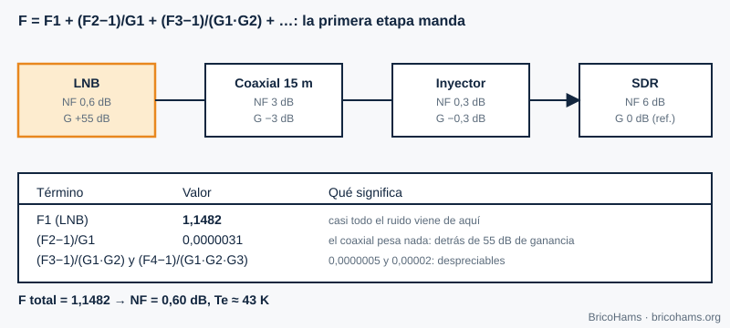
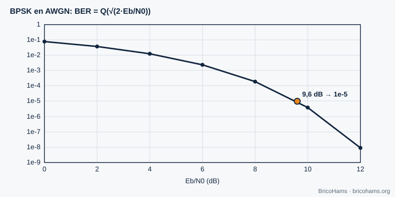
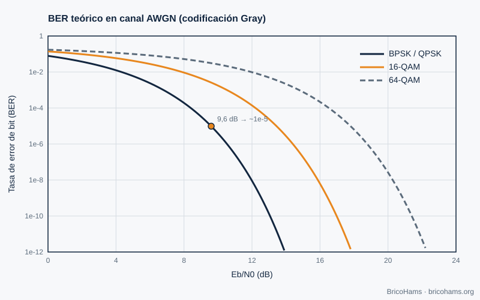
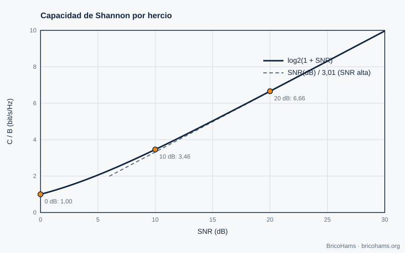

[ES](../es/03-ruido-y-probabilidad.md) · [EN](../en/03-ruido-y-probabilidad.md) · [FR](../fr/03-ruido-y-probabilidad.md) · [PT](../pt/03-ruido-y-probabilidad.md)

# 3. Bruit et probabilités

## Objectifs

- Calculer la puissance de bruit thermique dans une largeur de bande donnée.
- Relier SNR, C/N0 et Eb/N0.
- Appliquer la formule de Friis à la ligne LNB → coaxial → SDR.
- Lire une courbe de BER et savoir ce qui limite la capacité d'un canal.

## 3.1 Bruit thermique

Tout conducteur à la température *T* génère un bruit blanc de densité *N0 = k·T*, avec la constante de Boltzmann *k* = 1,38·10⁻²³ J/K. À 290 K, *N0* = −174 dBm/Hz. La puissance dans une largeur de bande *B* est *N = N0 + 10·log₁₀(B)* :

| Largeur de bande | Puissance de bruit à 290 K |
|---|---|
| 6,25 Hz (symbole FT8) | −166 dBm |
| 2,7 kHz (SSB) | −139,7 dBm |
| 500 kHz (transpondeur NB) | −117 dBm |

Plus le filtre est étroit, moins il entre de bruit. C'est pourquoi le FT8 parvient à décoder des signaux que l'oreille ne distingue pas.

## 3.2 SNR, C/N0 et Eb/N0

- **SNR** = puissance du signal / puissance du bruit, *dans une largeur de bande précise*. Sans la largeur, le chiffre ne signifie rien.
- **C/N0** (dB·Hz) = SNR + 10·log₁₀(B) : une mesure indépendante de la largeur de bande.
- **Eb/N0** = énergie par bit sur densité de bruit = C/N0 − 10·log₁₀(R_b), avec *R_b* le débit binaire.

**Exemple (illustratif).** Un signal avec C/N0 = 40 dB·Hz et un débit de 50 bit/s a Eb/N0 = 40 − 17 = **23 dB**.

Pour le FT8, on cite généralement un seuil d'environ −21 dB de SNR mesuré dans 2500 Hz. Dans la largeur d'un symbole (6,25 Hz), cela donne −21 + 10·log₁₀(2500/6,25) = −21 + 26 = **+5 dB** d'Es/N0, soit un ordre de grandeur de 0 dB par bit d'information après codage. C'est la magie de la combinaison d'une largeur étroite et d'une correction d'erreurs (chapitre 8).

## 3.3 Facteur de bruit et formule de Friis

Le **facteur de bruit (NF)** mesure combien de bruit un composant ajoute au-delà du bruit thermique. Une cascade d'étages a

*F = F₁ + (F₂−1)/G₁ + (F₃−1)/(G₁G₂) + …*

avec *F* et *G* en linéaire. La température équivalente de bruit est *Te = 290·(F−1)*.

*Figure 7 : Cascade de Friis.*

**Exemple.** LNB avec NF 0,6 dB et gain 55 dB ; coaxial avec 3 dB de pertes ; injecteur avec 0,3 dB ; SDR avec NF 6 dB. Le LNB apporte F₁ = 1,1482 ; le reste ajoute moins de 0,00003. Total : NF ≈ **0,60 dB**, *Te* ≈ **43 K**. Morale : seul le LNB compte, pourvu que son gain soit élevé. C'est pourquoi on l'installe sur la parabole et non au niveau de la SDR.

### Du bruit au signal : bilan de liaison

C/N0 = EIRP − affaiblissement en espace libre − pertes atmosphériques + G/T − 10·log₁₀(k).

Avec une distance oblique de 38 000 km à 10,489 GHz, l'affaiblissement en espace libre est 20·log₁₀(4π·d/λ) ≈ **204,5 dB** (λ = 2,858 cm). Une parabole de 90 cm d'efficacité 0,55 a ≈ 37,3 dBi. Avec *Tsys* = 60 K d'antenne + 43 K du récepteur = 103 K (20,1 dBK), G/T ≈ 17,2 dB/K. −10·log₁₀(k) = +228,6 dBW/K/Hz.

## 3.4 BER et Eb/N0

Le **taux d'erreur binaire (BER)** de la BPSK en bruit gaussien est *Q(√(2·Eb/N0))*. À 9,6 dB il vaut ≈ 10⁻⁵ ; chaque dB supplémentaire d'Eb/N0 fait baisser le BER de près d'un ordre de grandeur lorsque l'on est déjà dans la zone de « cascade ».

*Figure 8 : BER de la BPSK.*

La figure 23 compare BPSK/QPSK, 16-QAM et 64-QAM (les modulations plus denses exigent plus d'Eb/N0 pour le même BER).

*Figure 23 : BER théorique de la BPSK, 16-QAM et 64-QAM.*

## 3.5 Limite de Shannon

Aucun système ne dépasse la capacité *C = B·log₂(1 + SNR)*. Avec SNR = 0 dB (puissance du signal = puissance du bruit), *C/B* = 1 bit/s/Hz ; avec 10 dB, 3,46 ; avec 20 dB, 6,66 ; avec 30 dB, 9,97.

*Figure 24 : Capacité de Shannon.*

La capacité ne croît que de façon logarithmique avec la puissance : doubler la puissance (+3 dB) n'ajoute guère que ≈ 1 bit/s/Hz à fort SNR. D'où, sur QO-100, l'intérêt d'améliorer G/T (parabole plus grande, meilleur LNB) plutôt que d'ajouter de la puissance sans discernement.

## Comment BricoHams le fait

Le dossier [`services/qo100-calculators/`](../../../services/qo100-calculators/README.md) inclut un calculateur de **ligne du LNB** qui applique exactement Friis et le bilan de liaison :

- [`assets/qo100-math.js`](../../../services/qo100-calculators/assets/qo100-math.js) : `cascade`, `lnbLineup`, `fsplDb`, `dishGain`.
- [`demo.html`](../../../services/qo100-calculators/demo.html) : interface (servez-la en HTTP pour l'ouvrir).
- Le facteur de bruit décide aussi de la configuration du gain dans SDRangel (chapitre 5).

## Exercices

1. Calculez la puissance de bruit d'un canal de 2,5 kHz à 290 K.
2. Quelle est la *Te* d'un LNB avec NF = 0,8 dB ?
3. Une liaison a C/N0 = 50 dB·Hz. Quel SNR obtient-on dans 2,7 kHz ?
4. Quel Eb/N0 faut-il pour la BPSK à un BER de 10⁻⁵ ?

### Solutions

1. −174 + 10·log₁₀(2500) = −174 + 34 = **−140 dBm**.
2. F = 10^0,08 = 1,202 → *Te* = 290 × 0,202 ≈ **58,6 K**.
3. 50 − 10·log₁₀(2700) = 50 − 34,3 = **15,7 dB**.
4. Environ **9,6 dB**.

Lecture recommandée : Collins et al., Software-Defined Radio for Engineers, ch. 3
