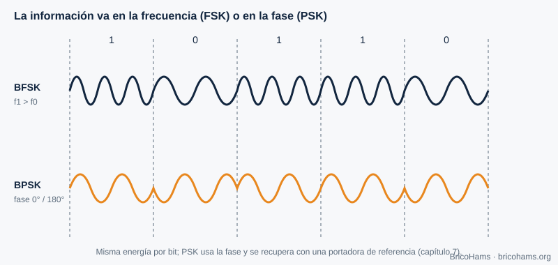
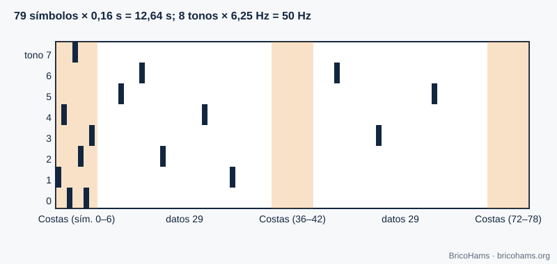
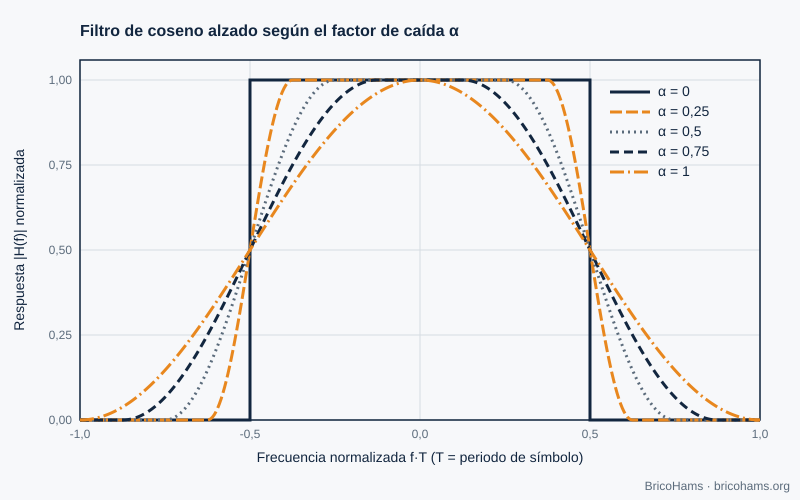

[ES](../es/04-modulacion-digital.md) · [EN](../en/04-modulacion-digital.md) · [FR](../fr/04-modulacion-digital.md) · [PT](../pt/04-modulacion-digital.md)

# 4. Modulation numérique

## Objectifs

- Expliquer comment la FSK et la PSK codent des bits en fréquence et en phase.
- Comprendre la structure du FT8 (8-GFSK), du FT4 et du CW.
- Comprendre pourquoi on met en forme les impulsions (cosinus surélevé, filtre gaussien).

## 4.1 Message → onde

Moduler, c'est modifier un paramètre d'une porteuse en fonction des données. Avec trois paramètres (amplitude, fréquence, phase), on obtient les familles ASK/OOK, FSK et PSK.

*Figure 9 : Formes d'onde FSK et PSK.*

- **FSK** : chaque symbole est un ton différent. Elle est robuste et simple à détecter sans connaître la phase de la porteuse (détection non cohérente).
- **PSK** : chaque symbole est une phase. En BPSK, il y a deux phases (0° et 180°) et un bit par symbole ; en QPSK, quatre phases et deux bits. Il faut récupérer la porteuse (chapitre 7).
- **QAM** combine amplitude et phase : plus de bits par symbole moyennant plus d'Eb/N0 (figure 23 du chapitre 3).

## 4.2 La constellation

Chaque symbole est un point du plan I/Q. Le bruit dessine un nuage autour de chaque point ; si le nuage franchit la frontière entre décisions, il y a erreur.

*Figure 3 : Constellations I/Q.*

## 4.3 FT8 et FT4 : FSK à tons multiples

Le **FT8** transmet 8 tons espacés de 6,25 Hz. Chaque symbole dure 0,16 s, soit 1/0,16 = 6,25 symboles par seconde, et l'espacement entre tons est égal au débit symbole : les tons sont orthogonaux. Chaque symbole code 3 bits. Le message complet compte 79 symboles (12,64 s), pour une largeur totale de 8 × 6,25 = **50 Hz**.

*Figure 10 : Grille de tons et de temps du FT8.*

Le « G » de *8-GFSK* signifie que la transition entre tons est adoucie par un filtre gaussien (paramètre BT = 2,0 dans ce dépôt) afin que le spectre ne s'élargisse pas avec les sauts brusques.

Le **FT4** est plus rapide : 4 tons, symboles de 0,048 s (espacement 20,83 Hz), 105 symboles et créneaux de 7,5 s. Il demande plus de SNR et occupe plus de largeur (≈ 83 Hz).

## 4.4 CW

La télégraphie est la modulation la plus simple : porteuse allumée ou éteinte (OOK). Un bon *keying* adoucit les fronts pour que le spectre ne « claque » pas. La vitesse se mesure en mots par minute : à 20 wpm, un point dure 60 ms (avec le mot PARIS comme référence).

## 4.5 La balise BPSK

La balise de QO-100 NB est une porteuse étroite, avec une modulation à faible débit. Pour BricoHams, seule sa **fréquence** importe : elle sert de référence absolue (chapitre 7).

## 4.6 Mise en forme des impulsions

Une impulsion rectangulaire de durée *T* a un spectre *sinc* dont les lobes s'étendent très loin. Pour occuper moins de largeur sans générer d'**interférence entre symboles (ISI)**, on utilise le **cosinus surélevé**, de facteur de retombée α (0 à 1). Sa réponse en fréquence est plate au centre, décroît doucement entre *(1−α)/2T* et *(1+α)/2T*, et vaut zéro au-delà : la largeur est *(1+α)/T*.

*Figure 26 : Cosinus surélevé.*

Avec α = 0,25 et 1200 symboles/s, la largeur est 1,25 × 1200 = 1500 Hz. En pratique, le cosinus surélevé se divise en deux « racines » : une à l'émetteur et une au récepteur (filtre adapté), qui ensemble donnent un cosinus surélevé complet.

## Comment BricoHams le fait

- Constantes de protocole : [`src/modes/ft8-constants.js`](../../../src/modes/ft8-constants.js) (`PROTOCOLS` pour FT8 et FT4).
- Synthèse de l'onde d'un message : `synthSlot` dans [`src/modes/ft8-encode.js`](../../../src/modes/ft8-encode.js).
- Décodage CW : [`src/modes/cw-decoder.js`](../../../src/modes/cw-decoder.js).
- Guide d'utilisation : [`docs/help/operar-digitales.md`](../../help/operar-digitales.md) et [`docs/help/operar-cw.md`](../../help/operar-cw.md).

## Exercices

1. Combien de symboles par seconde le FT4 transmet-il ?
2. Quelle largeur occupe un signal de 100 bauds avec un cosinus surélevé α = 0,5 ?
3. Combien de bits chaque symbole FT8 transporte-t-il et combien y a-t-il de symboles de données ?
4. Un point CW dure 80 ms. À combien de wpm va-t-on ?

### Solutions

1. 1 / 0,048 ≈ **20,8 symboles/s**.
2. (1 + 0,5) × 100 = **150 Hz**.
3. **3 bits** par symbole ; il y a 58 symboles de données (174 bits) plus 21 de synchronisation.
4. dit = 1,2 / wpm → wpm = 1,2 / 0,08 = **15 wpm**.

Lecture recommandée : Collins et al., Software-Defined Radio for Engineers, ch. 4
