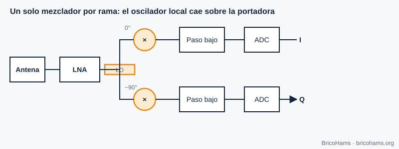
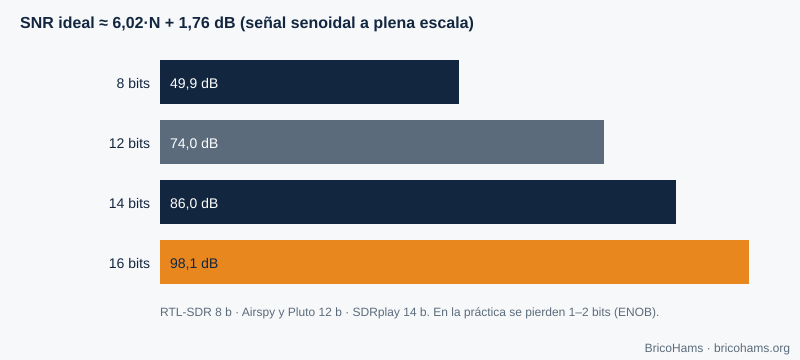

[ES](../es/05-hardware-sdr.md) · [EN](../en/05-hardware-sdr.md) · [FR](../fr/05-hardware-sdr.md) · [PT](../pt/05-hardware-sdr.md)

# 5. Matériel SDR

## Objectifs

- Comparer les architectures à FI nulle et à FI basse.
- Relier les bits du CAN à la plage dynamique.
- Reconnaître les fuites de l'oscillateur local et le déséquilibre I/Q.
- Comprendre le rôle de l'horloge (TCXO, GPSDO) et choisir une SDR dans `hardware/bom/components.csv`.

## 5.1 Architectures

**FI nulle (conversion directe).** Un oscillateur local à la fréquence d'intérêt est multiplié par le signal sur deux branches déphasées de 90°. Après un filtre passe-bas et deux CAN, on obtient I et Q. C'est l'architecture de la plupart des SDR (le RTL-SDR n'en est pas : il utilise une FI basse ; l'ADALM-Pluto avec l'AD9363, oui).

*Figure 11 : Récepteur à FI nulle.*

**FI basse.** L'oscillateur tombe un peu à côté du signal, et celui-ci se retrouve sur une petite fréquence intermédiaire, où le CAN l'échantillonne. On évite les problèmes de composante continue de la FI nulle, mais il faut rejeter la fréquence image.

| | FI nulle | FI basse |
|---|---|---|
| Largeur de bande | Élevée (I et Q séparés) | Plus faible |
| Problème typique | DC, déséquilibre I/Q, fuite du LO | Fréquence image |
| Complexité | Faible | Moyenne |

## 5.2 Convertisseur analogique-numérique

Un CAN de *N* bits offre au maximum 2^N niveaux. Pour une sinusoïde à pleine échelle, le rapport signal sur bruit de quantification est ≈ **6,02·N + 1,76 dB**.

*Figure 12 : Plage dynamique du CAN.*

| Bits | Plage théorique |
|---|---|
| 8 | 49,9 dB |
| 12 | 74,0 dB |
| 14 | 86,0 dB |
| 16 | 98,1 dB |

La plage réelle est plus faible (bruit propre du CAN, ENOB). Un RTL-SDR de 8 bits supporte mal un signal fort proche d'un signal faible (par exemple un émetteur TV à côté de QO-100) ; un SDRplay de 14 bits s'en sort nettement mieux. Sur QO-100, la FI contient la bande du satellite, où la balise est bien plus forte qu'un signal FT8 faible : la dynamique compte.

## 5.3 Imperfections de la FI nulle

- **Fuite du LO (LO leakage) :** une partie de l'oscillateur apparaît en sortie comme un pic à 0 Hz du spectre I/Q. On la corrige en soustrayant la composante continue ou en décalant le centre de quelques kHz.
- **Déséquilibre I/Q :** les deux branches ne sont pas identiques (différence de gain ε et de phase φ). Une *image* de chaque signal apparaît à la fréquence opposée. Réjection d'image ≈ 10·log₁₀(4 / (ε² + φ²)) : avec ε = 1 % et φ = 1° (0,01745 rad), 4 / (0,0001 + 0,000305) ≈ 9877 → ≈ **40 dB**.
- **Décalage continu (DC) :** le CAN a un niveau résiduel ; on le voit aussi à 0 Hz.

## 5.4 L'horloge : TCXO et GPSDO

Toutes les fréquences de la SDR dérivent d'un quartz. Une erreur de *p* ppm décale un signal à *f* de *p·f·10⁻⁶* Hz. Un quartz à 1 ppm sur 739,75 MHz donnerait 740 Hz ; sur l'oscillateur du LNB, à 9750 MHz, 1 ppm font **9,75 kHz**. C'est pourquoi la dérive du LNB (et non celle de la SDR) domine sur QO-100 (chapitre 7).

- **TCXO** : quartz compensé en température (±0,5 à ±2 ppm).
- **GPSDO** : oscillateur asservi par GPS (de 10⁻⁹ à 10⁻¹¹) ; partager la référence entre TX et RX évite les dérives relatives.

## 5.5 Les SDR de ce projet

La liste complète se trouve dans [`hardware/bom/components.csv`](../../../hardware/bom/components.csv) ; le comparatif, dans [`hardware/bom/comparison.md`](../../../hardware/bom/comparison.md).

| Usage | Exemples de la liste | Notes |
|---|---|---|
| RX de la FI | RTL-SDR Blog V3/V4 (8 bits), Airspy Mini/R2 (12 bits), SDRplay RSP1B (14 bits) | TCXO de 0,5–1 ppm ; le bias-T de la clé ne remplace pas l'injecteur |
| TX 2,4 GHz | ADALM-Pluto (AD9363, 12 bits, ≈ 20 MHz de largeur), HackRF One (8 bits), LimeSDR Mini 2.0, USRP B200mini-i (AD9364, 56 MHz, entrée de 10 MHz) | La puissance de sortie est faible : il faut un PA, un filtre et un wattmètre |
| Alternative HF | Hermes Lite 2 | Uniquement avec transverter ; ne branchez pas la FI du LNB sur son entrée |

L'AD9363 de la Pluto est un émetteur-récepteur intégré couvrant officiellement 325–3800 MHz, donc 2,4 GHz y entre sans problème ; son oscillateur peu précis est compensé par la correction par balise de BricoHams. Ces marques apparaissent comme exemples techniques et n'impliquent aucun lien avec BricoHams.

## Comment BricoHams le fait

- Configure la SDR via SDRangel : [`src/sdrangel/client.js`](../../../src/sdrangel/client.js).
- Calcule les décalages d'oscillateur dans [`src/modes/frequencies.js`](../../../src/modes/frequencies.js) (`downlinkToIf`, `ifToDownlink`).
- Compense la dérive du LNB avec la balise : [`src/beacon/index.js`](../../../src/beacon/index.js).
- Guide matériel : [`hardware/README.md`](../../../hardware/README.md) et [`docs/help/equipos-y-programas.md`](../../help/equipos-y-programas.md).

## Exercices

1. Quelle plage dynamique théorique a un CAN de 10 bits ?
2. Un oscillateur de 25 MHz à 2 ppm : de combien se décale-t-il à 739,75 MHz ?
3. Quelle est la réjection d'image avec ε = 2 % et φ = 2° ?
4. Quel LO de LNB correspond à une FI de 739,75 MHz pour 10 489,75 MHz ?

### Solutions

1. 6,02 × 10 + 1,76 = **62 dB**.
2. 2 ppm × 739,75 MHz = **1,48 kHz**.
3. ε² = 0,0004 ; φ = 0,0349 rad → φ² = 0,00122 ; somme = 0,00162 ; 4 / 0,00162 = 2469 → **≈ 34 dB**.
4. 10 489,75 − 739,75 = **9750 MHz**.

Lecture recommandée : Collins et al., Software-Defined Radio for Engineers, ch. 5
