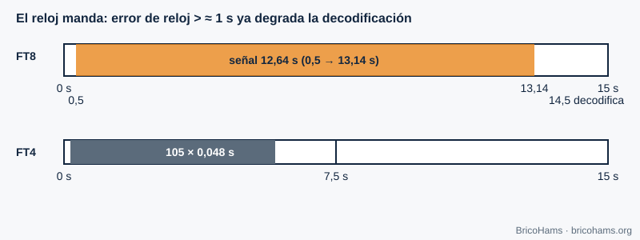

[ES](../es/06-sincronizacion-de-tiempo.md) · [EN](../en/06-sincronizacion-de-tiempo.md) · [FR](../fr/06-sincronizacion-de-tiempo.md) · [PT](../pt/06-sincronizacion-de-tiempo.md)

# 6. Synchronisation temporelle

## Objectifs

- Comprendre ce qu'est la synchronisation symbole et pourquoi il faut la réaliser.
- Calculer la structure temporelle du FT8 et du FT4.
- Savoir pourquoi l'horloge UTC de votre ordinateur fait partie de la station.

## 6.1 Trois niveaux de temps

1. **Échantillon** : l'horloge du CAN fixe quand chaque échantillon est pris.
2. **Symbole** : il faut savoir *à quel échantillon* commence chaque symbole ; si le récepteur échantillonne juste entre deux symboles, le bruit et l'interférence entre symboles augmentent.
3. **Trame ou créneau** : il faut savoir quand commence le message complet.

Les récepteurs classiques ajustent l'instant d'échantillonnage avec une boucle de poursuite (détecteur d'erreur de synchronisation qui mesure si l'échantillon tombe en avance ou en retard par rapport au centre du symbole). Les modes à créneau fixe comme le FT8 résolvent le problème autrement : un **premier réglage grossier par l'horloge UTC** et un **réglage fin par corrélation** avec une séquence de synchronisation (chapitre 8).

## 6.2 Créneaux FT8 et FT4

Le FT8 émet dans des créneaux de 15 s alignés sur les secondes 0, 15, 30 et 45 de chaque minute UTC. Le signal commence 0,5 s après le début et dure 79 × 0,16 = 12,64 s. Le décodeur démarre vers 14,5 s. Le FT4 utilise des créneaux de 7,5 s : 105 symboles × 0,048 s = 5,04 s de signal.

*Figure 22 : Créneaux UTC du FT8 et du FT4.*

Le récepteur ne sait pas exactement quand l'émetteur a commencé : son horloge a une erreur. Il recherche par corrélation le décalage temporel *dt* (en secondes) et l'indique avec le message. Avec une horloge bien réglée, *dt* devrait être proche de 0 ; si tous vos contacts affichent un *dt* similaire, le décalage vient de chez vous.

**Exemple.** À 12 kS/s, une erreur de 0,1 s représente 1200 échantillons, un peu plus d'un demi-symbole (1920 échantillons). Une erreur de 1 s équivaut à 12 000 échantillons (6,25 symboles) : le bloc Costas est tellement décalé que la synchronisation fine ne le retrouve plus à sa place.

## 6.3 UTC et NTP

Un PC synchronisé par **NTP** a généralement une erreur de quelques dizaines de millisecondes : largement suffisant. Un PC non synchronisé peut dériver de plusieurs secondes par semaine. Sur une station distante, c'est l'horloge du serveur qui compte. La latence réseau (WebRTC, WebSocket) ne change pas l'horloge de décodage, elle ne fait que retarder l'image que voit l'utilisateur.

QO-100 ajoute un retard de propagation de ≈ 0,25 s par saut (≈ 36 000 km à la montée et autant à la descente, à la vitesse de la lumière). Le FT8 le tolère sans problème, mais cela compte dans les conversations en phonie.

## Comment BricoHams le fait

- `utcSlot` calcule le créneau UTC du FT8 et du FT4 dans [`src/modes/decoders.js`](../../../src/modes/decoders.js).
- Le décodeur de créneau (dans un thread séparé pour ne pas bloquer le serveur) : [`src/modes/slot-decoder.js`](../../../src/modes/slot-decoder.js) et [`src/modes/decode-service.js`](../../../src/modes/decode-service.js).
- Le décalage temporel de chaque décodage (`dtSec`) est calculé par [`src/modes/ft8-decode.js`](../../../src/modes/ft8-decode.js).
- Recommandation sur l'horloge dans [`docs/help/solucion-de-problemas.md`](../../help/solucion-de-problemas.md).

## Exercices

1. Combien d'échantillons y a-t-il dans un créneau FT8 à 12 kS/s ?
2. Combien d'échantillons dure un symbole FT4 à 12 kS/s ?
3. Si votre horloge retarde de 0,8 s, de combien de symboles FT8 êtes-vous décalé ?
4. Combien de temps le signal met-il pour aller de la station au satellite puis revenir vers une autre station au sol ?

### Solutions

1. 15 × 12 000 = **180 000** échantillons.
2. 0,048 × 12 000 = **576** échantillons.
3. 0,8 / 0,16 = **5 symboles**.
4. ≈ 36 000 km × 2 / 300 000 km/s ≈ **0,24–0,26 s** (davantage selon la géométrie).

Lecture recommandée : Collins et al., Software-Defined Radio for Engineers, ch. 6
