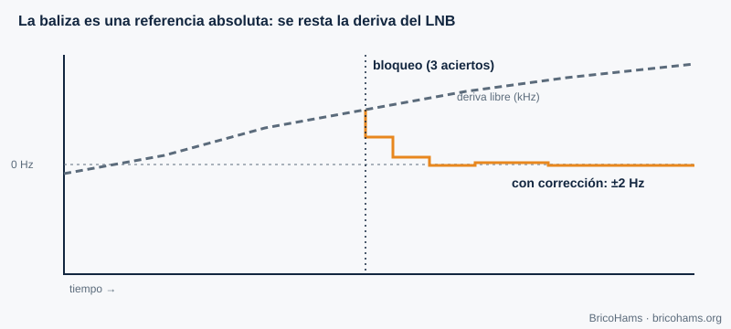
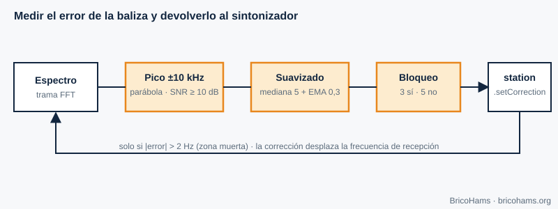

[ES](../es/07-sincronizacion-de-portadora.md) · [EN](../en/07-sincronizacion-de-portadora.md) · [FR](../fr/07-sincronizacion-de-portadora.md) · [PT](../pt/07-sincronizacion-de-portadora.md)

# 7. Synchronisation de porteuse

## Objectifs

- Comprendre pourquoi un décalage de fréquence apparaît et quelle est sa valeur sur QO-100.
- Expliquer comment une balise sert de référence absolue.
- Suivre pas à pas l'algorithme de `src/beacon/`.

## 7.1 Décalage de fréquence

L'émetteur et le récepteur utilisent des oscillateurs différents. Si le récepteur se cale sur *f₀* mais que la porteuse arrive à *f₀ + Δf*, le signal en bande de base tourne à Δf hertz. Avec la BPSK ou la QPSK, cette rotation détruit la décision : il faut estimer et corriger *Δf* (et la phase) avant de démoduler.

Sur QO-100, il y a trois sources de décalage :

| Source | Ordre de grandeur |
|---|---|
| Oscillateur du LNB (9750 MHz) | 1 ppm ≈ 9,75 kHz ; les LNB bon marché dérivent de dizaines ou centaines de kHz avec la température |
| Oscillateur de la SDR (739,75 MHz) | 1 ppm ≈ 740 Hz (moins avec un TCXO) |
| Oscillateur de la station émettrice | idem, à 2,4 GHz |
| Doppler du satellite GEO | très faible (chapitre 9) |

*Figure 13 : Dérive du LNB et correction par la balise.*

## 7.2 Techniques de récupération

- **Boucle à verrouillage de phase (PLL) ou de Costas** : un oscillateur commandé qui poursuit la phase de la porteuse par rétroaction. Convient à la PSK à faible bruit.
- **Estimation en boucle ouverte** : élever le signal à la puissance *M* supprime la modulation PSK et laisse un ton à *M·Δf* que l'on mesure avec une FFT.
- **Pilote ou balise** : un signal connu à fréquence connue permet de mesurer directement l'erreur.

Le FT8 et le FT4 utilisent une FSK non cohérente et tolèrent des décalages de plusieurs dizaines de hertz car le décodeur cherche le ton ; mais dans une station bidirectionnelle, ce qui pèse, c'est que le **LNB dérive** (cela change l'endroit où l'on voit les autres) et que votre **émission** tombe là où elle doit. La balise résout les deux.

## 7.3 La balise comme récupération de porteuse

QO-100 NB rayonne une porteuse continue très stable que le satellite génère avec sa propre référence. Si le LNB et la SDR sont décalés, cette balise **n'est pas là où elle devrait être** : l'écart mesuré est exactement l'erreur cumulée de toute la chaîne de réception.

*Figure 20 : Boucle de correction par la balise.*

L'algorithme de [`src/beacon/index.js`](../../../src/beacon/index.js) se compose de trois éléments :

1. **`estimateBeaconOffset`** (fonction pure). Elle reçoit un spectre en dB, la fréquence centrale, la largeur de bin et la fréquence attendue de la balise. Elle définit une fenêtre de ±10 kHz autour de la position attendue, cherche le maximum, calcule le SNR comme *pic − médiane de la fenêtre* et exige ≥ 10 dB. Elle écarte les maxima en bord de fenêtre. Avec les trois bins autour du pic (a, b, c), elle fait une **interpolation parabolique** : δ = 0,5·(a−c)/(a−2b+c), limité à ±0,5 bin. La fréquence du pic est *centre + (bin + δ − N/2)·binHz* ; le décalage est la différence avec la fréquence attendue.
2. **`createBeaconFilter`**. Il transforme des mesures bruitées en une estimation stable : médiane des 5 dernières détections (écarte les valeurs aberrantes), moyenne mobile exponentielle avec α = 0,3 (lissage), et une hystérésis : **verrouillage** après 3 détections consécutives et **perte de verrouillage** après 5 échecs consécutifs. Ainsi un échec isolé ne fait pas osciller l'état.
3. **`createBeaconController`**. À chaque trame de spectre, il appelle les deux fonctions précédentes ; s'il y a verrouillage et que le changement dépasse la **zone morte** de 2 Hz, il appelle `station.setCorrection(offsetHz, 'beacon')`. Si le verrouillage est perdu, il conserve la dernière correction (*holdover*) et marque `no-lock`.

**Exemple.** Spectre de 1024 bins avec *binHz* = 100 Hz centré sur 739,75 MHz (la balise attendue tombe dans le bin 512). Pic dans le bin 520, voisins égaux → δ = 0 → décalage = 8 bins × 100 Hz = **+800 Hz**. Le contrôleur décale le centre de réception de +800 Hz et, lorsque l'émetteur est inactif, celui d'émission de −800 Hz (la correction est appliquée de façon cohérente des deux côtés).

Les raisons de la méthode choisie figurent dans [`docs/adr/0008-beacon-correction-method.md`](../../adr/0008-beacon-correction-method.md).

## Comment BricoHams le fait

- Algorithme et API : [`src/beacon/index.js`](../../../src/beacon/index.js) et son [`README`](../../../src/beacon/README.md).
- Application de la correction à la station : `setCorrection` dans [`src/modes/station.js`](../../../src/modes/station.js).
- Origine des trames de spectre : [`src/webrtc/spectrum.js`](../../../src/webrtc/spectrum.js).
- Tests : [`test/unit/beacon.test.js`](../../../test/unit/beacon.test.js).
- Attention : la fréquence de balise par défaut du dépôt est 10 489,750 MHz et elle est configurable ; confirmez-la auprès des sources officielles d'AMSAT-DL avant de vous y fier.

## Exercices

1. Avec *binHz* = 100 et un pic dans le bin 507 (attendu 512), quel est le décalage ?
2. Voisins a, b, c = −62, −55, −60 dB. Combien vaut δ ?
3. Combien de bonnes mesures faut-il pour s'accrocher ? Et de mauvaises pour décrocher ?
4. Pourquoi la médiane avant la moyenne ?

### Solutions

1. (507 − 512) × 100 = **−500 Hz**.
2. δ = 0,5·(−62 − (−60)) / (−62 − 2·(−55) − 60) = 0,5·(−2)/(−12) ≈ **+0,083 bin** (≈ 8 Hz).
3. 3 et 5 respectivement.
4. La médiane écarte les *outliers* (un pic parasite) qui fausseraient la moyenne.

Lecture recommandée : Collins et al., Software-Defined Radio for Engineers, ch. 7
