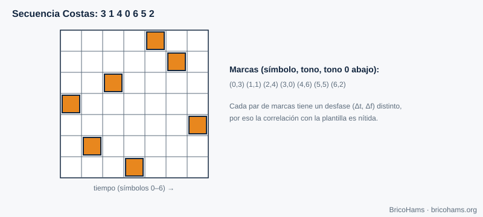
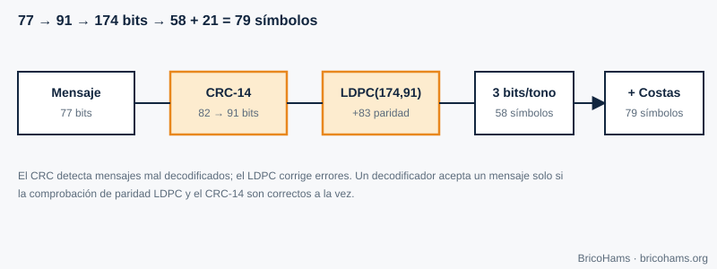
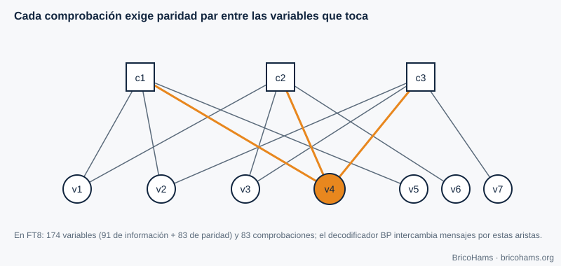

[ES](../es/08-tramas-y-codificacion.md) · [EN](../en/08-tramas-y-codificacion.md) · [FR](../fr/08-tramas-y-codificacion.md) · [PT](../pt/08-tramas-y-codificacion.md)

# 8. Trames et codage

## Objectifs

- Expliquer à quoi servent les mots de synchronisation et les matrices de Costas.
- Calculer un CRC et comprendre ce qu'il détecte.
- Décrire comment un code LDPC corrige les erreurs et ce qu'est le graphe de Tanner.
- Suivre le chemin d'un message FT8 de 77 bits à 79 symboles.

## 8.1 Synchronisation de trame

Même si l'horloge UTC donne une idée du début du créneau, le récepteur doit localiser avec précision le début et la fréquence du message. On inclut un motif connu (un **mot de synchronisation**) et on le corrèle avec le signal reçu. Un bon motif a une autocorrélation avec un seul pic marqué.

Le FT8 utilise trois blocs de 7 symboles, aux positions 0–6, 36–42 et 72–78, selon une **matrice de Costas** : la séquence de tons 3, 1, 4, 0, 6, 5, 2.

*Figure 14 : Matrice de Costas.*

Dans une matrice de Costas, pour chaque paire de marques, le décalage relatif (temps, fréquence) est unique. Ainsi, si l'on décale le gabarit d'un symbole ou d'un ton, presque toutes les marques échouent : le pic de corrélation est net sur les deux axes (temps et fréquence) à la fois. 21 des 79 symboles sont de la synchronisation.

## 8.2 Détection d'erreurs : CRC

Un **CRC (contrôle de redondance cyclique)** divise le message, vu comme un polynôme binaire, par un polynôme générateur et ajoute le reste. Le récepteur refait le calcul : s'il ne coïncide pas, le message est endommagé. Le FT8 utilise un **CRC de 14 bits** avec le polynôme `0x2757` sur 82 bits (les 77 du message plus 5 zéros), et ajoute les 14 bits à la fin : 77 + 14 = 91 bits.

Un CRC de 14 bits laisse passer un message corrompu aléatoire avec une probabilité de 2⁻¹⁴ ≈ 6·10⁻⁵ (1 sur 16 384). C'est peu, mais avec des centaines de candidats par créneau, ce n'est pas nul ; il convient donc de vérifier aussi que le texte décodé a un sens.

*Figure 16 : Flux de codage CRC et LDPC.*

## 8.3 Correction d'erreurs : LDPC (174, 91)

Un code en blocs (*n*, *k*) convertit *k* bits d'information en *n* bits transmis. Avec *n* = 174 et *k* = 91, le **rendement** est 91/174 ≈ 0,52 : on envoie presque le double de bits, mais grâce à cette redondance, le récepteur peut reconstruire le message même avec beaucoup de bits erronés.

Un **code LDPC** est défini par une matrice de contrôle de parité *H* creuse (peu de uns). Chaque ligne est une **équation de parité** : les bits qu'elle touche doivent sommer à zéro (modulo 2). Le FT8 a 83 équations (174 − 91) et chaque bit participe à exactement 3 d'entre elles.

Le **graphe de Tanner** représente cette matrice : nœuds de variable (bits), nœuds de contrôle (équations) et une arête pour chaque 1 de *H*.

*Figure 15 : Graphe de Tanner.*

**Décodage par propagation de croyance (BP).** Le démodulateur ne fournit pas des zéros et des uns durs, mais des **probabilités** (rapports de vraisemblance logarithmiques, LLR) pour chaque bit. On échange des messages le long des arêtes : chaque variable informe ses contrôles de ce qu'elle croit ; chaque contrôle indique aux variables quelle valeur elles devraient avoir pour que la parité tombe juste. Après plusieurs itérations, les croyances convergent ; si tous les contrôles sont satisfaits et que le CRC coïncide, le message est valide.

**Exemple.** Le FT8 annonce des décodages jusqu'à ≈ −21 dB de SNR dans 2,5 kHz (valeur indicative ; dépend de l'implémentation). Un schéma sans codage demanderait bien plus de SNR pour un BER acceptable (chapitre 3) : la redondance achète plusieurs dB de seuil.

## 8.4 Du bit au ton

Les 174 bits sont groupés par 3 : 58 symboles de données, chacun avec 8 tons possibles. Avec les 21 symboles Costas, cela fait 79 symboles de 0,16 s. Le FT4 suit le même principe avec 87 symboles de données, 4×4 symboles Costas et un masque XOR de brouillage (pour éviter les motifs répétés).

## Comment BricoHams le fait

- Tables et dimensions : [`src/modes/ft8-tables.js`](../../../src/modes/ft8-tables.js) (`LDPC_N = 174`, `LDPC_K = 91`, `LDPC_M = 83`).
- CRC et LDPC (`computeCrc`, `addCrc`, `encode174`, `ldpcCheck`, `bpDecode`) : [`src/modes/ft8-ldpc.js`](../../../src/modes/ft8-ldpc.js).
- Empaquetage du texte du message en 77 bits : [`src/modes/ft8-message.js`](../../../src/modes/ft8-message.js).
- Tests : [`test/unit/ft8.test.js`](../../../test/unit/ft8.test.js).

## Exercices

1. Quelle fraction des symboles FT8 est de la synchronisation ?
2. Combien de bits de parité LDPC(174, 91) ajoute-t-il ?
3. Si la probabilité d'erreur par bit est de 0,1, quelle est la probabilité que 3 bits consécutifs soient corrects ?
4. Pourquoi un CRC ne peut-il pas corriger d'erreurs alors qu'un LDPC le peut ?

### Solutions

1. 21 / 79 ≈ **26,6 %**.
2. 174 − 91 = **83**.
3. 0,9³ = **0,729**.
4. Le CRC n'offre qu'un résumé de contrôle ; il n'a pas assez de redondance structurée pour localiser les erreurs. Le LDPC répartit la redondance en équations qui se recoupent et permettent d'estimer quels bits sont fautifs.

Lecture recommandée : Collins et al., Software-Defined Radio for Engineers, ch. 8
