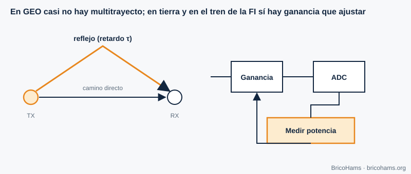

[ES](../es/09-canal-y-ecualizacion.md) · [EN](../en/09-canal-y-ecualizacion.md) · [FR](../fr/09-canal-y-ecualizacion.md) · [PT](../pt/09-canal-y-ecualizacion.md)

# 9. Canal et égalisation

## Objectifs

- Décrire le canal de QO-100 et le comparer à un canal terrestre.
- Estimer le Doppler d'un satellite géostationnaire.
- Comprendre les trajets multiples, l'égalisation et le contrôle automatique de gain (CAG).

## 9.1 Un canal presque idéal

La liaison QO-100 est en visibilité directe, avec un transpondeur en orbite géostationnaire à environ 36 000 km. Le canal ressemble beaucoup à un **canal AWGN** (bruit blanc gaussien additif) : affaiblissement fixe, retard constant et bruit. Ses défauts réels sont faibles :

- **Affaiblissement atmosphérique et pluie** à 10,489 GHz : de quelques dixièmes de dB à quelques dB sous forte pluie.
- **Perte de pointage** (chapitre 11).
- **Polarisation** : un LNB et un cornet mal orientés perdent du signal.
- **Interférences** de liaisons terrestres, et saturation du transpondeur par des signaux forts.

## 9.2 Doppler en orbite géostationnaire

Le décalage Doppler est *Δf = f·v/c*. Un satellite GEO n'est pas parfaitement immobile : ses petites oscillations quotidiennes d'inclinaison produisent des vitesses radiales de l'ordre de quelques mètres par seconde au plus. Avec *v* = 1 m/s (illustratif) :

- à 10,489 GHz : Δf ≈ 10,489·10⁹ / 3·10⁸ ≈ **35 Hz** ;
- à 2,4 GHz : ≈ **8 Hz**.

Face aux ±kHz de dérive du LNB, c'est négligeable, et c'est pourquoi BricoHams ne mesure que la correction par balise et ne calcule pas d'éphémérides Doppler. Sur les satellites LEO (quelques centaines de km), en revanche, le Doppler atteint des dizaines de kHz.

## 9.3 Trajets multiples et égalisation

Au sol, le signal arrive par des chemins de retards différents ; ses copies s'additionnent avec des phases différentes et produisent des **évanouissements sélectifs en fréquence**. Un **égaliseur** estime la réponse du canal (avec une séquence d'apprentissage ou en aveugle) et applique un filtre inverse. Sur QO-100, le trajet spatial n'a pas de trajet multiple significatif ; le seul écho possible est la réflexion proche de la parabole.

*Figure 27 : Trajets multiples et CAG.*

## 9.4 Contrôle automatique de gain

Le **CAG** ajuste le gain du récepteur pour que le signal exploite bien la plage du CAN : ni trop bas pour ne pas se perdre dans le bruit de quantification, ni trop haut pour ne pas saturer. Sur QO-100, le CAG peut être un piège : la balise, forte, fait baisser le gain et réduit le signal faible. Les récepteurs SDR utilisent donc un gain manuel ou un CAG à constantes de temps lentes.

**Exemple.** Si la balise arrive à −50 dBFS et le bruit à −90 dBFS, il y a 40 dB de marge au-dessus du bruit et 50 dB jusqu'à la saturation ; un signal FT8 à −85 dBFS survit. Si vous montez le gain de 20 dB, la balise passe à −30 dBFS : elle tient encore, mais un voisin fort (un signal SSB 10 dB plus puissant) rapprocherait déjà de la saturation.

## Comment BricoHams le fait

- La station n'utilise pas le Doppler : elle corrige uniquement par la balise ([`src/beacon/`](../../../src/beacon/README.md)).
- Le niveau de réception et l'audio sont normalisés dans [`src/webrtc/rx-audio.js`](../../../src/webrtc/rx-audio.js).
- Le profil de réception (filtre et DSP) : [`src/modes/rx-profile.js`](../../../src/modes/rx-profile.js).
- Détails du canal dans le guide [`docs/help/qo100-fundamentos.md`](../../help/qo100-fundamentos.md).

## Exercices

1. Δf à 10,489 GHz avec *v* = 3 m/s.
2. Quel retard aller-retour en phonie (avec un seul saut) ?
3. Pourquoi n'utilise-t-on pas de CAG rapide sur la FI de QO-100 ?
4. Deux copies avec des retards de 0 et 1 µs. À quelle fréquence tombe le premier nul ?

### Solutions

1. 3 × 35 = **≈ 105 Hz**.
2. Chaque saut ≈ 0,25 s ; aller-retour ≈ **0,5 s**.
3. La balise, bien plus forte, ferait baisser le gain de tout le spectre par le CAG et les signaux faibles se perdraient.
4. Nul lorsque le retard vaut un demi-cycle : 1/(2 × 1 µs) = **500 kHz**.

Lecture recommandée : Collins et al., Software-Defined Radio for Engineers, ch. 9
