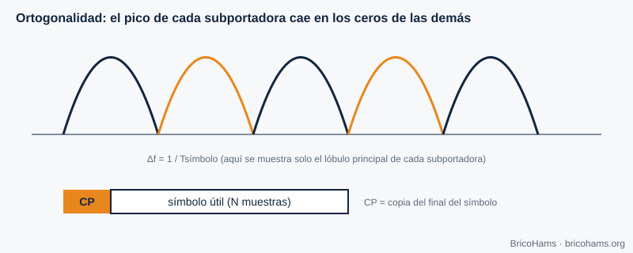
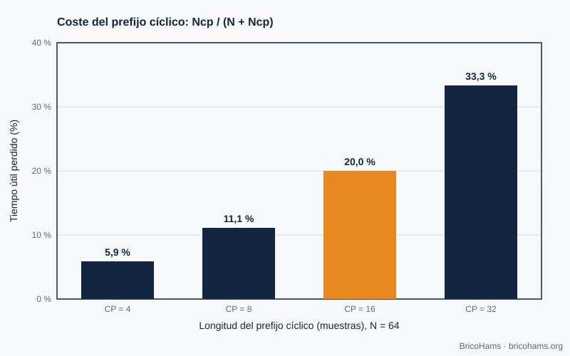

[ES](../es/10-ofdm.md) · [EN](../en/10-ofdm.md) · [FR](../fr/10-ofdm.md) · [PT](../pt/10-ofdm.md)

# 10. OFDM

## Objectifs

- Comprendre l'idée des sous-porteuses orthogonales et du préfixe cyclique.
- Calculer le coût du préfixe.
- Savoir pourquoi la bande étroite de QO-100 n'utilise pas l'OFDM et où il apparaît (bande large, DATV).

## 10.1 L'idée

Un signal à large bande subit des évanouissements sélectifs en fréquence. L'OFDM répartit les données sur de nombreuses **sous-porteuses** étroites et lentes, de sorte que chacune voit un canal quasi plat. Les sous-porteuses sont espacées exactement de *Δf = 1/T* (où *T* est la durée utile du symbole) : les maxima de chacune tombent sur les zéros des autres (**orthogonalité**) et elles n'interfèrent pas même si leurs spectres se recouvrent.

*Figure 28 : Sous-porteuses OFDM.*

L'émetteur génère toutes les sous-porteuses d'un coup avec une **FFT inverse** de *N* points ; le récepteur les sépare avec une FFT. Cela explique pourquoi l'OFDM est pratique en logiciel.

## 10.2 Préfixe cyclique

Avant chaque symbole, on copie la fin du symbole lui-même (**préfixe cyclique, CP**). Si le retard des trajets multiples est inférieur au CP, l'interférence entre symboles disparaît et le canal se réduit à un facteur complexe par sous-porteuse, facile à égaliser. Le coût est l'efficacité : la surcharge est *CP / (N + CP)*.

*Figure 25 : Surcharge du préfixe cyclique OFDM.*

Avec *N* = 64 :

| CP | Surcharge |
|---|---|
| 4 | 5,9 % |
| 8 | 11,1 % |
| 16 | **20 %** |
| 32 | 33,3 % |

## 10.3 Et QO-100 ?

- **Bande étroite (NB, 500 kHz)** : ses signaux (SSB, CW, FT8) sont étroits (≤ 3 kHz) et le canal spatial est plat ; il n'y a pas de sélectivité en fréquence que l'OFDM pourrait compenser. Le FT8 est d'ailleurs bien plus efficace avec sa FSK de 50 Hz de largeur et un code puissant.
- **Bande large (WB, ≈ 8 MHz)** : elle transporte de la télévision numérique amateur (DATV) avec la norme de télévision par satellite DVB-S2, qui utilise une **modulation à porteuse unique** (QPSK/8PSK) et un LDPC plus long. L'OFDM apparaît surtout dans les transmissions terrestres (DVB-T) ou le Wi-Fi. Consultez les informations actuelles d'AMSAT-DL et du BATC pour les paramètres en vigueur.

La leçon générale est d'ingénierie : on choisit la modulation qui convient au canal. Sur un canal quasi AWGN à puissance limitée, une porteuse unique avec un bon codage est plus simple et plus efficace.

## Comment BricoHams le fait

BricoHams n'implémente pas l'OFDM. La partie bande large est hors du périmètre du dépôt ; la station se concentre sur la bande étroite. Ce qui touche au spectre :

- Visualisation du spectre de FI : [`src/webrtc/spectrum.js`](../../../src/webrtc/spectrum.js) et [`src/web/public/scope-math.js`](../../../src/web/public/scope-math.js).
- Plan de bande de la NB : [`src/modes/bandplan.js`](../../../src/modes/bandplan.js).
- La FFT utilisée par les décodeurs FT8/FT4 : [`src/modes/ft8-fft.js`](../../../src/modes/ft8-fft.js).

## Exercices

1. Avec *N* = 64 et CP = 16, combien d'échantillons compte chaque symbole transmis ?
2. Si le symbole dure 3,2 µs utiles, combien vaut Δf ?
3. Quelle est la surcharge avec *N* = 128 et CP = 16 ?
4. Pourquoi le FT8 n'a-t-il pas besoin d'égaliseur ?

### Solutions

1. 64 + 16 = **80**.
2. 1 / 3,2 µs = **312,5 kHz**.
3. 16 / 144 = **11,1 %**.
4. Chaque ton dure 0,16 s et le canal est plat sur 50 Hz ; la détection non cohérente par énergie n'a pas besoin d'estimer la réponse.

Lecture recommandée : Collins et al., Software-Defined Radio for Engineers, ch. 10
