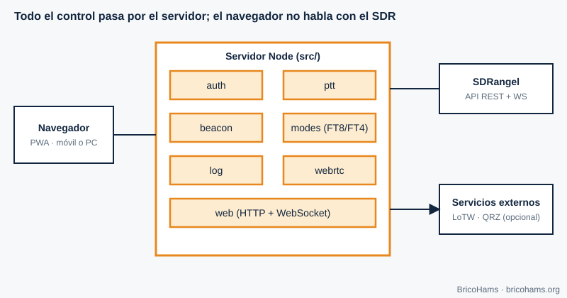
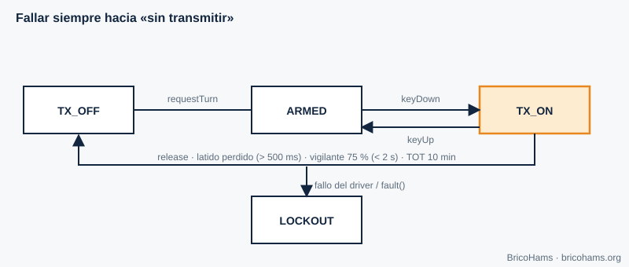
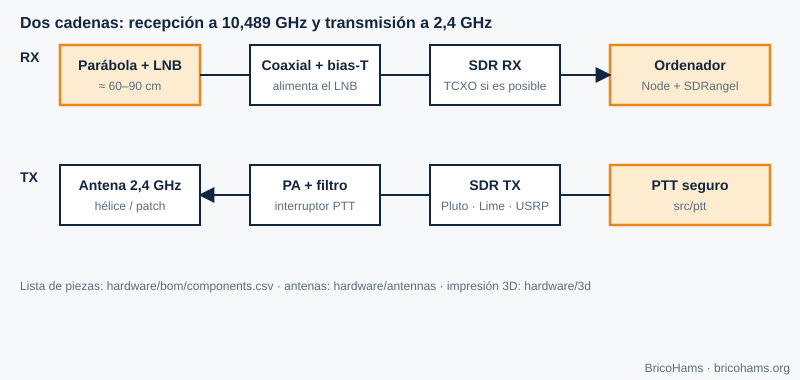

[ES](../es/11-aplicaciones-qo100.md) · [EN](../en/11-aplicaciones-qo100.md) · [FR](../fr/11-aplicaciones-qo100.md) · [PT](../pt/11-aplicaciones-qo100.md)

# 11. Applications sur QO-100 : la station BricoHams

## Objectifs

- Voir comment tous les concepts s'intègrent dans une station complète.
- Connaître chaque module de BricoHams, sa responsabilité et sa sécurité.
- Vous orienter pour construire votre propre station avec le dossier `hardware/`.

## 11.1 Architecture

*Figure 18 : Architecture BricoHams.*

Le navigateur (une PWA) ne dialogue jamais avec la SDR : c'est le serveur Node (`src/`) qui le fait, en orchestrant SDRangel via son API REST et son WebSocket. Authentification avec Google (OpenID Connect) et liste d'utilisateurs autorisés ; tout le trafic est chiffré.

| Module | Responsabilité | Code |
|---|---|---|
| `auth` | Connexion (OIDC), sessions, rôles | [`src/auth/`](../../../src/auth/) |
| `ptt` | Tour exclusif, battement de cœur (heartbeat), durée maximale d'émission, audit | [`src/ptt/`](../../../src/ptt/README.md) |
| `beacon` | Correction par la balise (chapitre 7) | [`src/beacon/`](../../../src/beacon/README.md) |
| `modes` | Accord, FT8/FT4/CW, RIT/XIT, mémoires | [`src/modes/`](../../../src/modes/README.md) |
| `sdrangel` | Client et pilote de PTT vers SDRangel | [`src/sdrangel/`](../../../src/sdrangel/index.js) |
| `webrtc` | Audio RX/TX et trames de spectre | [`src/webrtc/`](../../../src/webrtc/index.js) |
| `log` | Journal de trafic, ADIF, LoTW et QRZ | [`src/log/`](../../../src/log/index.js) |
| `web` | Interface PWA | [`src/web/public/`](../../../src/web/public/index.html) |

## 11.2 PTT en sécurité

Mal émettre peut endommager le matériel, brouiller le reste du transpondeur ou enfreindre la licence. La machine à états de [`src/ptt/`](../../../src/ptt/index.js) est conçue pour **se replier vers « ne pas émettre »**.

*Figure 19 : Machine à états du PTT.*

- Un seul titulaire du tour à la fois.
- Le navigateur envoie un **battement de cœur toutes les 500 ms** ; s'il cesse d'arriver, un chien de garde coupe avant l'échéance de la limite (à 75 %, toujours en dessous de 2 s).
- **TOT** (durée maximale d'émission) : 10 minutes par défaut.
- Si le pilote ne confirme pas l'« arrêt », l'état passe à **LOCKOUT** ; seul un propriétaire muni d'un code à usage unique peut en sortir.
- Chaque émission est enregistrée ; si elle ne peut pas l'être, on n'émet pas.

Justification : [`docs/adr/0005-ptt-fail-safe-state-machine.md`](../../adr/0005-ptt-fail-safe-state-machine.md).

## 11.3 Correction par la balise

Le module `beacon` mesure le spectre toutes les quelques secondes et, s'il détecte la balise avec un SNR suffisant, corrige la fréquence de réception et d'émission. Ainsi, le LNB bon marché devient, en pratique, une référence stable.

## 11.4 Journal de trafic : ADIF, LoTW et QRZ

Chaque contact est enregistré dans SQLite (module `node:sqlite` de Node). Il s'exporte en **ADIF 3.1** avec les champs satellite nécessaires à LoTW (`PROP_MODE=SAT`, `SAT_NAME=QO-100`, bandes 13 cm en montée et 3 cm en descente). L'envoi vers LoTW utilise l'outil TQSL (le certificat est géré par l'utilisateur) et celui vers QRZ Logbook utilise son API avec une clé conservée chiffrée. Détails : [`docs/help/log-lotw-qrz.md`](../../help/log-lotw-qrz.md).

## 11.5 Écoute publique avec OpenWebRX

Le plugin de [`plugins/openwebrx/`](../../../plugins/openwebrx/README.md) ajoute des marqueurs et une aide au décalage à OpenWebRX+, il est en **réception seule** et n'a aucun chemin vers l'émission.

## 11.6 Calculateurs

Pour dimensionner votre station : parabole, LNB, hélice, pointage et dérive du LNB se calculent dans [`services/qo100-calculators/`](../../../services/qo100-calculators/README.md).

## 11.7 Construisez votre station

*Figure 21 : Carte de construction de la station.*

1. **Réception** : parabole (≥ 80 cm recommandée), LNB (idéalement avec TCXO), coaxial, injecteur de polarisation, SDR de la liste. Guide : [`docs/help/construir-tu-estacion.md`](../../help/construir-tu-estacion.md), [`hardware/antennas/dish.md`](../../../hardware/antennas/dish.md) et [`hardware/antennas/lnb-y-referencias.md`](../../../hardware/antennas/lnb-y-referencias.md).
2. **Émission** : SDR d'émission, atténuateur, PA linéaire avec filtre, antenne hélice ([`helix-2g4.md`](../../../hardware/antennas/helix-2g4.md)) ou patch ([`poty-patch.md`](../../../hardware/antennas/poty-patch.md)) ; pièces imprimées en 3D dans [`hardware/3d/`](../../../hardware/3d/README.md).
3. **Mesures avant de rayonner** : un wattmètre et une charge fictive sont indispensables. Commencez avec la puissance minimale et vérifiez votre signal sur le récepteur.
4. **Installation du logiciel** : [`docs/help/instalacion-linux.md`](../../help/instalacion-linux.md), [`instalacion-windows.md`](../../help/instalacion-windows.md) ou [`instalacion-raspberry-pi.md`](../../help/instalacion-raspberry-pi.md).
5. **Premier démarrage** : [`docs/help/primera-puesta-en-marcha.md`](../../help/primera-puesta-en-marcha.md).

SDRangel, OpenWebRX+, TQSL, QRZ et les fabricants de matériel sont des projets et des entreprises indépendants ; BricoHams ne fait qu'interopérer avec eux et aucun ne le soutient.

## Exercices

1. Pourquoi est-ce le serveur, et non le navigateur, qui commande la SDR ?
2. Avec `heartbeatTimeoutMs` = 2000 ms, quand le chien de garde coupe-t-il ?
3. Si la balise dérive de +1500 Hz et que la zone morte est de 2 Hz, corrige-t-on ? Qu'applique-t-on au TX ?
4. Quels champs rendent un ADIF valide pour les satellites dans LoTW ?

### Solutions

1. Pour que les identifiants, la commande du PTT et la logique de sécurité ne dépendent pas d'un client susceptible de tomber en panne ou d'être manipulé.
2. À 75 % : **1,5 s**.
3. Oui (1500 > 2). RX = FI + 1500 Hz ; TX = montée nominale − 1500 Hz (lorsqu'il est inactif).
4. `PROP_MODE=SAT`, `SAT_NAME=QO-100`, `BAND`, `BAND_RX`, `FREQ` et `FREQ_RX`.

Lecture recommandée : Collins et al., Software-Defined Radio for Engineers, ch. 11
