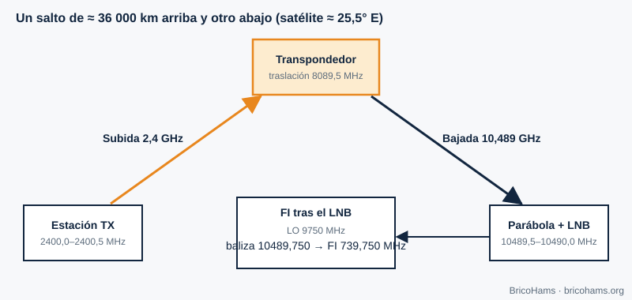

[ES](../es/01-que-es-sdr.md) · [EN](../en/01-que-es-sdr.md) · [FR](../fr/01-que-es-sdr.md) · [PT](../pt/01-que-es-sdr.md)

# 1. O que é um rádio definido por software?

## Objetivos

- Distinguir que parte de um rádio é hardware e que parte é software.
- Seguir o sinal do QO-100 desde o prato até ao texto de uma mensagem.
- Compreender porque um SDR vê toda a banda de uma só vez.

## 1.1 A ideia

Num rádio clássico, cada função (filtrar, desmodular, detetar) é um circuito analógico fixo. Num **rádio definido por software (SDR)** o hardware reduz-se ao imprescindível: uma antena, um amplificador, um conversor de frequência e um **conversor analógico-digital (ADC)**. A partir daí tudo são números. Mudar de SSB para FT8 ou para CW não exige soldar nada: executa-se outro programa sobre as mesmas amostras.

*Figura 1: Blocos de um SDR.*

A fronteira entre o mundo analógico e o digital desloca-se cada vez mais para a antena. O limite é marcado pelos ADC (quantos bits e quantas amostras por segundo) e pelo processador disponível.

## 1.2 A cadeia do QO-100

O sinal que nos interessa desce do satélite em torno de 10,489 GHz. Um ADC barato não consegue amostrar 10 GHz, pelo que se faz por etapas:

1. O **LNB** (bloco de baixo ruído) amplifica e mistura com um oscilador local de 9750 MHz. A baliza de 10 489,750 MHz fica numa **frequência intermédia (FI)** de 10 489,750 − 9750 = **739,750 MHz**.
2. Um cabo coaxial leva a FI ao SDR e, pelo mesmo cabo, um injetor (bias-T) alimenta o LNB.
3. O SDR translada para banda base e amostra, entregando amostras complexas **I/Q** a, por exemplo, 2,4 milhões de amostras por segundo.
4. O software (SDRangel e, nesta estação, módulos Node) filtra, dizima, desmodula e descodifica.

*Figura 17: Ligação por satélite.*

No sentido contrário, a subida faz-se em 2400,0–2400,5 MHz; o satélite desloca o sinal 8089,5 MHz e retransmite-o entre 10 489,5 e 10 490,0 MHz. Esta relação fixa permite calcular a frequência de subida a partir da de descida: `uplink = downlink − 8089,5 MHz`.

## 1.3 O que ganha e o que perde um SDR

| Vantagem | Custo |
|---|---|
| Um só equipamento para muitos modos | Precisa de um computador e de software configurado |
| Vê toda a banda estreita do QO-100 (500 kHz) de uma vez | O ADC limita a dinâmica (capítulo 5) |
| Atualizável: novos modos sem hardware | A latência do processamento pode ser notória |
| Reprodutível: grava I/Q e volta a analisá-lo | A sincronização de tempo é da sua responsabilidade |

## 1.4 Um exemplo numérico

Se o SDR amostrar a 600 kS/s complexas, vê 600 kHz de espectro: mais do que os 500 kHz do transponder de banda estreita. Cada amostra I/Q são dois números; a 16 bits por componente, o fluxo é 600 000 × 2 × 2 bytes = 2,4 MB/s, cerca de 8,6 GB por hora. Por isso a estação dizima cedo (capítulo 2): o FT8 trabalha com 12 000 amostras reais por segundo, 200 vezes menos do que a 2,4 MS/s.

## Como o BricoHams o faz

O BricoHams **não reinventa o motor de rádio**: delega o processamento de sinal pesado no SDRangel (decisão em [`docs/adr/0001-sdrangel-as-engine.md`](../../adr/0001-sdrangel-as-engine.md)) e acrescenta por cima o que falta para operar o QO-100 de forma remota e segura: controlo de PTT, correção por baliza, descodificadores FT8/FT4/CW, registo de contactos e uma interface web.

- Cliente do SDRangel: [`src/sdrangel/client.js`](../../../src/sdrangel/client.js)
- Frequências e conversões do QO-100: [`src/modes/frequencies.js`](../../../src/modes/frequencies.js)
- Visão geral: [`docs/ARCHITECTURE.md`](../../ARCHITECTURE.md)

## Exercícios

1. Calcule a FI no SDR se o LNB tivesse um oscilador de 9750 MHz e quisesse receber 10 489,900 MHz.
2. Que frequência de subida corresponde a uma descida de 10 489,900 MHz?
3. Um SDR amostra a 2,4 MS/s com 8 bits por componente. Quantos MB/s gera?

### Soluções

1. 10 489,900 − 9750 = **739,900 MHz**.
2. 10 489,900 − 8089,5 = **2400,400 MHz**.
3. 2 400 000 × 2 componentes × 1 byte = 4,8 MB/s.

**Leitura recomendada:** Collins et al., *Software-Defined Radio for Engineers*, ch. 1 (Introduction to Software-Defined Radio).
