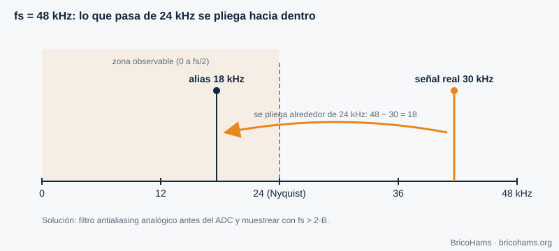
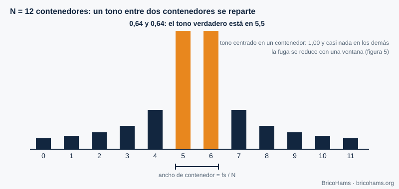
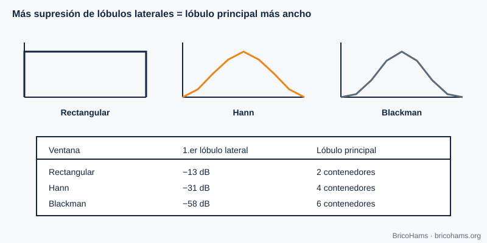
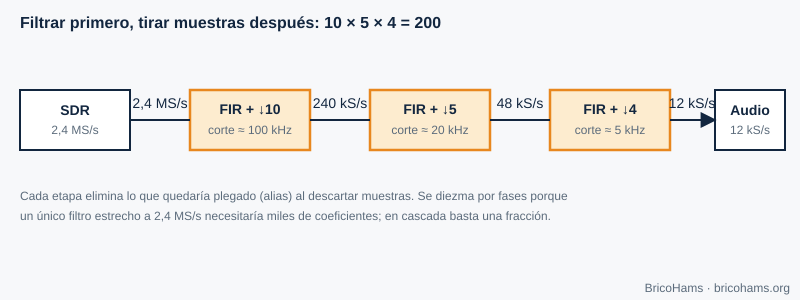

[ES](../es/02-senales-y-sistemas.md) · [EN](../en/02-senales-y-sistemas.md) · [FR](../fr/02-senales-y-sistemas.md) · [PT](../pt/02-senales-y-sistemas.md)

# 2. Sinais e sistemas

## Objetivos

- Aplicar o teorema de Nyquist e reconhecer o aliasing.
- Manejar sinais I/Q e a banda base complexa.
- Interpretar uma FFT: resolução, fugas e janelas.
- Desenhar uma cadeia de dizimação.

## 2.1 Amostrar: converter tempo contínuo em números

Um ADC mede a tensão do sinal a intervalos regulares, cada *T = 1/fs* segundos. Se o sinal contiver componentes até uma frequência máxima *B*, basta **fs > 2B** para o poder reconstruir (critério de **Nyquist**). Abaixo disso, as componentes altas «dobram-se» sobre as baixas e confundem-se com elas: é o **aliasing**.

*Figura 2: Amostragem e aliasing.*

**Exemplo.** Uma sinusoide de 7 kHz amostrada a 12 kHz (frequência de trabalho dos descodificadores FT8) ultrapassa o limite de Nyquist de 6 kHz. Vê-se como uma de |7 − 12| = **5 kHz**. Por isso, antes de baixar a taxa, filtra-se sempre.

## 2.2 Sinais complexos: I e Q

Um sinal real de 2 kHz e outro de −2 kHz são indistinguíveis num espectro real. Um **sinal complexo** *x[n] = I[n] + j·Q[n]* distingue frequências positivas e negativas, e ocupa o espectro de −fs/2 a +fs/2. Um recetor de **conversão direta** (capítulo 5) produz exatamente isso: I e Q são a projeção sobre dois osciladores em quadratura.

*Figura 3: Constelação I/Q.*

A **banda base complexa** coloca o centro do SDR em 0 Hz. Um sinal a +3 kHz do centro é *e^(j2π·3000·t)*; a −3 kHz, *e^(−j2π·3000·t)*. Mudar o sinal da frequência equivale a conjugar o sinal. Assim distinguem-se USB e LSB sem ambiguidade.

## 2.3 A FFT: ver o espectro

A **transformada rápida de Fourier (FFT)** de *N* amostras produz *N* contentores (bins) separados por *fs/N*. É a lupa com que se vê o espectro do QO-100.

*Figura 4: Contentores (bins) da FFT.*

**Exemplo.** O fluxo espectral da estação usa *fs* = 102 400 Hz e *N* = 1024: cada bin mede 100 Hz. Um tom perfeitamente centrado cai num só bin; um a meio caminho entre dois bins reparte-se pelos vizinhos, e daí sai a interpolação parabólica da baliza (capítulo 7).

O ganho de processamento da FFT também ajuda: um tom concentra a sua energia num bin, enquanto o ruído branco se reparte pelos *N*. A relação sinal/ruído *por bin* melhora cerca de 10·log₁₀(N) dB; com N = 1024, 30 dB.

## 2.4 Janelas

A FFT assume que o bloco se repete periodicamente. Se o tom não completa um número inteiro de ciclos, aparecem **fugas** (leakage): energia em bins afastados. Multiplicar o bloco por uma **janela** suaviza os bordos e reduz as fugas, à custa de alargar o lóbulo principal.

*Figura 5: Comparação de janelas.*

| Janela | 1.º lóbulo lateral | Largura do lóbulo principal |
|---|---|---|
| Retangular | −13 dB | 2 bins |
| Hann | −31 dB | 4 bins |
| Blackman | −58 dB | 6 bins |

Regra prática: se procura um sinal fraco perto de um forte (por exemplo, um sinal CW junto à baliza), use uma janela com lóbulos laterais baixos.

## 2.5 Dizimação

Baixar a taxa de amostragem («dizimar») por um fator *M* é deitar fora *M−1* de cada *M* amostras, **depois** de filtrar passa-baixo para que não haja aliasing. Faz-se por etapas porque um único filtro muito estreito a taxa alta é caríssimo.

*Figura 6: Cadeia de dizimação.*

**Exemplo.** De 2,4 MS/s a 12 kS/s há um fator 200 = 10 × 5 × 4: 2 400 000 → 240 000 → 48 000 → 12 000 amostras por segundo.

## Como o BricoHams o faz

- A FFT dos descodificadores vive em [`src/modes/ft8-fft.js`](../../../src/modes/ft8-fft.js) e constrói a cascata (waterfall) em [`src/modes/ft8-decode.js`](../../../src/modes/ft8-decode.js).
- A taxa de trabalho do FT8 e do FT4 é `SAMPLE_RATE = 12000` ([`ft8-constants.js`](../../../src/modes/ft8-constants.js)).
- A reamostragem do áudio do recetor está em [`src/webrtc/resample.js`](../../../src/webrtc/resample.js).
- As tramas de espectro (bins em dB) são interpretadas em [`src/webrtc/spectrum.js`](../../../src/webrtc/spectrum.js).

## Exercícios

1. Um sinal de 8 kHz é amostrado a 12 kHz. A que frequência aparece?
2. Que resolução tem uma FFT de 4096 pontos a 12 kS/s?
3. Quantos pontos precisa para resolver 6,25 Hz com fs = 12 kHz?
4. Com bins de 100 Hz, um tom aparece a 740 Hz do primeiro bin. Em que bin está o seu pico e que fração de bin fica por interpolar?

### Soluções

1. |8 − 12| = **4 kHz** (alias).
2. 12 000 / 4096 ≈ **2,93 Hz** por bin.
3. N = fs / Δf = 12 000 / 6,25 = **1920** amostras (é justamente a duração de um símbolo FT8: 0,16 s).
4. 740 / 100 = 7,4 → o bin 7 (a +0,4 bins); a interpolação parabólica afina o 0,4.

**Leitura recomendada:** Collins et al., *Software-Defined Radio for Engineers*, ch. 2 (Signals and Systems).
