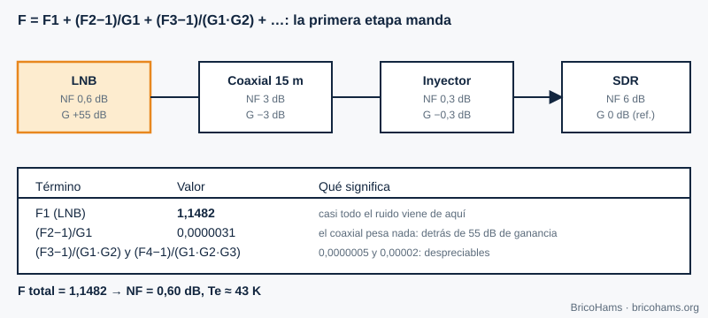
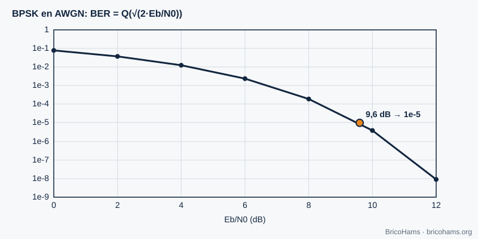
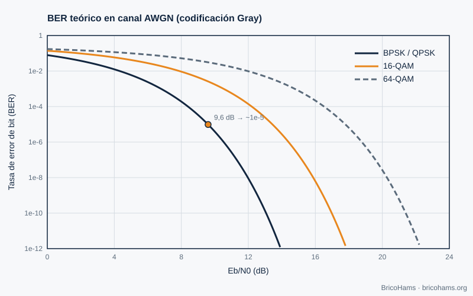
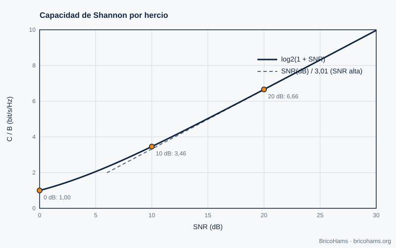

[ES](../es/03-ruido-y-probabilidad.md) · [EN](../en/03-ruido-y-probabilidad.md) · [FR](../fr/03-ruido-y-probabilidad.md) · [PT](../pt/03-ruido-y-probabilidad.md)

# 3. Ruído e probabilidade

## Objetivos

- Calcular a potência de ruído térmico numa largura de banda dada.
- Relacionar SNR, C/N0 e Eb/N0.
- Aplicar a fórmula de Friis à linha LNB → coaxial → SDR.
- Ler uma curva de BER e saber o que limita a capacidade de um canal.

## 3.1 Ruído térmico

Todo o condutor a temperatura *T* gera ruído branco de densidade *N0 = k·T*, com a constante de Boltzmann *k* = 1,38·10⁻²³ J/K. A 290 K, *N0* = −174 dBm/Hz. A potência numa largura de banda *B* é *N = N0 + 10·log₁₀(B)*:

| Largura de banda | Potência de ruído a 290 K |
|---|---|
| 6,25 Hz (símbolo FT8) | −166 dBm |
| 2,7 kHz (SSB) | −139,7 dBm |
| 500 kHz (transponder NB) | −117 dBm |

Quanto mais estreito o filtro, menos ruído entra. Por isso o FT8 consegue descodificar sinais que o ouvido não distingue.

## 3.2 SNR, C/N0 e Eb/N0

- **SNR** = potência de sinal / potência de ruído, *numa largura de banda concreta*. Sem a largura, o valor não significa nada.
- **C/N0** (dB·Hz) = SNR + 10·log₁₀(B): uma medida independente da largura.
- **Eb/N0** = energia por bit sobre densidade de ruído = C/N0 − 10·log₁₀(R_b), com *R_b* o débito binário.

**Exemplo (ilustrativo).** Um sinal com C/N0 = 40 dB·Hz e um débito de 50 bit/s tem Eb/N0 = 40 − 17 = **23 dB**.

Para o FT8 costuma citar-se um limiar de cerca de −21 dB de SNR medido em 2500 Hz. Na largura de um símbolo (6,25 Hz) isso são −21 + 10·log₁₀(2500/6,25) = −21 + 26 = **+5 dB** de Es/N0, ou seja, uma ordem de grandeza de 0 dB por bit de informação após a codificação. É a magia de combinar uma largura estreita com correção de erros (capítulo 8).

## 3.3 Figura de ruído e fórmula de Friis

A **figura de ruído (NF)** mede quanto ruído acrescenta um componente acima do térmico. Uma cascata de etapas tem

*F = F₁ + (F₂−1)/G₁ + (F₃−1)/(G₁G₂) + …*

com *F* e *G* em linear. A temperatura equivalente de ruído é *Te = 290·(F−1)*.

*Figura 7: Cascata de Friis.*

**Exemplo.** LNB com NF 0,6 dB e ganho 55 dB; coaxial com 3 dB de perda; injetor com 0,3 dB; SDR com NF 6 dB. O LNB contribui com F₁ = 1,1482; o resto soma menos de 0,00003. Total: NF ≈ **0,60 dB**, *Te* ≈ **43 K**. Moral da história: a única coisa que importa é o LNB, desde que o seu ganho seja alto. Por isso se instala no prato e não no SDR.

### Do ruído ao sinal: orçamento de ligação

C/N0 = EIRP − perda de espaço livre − perdas atmosféricas + G/T − 10·log₁₀(k).

Com uma distância oblíqua de 38 000 km a 10,489 GHz, a perda de espaço livre é 20·log₁₀(4π·d/λ) ≈ **204,5 dB** (λ = 2,858 cm). Um prato de 90 cm com eficiência 0,55 tem ≈ 37,3 dBi. Com *Tsys* = 60 K de antena + 43 K do recetor = 103 K (20,1 dBK), G/T ≈ 17,2 dB/K. −10·log₁₀(k) = +228,6 dBW/K/Hz.

## 3.4 BER e Eb/N0

A **taxa de erro de bit (BER)** da BPSK em ruído gaussiano é *Q(√(2·Eb/N0))*. A 9,6 dB é ≈ 10⁻⁵; cada dB extra de Eb/N0 baixa a BER em quase uma ordem de grandeza quando já estamos na zona de «cascata».

*Figura 8: BER da BPSK.*

A figura 23 compara BPSK/QPSK, 16-QAM e 64-QAM (modulações mais densas precisam de mais Eb/N0 para a mesma BER).

*Figura 23: BER teórica da BPSK, 16-QAM e 64-QAM.*

## 3.5 Limite de Shannon

Nenhum sistema supera a capacidade *C = B·log₂(1 + SNR)*. Com SNR = 0 dB (potência de sinal = potência de ruído), *C/B* = 1 bit/s/Hz; com 10 dB, 3,46; com 20 dB, 6,66; com 30 dB, 9,97.

*Figura 24: Capacidade de Shannon.*

A capacidade cresce apenas logaritmicamente com a potência: duplicar a potência (+3 dB) acrescenta apenas ≈ 1 bit/s/Hz a alta SNR. Daí que, no QO-100, faça mais sentido melhorar o G/T (prato maior, melhor LNB) do que acrescentar potência sem critério.

## Como o BricoHams o faz

A pasta [`services/qo100-calculators/`](../../../services/qo100-calculators/README.md) inclui uma calculadora de **linha do LNB** que aplica exatamente Friis e o orçamento de ligação:

- [`assets/qo100-math.js`](../../../services/qo100-calculators/assets/qo100-math.js): `cascade`, `lnbLineup`, `fsplDb`, `dishGain`.
- [`demo.html`](../../../services/qo100-calculators/demo.html): interface (sirva-a por HTTP para a abrir).
- A figura de ruído também decide como configurar o ganho no SDRangel (capítulo 5).

## Exercícios

1. Calcule a potência de ruído de um canal de 2,5 kHz a 290 K.
2. Qual é a *Te* de um LNB com NF = 0,8 dB?
3. Uma ligação tem C/N0 = 50 dB·Hz. Que SNR há em 2,7 kHz?
4. Que Eb/N0 é necessário para BPSK a BER 10⁻⁵?

### Soluções

1. −174 + 10·log₁₀(2500) = −174 + 34 = **−140 dBm**.
2. F = 10^0,08 = 1,202 → *Te* = 290 × 0,202 ≈ **58,6 K**.
3. 50 − 10·log₁₀(2700) = 50 − 34,3 = **15,7 dB**.
4. Aproximadamente **9,6 dB**.

**Leitura recomendada:** Collins et al., *Software-Defined Radio for Engineers*, ch. 3 (Probability in Communications).
