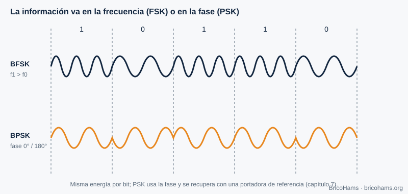
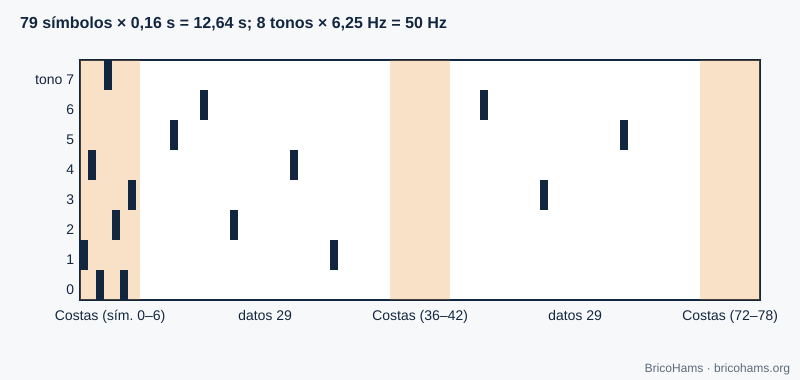
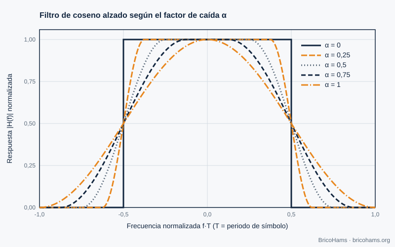

[ES](../es/04-modulacion-digital.md) · [EN](../en/04-modulacion-digital.md) · [FR](../fr/04-modulacion-digital.md) · [PT](../pt/04-modulacion-digital.md)

# 4. Modulação digital

## Objetivos

- Explicar como a FSK e a PSK codificam bits em frequência e fase.
- Compreender a estrutura do FT8 (8-GFSK), do FT4 e do CW.
- Compreender porque se conformam os pulsos (cosseno elevado, filtro gaussiano).

## 4.1 Mensagem → onda

Modular é modificar um parâmetro de uma portadora segundo os dados. Com três parâmetros (amplitude, frequência, fase) saem as famílias ASK/OOK, FSK e PSK.

*Figura 9: Formas de onda FSK e PSK.*

- **FSK**: cada símbolo é um tom diferente. É robusta e simples de detetar sem conhecer a fase da portadora (deteção não coerente).
- **PSK**: cada símbolo é uma fase. Em BPSK há duas fases (0° e 180°) e um bit por símbolo; em QPSK, quatro fases e dois bits. Precisa de recuperar a portadora (capítulo 7).
- **QAM** combina amplitude e fase: mais bits por símbolo com mais Eb/N0 (figura 23 do capítulo 3).

## 4.2 A constelação

Cada símbolo é um ponto do plano I/Q. O ruído desenha uma nuvem à volta de cada ponto; se a nuvem cruzar a fronteira entre decisões, há erro.

*Figura 3: Constelações I/Q.*

## 4.3 FT8 e FT4: FSK de tons múltiplos

O **FT8** transmite 8 tons separados por 6,25 Hz. Cada símbolo dura 0,16 s, ou seja, 1/0,16 = 6,25 símbolos por segundo, e a separação entre tons é igual à taxa de símbolo: os tons são ortogonais. Cada símbolo codifica 3 bits. A mensagem completa são 79 símbolos (12,64 s), com uma largura total de 8 × 6,25 = **50 Hz**.

*Figura 10: Grelha de tons e tempo do FT8.*

O «G» de *8-GFSK* significa que a transição entre tons é suavizada com um filtro gaussiano (parâmetro BT = 2,0 neste repositório) para que o espectro não alargue com os saltos bruscos.

O **FT4** é mais rápido: 4 tons, símbolos de 0,048 s (separação 20,83 Hz), 105 símbolos e intervalos de 7,5 s. Custa mais SNR e ocupa mais largura (≈ 83 Hz).

## 4.4 CW

A telegrafia é a modulação mais simples: portadora ligada ou desligada (OOK). Uma boa *manipulação* (keying) suaviza os flancos para que o espectro não «estale». A velocidade mede-se em palavras por minuto: a 20 wpm um ponto dura 60 ms (com a palavra PARIS como referência).

## 4.5 A baliza BPSK

A baliza do QO-100 NB é uma portadora estreita, com modulação de baixo débito. Para o BricoHams só importa a sua **frequência**: é usada como referência absoluta (capítulo 7).

## 4.6 Conformação de pulsos

Um pulso retangular de duração *T* tem um espectro *sinc* com lóbulos que se estendem muito longe. Para ocupar menos largura sem gerar **interferência entre símbolos (ISI)** usa-se o **cosseno elevado**, com fator de roll-off α (0 a 1). A sua resposta em frequência é plana no centro, cai suavemente entre *(1−α)/2T* e *(1+α)/2T*, e é nula fora: a largura é *(1+α)/T*.

*Figura 26: Cosseno elevado.*

Com α = 0,25 e 1200 símbolos/s, a largura é 1,25 × 1200 = 1500 Hz. Na prática o cosseno elevado divide-se em duas «raízes»: uma no emissor e outra no recetor (filtro adaptado), que juntas dão um cosseno elevado completo.

## Como o BricoHams o faz

- Constantes de protocolo: [`src/modes/ft8-constants.js`](../../../src/modes/ft8-constants.js) (`PROTOCOLS` para FT8 e FT4).
- Síntese da onda de uma mensagem: `synthSlot` em [`src/modes/ft8-encode.js`](../../../src/modes/ft8-encode.js).
- Descodificação CW: [`src/modes/cw-decoder.js`](../../../src/modes/cw-decoder.js).
- Guia de utilização: [`docs/help/operar-digitales.md`](../../help/operar-digitales.md) e [`docs/help/operar-cw.md`](../../help/operar-cw.md).

## Exercícios

1. Quantos símbolos por segundo transmite o FT4?
2. Que largura ocupa um sinal de 100 bauds com cosseno elevado α = 0,5?
3. Quantos bits transporta cada símbolo FT8 e quantos símbolos de dados há?
4. Um ponto CW dura 80 ms. A quantas wpm vai?

### Soluções

1. 1 / 0,048 ≈ **20,8 símbolos/s**.
2. (1 + 0,5) × 100 = **150 Hz**.
3. **3 bits** por símbolo; há 58 símbolos de dados (174 bits) mais 21 de sincronismo.
4. dit = 1,2 / wpm → wpm = 1,2 / 0,08 = **15 wpm**.

**Leitura recomendada:** Collins et al., *Software-Defined Radio for Engineers*, ch. 4 (Digital Communications Fundamentals).
