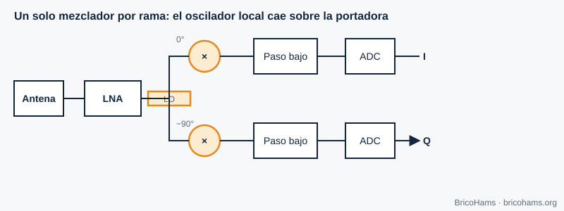
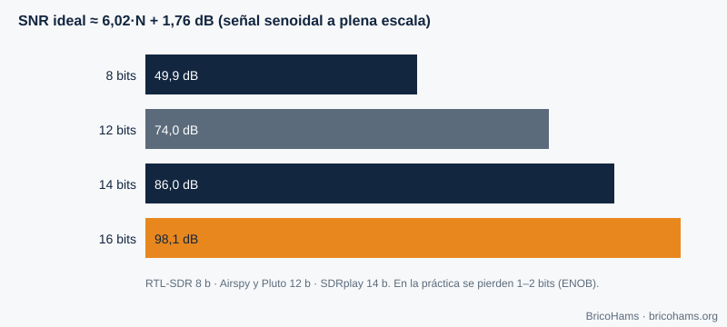

[ES](../es/05-hardware-sdr.md) · [EN](../en/05-hardware-sdr.md) · [FR](../fr/05-hardware-sdr.md) · [PT](../pt/05-hardware-sdr.md)

# 5. Hardware SDR

## Objetivos

- Comparar arquiteturas de FI zero e de FI baixa.
- Relacionar bits do ADC com gama dinâmica.
- Reconhecer fugas do oscilador local e desequilíbrio I/Q.
- Compreender o papel do relógio (TCXO, GPSDO) e escolher SDR a partir de `hardware/bom/components.csv`.

## 5.1 Arquiteturas

**FI zero (conversão direta).** Um oscilador local na frequência de interesse é multiplicado pelo sinal em dois ramos desfasados 90°. Após um filtro passa-baixo e dois ADC saem I e Q. É a arquitetura da maioria dos SDR (o RTL-SDR não o é: usa FI baixa; o ADALM-Pluto com o AD9363 sim).

*Figura 11: Recetor de FI zero.*

**FI baixa.** O oscilador cai um pouco ao lado do sinal, e este fica numa frequência intermédia pequena, onde o ADC o amostra. Evita os problemas de contínua da FI zero mas precisa de rejeitar a frequência imagem.

| | FI zero | FI baixa |
|---|---|---|
| Largura de banda | Alta (I e Q separados) | Menor |
| Problema típico | DC, desequilíbrio I/Q, fuga do LO | Frequência imagem |
| Complexidade | Baixa | Média |

## 5.2 Conversor analógico-digital

Um ADC de *N* bits oferece no máximo 2^N níveis. Para uma sinusoide a plena escala, a relação sinal/ruído de quantização é ≈ **6,02·N + 1,76 dB**.

*Figura 12: Gama dinâmica do ADC.*

| Bits | Gama teórica |
|---|---|
| 8 | 49,9 dB |
| 12 | 74,0 dB |
| 14 | 86,0 dB |
| 16 | 98,1 dB |

A gama real é menor (o ruído próprio do ADC, ENOB). Um RTL-SDR de 8 bits tolera mal um sinal forte perto de um fraco (por exemplo, um emissor de TV junto ao QO-100); um SDRplay de 14 bits comporta-se bastante melhor. No QO-100 a FI contém a banda do satélite, onde a baliza é muito mais forte do que um sinal FT8 fraco: a dinâmica importa.

## 5.3 Imperfeições da FI zero

- **Fuga do LO (LO leakage):** parte do oscilador aparece na saída como um pico em 0 Hz do espectro I/Q. Corrige-se subtraindo a componente contínua ou deslocando o centro alguns kHz.
- **Desequilíbrio I/Q:** os dois ramos não são idênticos (diferença de ganho ε e de fase φ). Aparece uma *imagem* de cada sinal na frequência oposta. Rejeição de imagem ≈ 10·log₁₀(4 / (ε² + φ²)): com ε = 1 % e φ = 1° (0,01745 rad), 4 / (0,0001 + 0,000305) ≈ 9877 → ≈ **40 dB**.
- **Offset de contínua (DC):** o ADC tem um nível residual; também se vê em 0 Hz.

## 5.4 O relógio: TCXO e GPSDO

Todas as frequências do SDR derivam de um cristal. Um erro de *p* ppm desloca um sinal a *f* em *p·f·10⁻⁶* Hz. Um cristal de 1 ppm em 739,75 MHz seria 740 Hz; no oscilador do LNB, a 9750 MHz, 1 ppm são **9,75 kHz**. Por isso é a deriva do LNB (e não a do SDR) que domina no QO-100 (capítulo 7).

- **TCXO**: cristal com compensação de temperatura (±0,5 a ±2 ppm).
- **GPSDO**: oscilador disciplinado por GPS (frações de 10⁻⁹ a 10⁻¹¹); partilhar a referência entre TX e RX evita derivas relativas.

## 5.5 Os SDR deste projeto

A lista completa está em [`hardware/bom/components.csv`](../../../hardware/bom/components.csv); a comparação, em [`hardware/bom/comparison.md`](../../../hardware/bom/comparison.md).

| Utilização | Exemplos da lista | Notas |
|---|---|---|
| RX da FI | RTL-SDR Blog V3/V4 (8 bits), Airspy Mini/R2 (12 bits), SDRplay RSP1B (14 bits) | TCXO de 0,5–1 ppm; o bias-T do dongle não substitui o injetor |
| TX 2,4 GHz | ADALM-Pluto (AD9363, 12 bits, ≈ 20 MHz de largura), HackRF One (8 bits), LimeSDR Mini 2.0, USRP B200mini-i (AD9364, 56 MHz, entrada de 10 MHz) | A potência de saída é baixa: são precisos PA, filtro e medidor |
| Alternativa HF | Hermes Lite 2 | Só com transverter; não ligue a FI do LNB à sua entrada |

O AD9363 do Pluto é um transcetor integrado que cobre oficialmente 325–3800 MHz, pelo que 2,4 GHz entra sem problema; o seu oscilador de baixa precisão é compensado com a correção por baliza do BricoHams. Estas marcas aparecem como exemplos técnicos e não implicam nenhum vínculo com o BricoHams.

## Como o BricoHams o faz

- Configura o SDR através do SDRangel: [`src/sdrangel/client.js`](../../../src/sdrangel/client.js).
- Calcula os deslocamentos de oscilador em [`src/modes/frequencies.js`](../../../src/modes/frequencies.js) (`downlinkToIf`, `ifToDownlink`).
- Compensa a deriva do LNB com a baliza: [`src/beacon/index.js`](../../../src/beacon/index.js).
- Guia de hardware: [`hardware/README.md`](../../../hardware/README.md) e [`docs/help/equipos-y-programas.md`](../../help/equipos-y-programas.md).

## Exercícios

1. Que gama dinâmica teórica tem um ADC de 10 bits?
2. Um oscilador de 25 MHz com 2 ppm: quanto se desloca a 739,75 MHz?
3. Qual é a rejeição de imagem com ε = 2 % e φ = 2°?
4. Que LO de LNB corresponde a uma FI de 739,75 MHz para 10 489,75 MHz?

### Soluções

1. 6,02 × 10 + 1,76 = **62 dB**.
2. 2 ppm × 739,75 MHz = **1,48 kHz**.
3. ε² = 0,0004; φ = 0,0349 rad → φ² = 0,00122; soma = 0,00162; 4 / 0,00162 = 2469 → **≈ 34 dB**.
4. 10 489,75 − 739,75 = **9750 MHz**.

**Leitura recomendada:** Collins et al., *Software-Defined Radio for Engineers*, ch. 5 (Understanding SDR Hardware).
