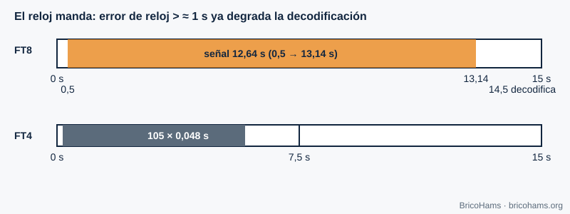

[ES](../es/06-sincronizacion-de-tiempo.md) · [EN](../en/06-sincronizacion-de-tiempo.md) · [FR](../fr/06-sincronizacion-de-tiempo.md) · [PT](../pt/06-sincronizacion-de-tiempo.md)

# 6. Sincronização de tempo

## Objetivos

- Compreender o que é a sincronização de símbolo e porque é preciso fazê-la.
- Calcular a estrutura temporal do FT8 e do FT4.
- Saber porque o relógio UTC do seu computador faz parte da estação.

## 6.1 Três níveis de tempo

1. **Amostra**: o relógio do ADC fixa quando se toma cada amostra.
2. **Símbolo**: é preciso saber *em que amostra* começa cada símbolo; se o recetor amostrar mesmo entre dois símbolos, o ruído e a interferência entre símbolos aumentam.
3. **Trama ou intervalo**: é preciso saber quando começa a mensagem completa.

Os recetores clássicos ajustam o instante de amostragem com um laço de seguimento (detetor de erro de temporização que mede se a amostra cai adiantada ou atrasada em relação ao centro do símbolo). Os modos de intervalo fixo como o FT8 resolvem o problema de outra forma: um **primeiro ajuste grosso pelo relógio UTC** e um **fino por correlação** com uma sequência de sincronismo (capítulo 8).

## 6.2 Intervalos FT8 e FT4

O FT8 transmite em intervalos de 15 s alinhados com os segundos 0, 15, 30 e 45 de cada minuto UTC. O sinal começa 0,5 s após o início e dura 79 × 0,16 = 12,64 s. O descodificador arranca por volta dos 14,5 s. O FT4 usa intervalos de 7,5 s: 105 símbolos × 0,048 s = 5,04 s de sinal.

*Figura 22: Intervalos UTC do FT8 e do FT4.*

O recetor não sabe exatamente quando começou o emissor: o seu relógio tem erro. Procura por correlação o desfasamento temporal *dt* (em segundos) e comunica-o junto com a mensagem. Com um relógio bem ajustado, *dt* deveria estar perto de 0; se todos os seus contactos mostrarem um *dt* semelhante, o desajuste é seu.

**Exemplo.** A 12 kS/s, o erro de 0,1 s são 1200 amostras, pouco mais de meio símbolo (1920 amostras). Um erro de 1 s equivale a 12 000 amostras (6,25 símbolos): o bloco Costas fica tão deslocado que a sincronização fina deixa de o encontrar no seu lugar.

## 6.3 UTC e NTP

Um PC sincronizado por **NTP** costuma ter um erro de dezenas de milissegundos: mais do que suficiente. Um PC não sincronizado pode derivar segundos por semana. Numa estação remota, o relógio do servidor é o que importa. A latência de rede (WebRTC, WebSocket) não altera o relógio de descodificação, apenas atrasa a imagem que o utilizador vê.

O QO-100 acrescenta um atraso de propagação de ≈ 0,25 s por salto (≈ 36 000 km para cima e outro tanto para baixo, à velocidade da luz). O FT8 tolera-o sem problema, mas importa nas conversas por voz.

## Como o BricoHams o faz

- `utcSlot` calcula o intervalo UTC do FT8 e do FT4 em [`src/modes/decoders.js`](../../../src/modes/decoders.js).
- O descodificador de intervalo (em thread à parte para não bloquear o servidor): [`src/modes/slot-decoder.js`](../../../src/modes/slot-decoder.js) e [`src/modes/decode-service.js`](../../../src/modes/decode-service.js).
- O tempo de cada descodificação (`dtSec`) é calculado por [`src/modes/ft8-decode.js`](../../../src/modes/ft8-decode.js).
- Recomendação de relógio em [`docs/help/solucion-de-problemas.md`](../../help/solucion-de-problemas.md).

## Exercícios

1. Quantas amostras há num intervalo FT8 a 12 kS/s?
2. Quantas amostras dura um símbolo FT4 a 12 kS/s?
3. Se o seu relógio atrasar 0,8 s, quantos símbolos FT8 desloca?
4. Quanto tempo demora o sinal a ir da estação ao satélite e voltar a outra estação em terra?

### Soluções

1. 15 × 12 000 = **180 000** amostras.
2. 0,048 × 12 000 = **576** amostras.
3. 0,8 / 0,16 = **5 símbolos**.
4. ≈ 36 000 km × 2 / 300 000 km/s ≈ **0,24–0,26 s** (mais pela geometria).

**Leitura recomendada:** Collins et al., *Software-Defined Radio for Engineers*, ch. 6 (Timing Synchronization).
