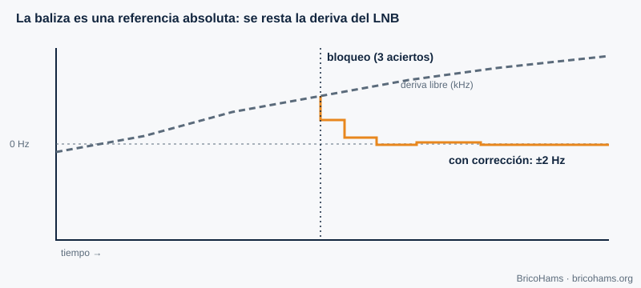
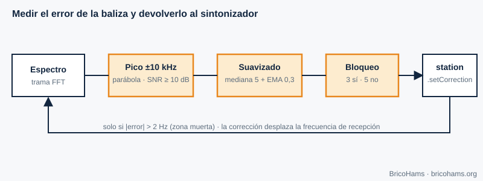

[ES](../es/07-sincronizacion-de-portadora.md) · [EN](../en/07-sincronizacion-de-portadora.md) · [FR](../fr/07-sincronizacion-de-portadora.md) · [PT](../pt/07-sincronizacion-de-portadora.md)

# 7. Sincronização de portadora

## Objetivos

- Compreender porque aparece um desvio de frequência e quanto vale no QO-100.
- Explicar como uma baliza serve de referência absoluta.
- Seguir passo a passo o algoritmo de `src/beacon/`.

## 7.1 Desvio de frequência

Emissor e recetor usam osciladores diferentes. Se o recetor sintoniza *f₀* mas a portadora chega em *f₀ + Δf*, o sinal em banda base gira a Δf hertz. Com BPSK ou QPSK, essa rotação destrói a decisão: é preciso estimar e corrigir *Δf* (e a fase) antes de desmodular.

No QO-100 há três fontes de desvio:

| Fonte | Ordem de grandeza |
|---|---|
| Oscilador do LNB (9750 MHz) | 1 ppm ≈ 9,75 kHz; LNB baratos derivam dezenas ou centenas de kHz com a temperatura |
| Oscilador do SDR (739,75 MHz) | 1 ppm ≈ 740 Hz (menos com TCXO) |
| Oscilador da estação emissora | idem, a 2,4 GHz |
| Doppler do satélite GEO | muito pequeno (capítulo 9) |

*Figura 13: Deriva do LNB e correção pela baliza.*

## 7.2 Técnicas de recuperação

- **Laço de captura de fase (PLL) ou de Costas**: um oscilador controlado que persegue a fase da portadora com realimentação. Serve para PSK com ruído baixo.
- **Estimação em malha aberta**: elevar o sinal à potência *M* elimina a modulação PSK e deixa um tom em *M·Δf* que se mede com uma FFT.
- **Piloto ou baliza**: um sinal conhecido a frequência conhecida permite medir o erro diretamente.

O FT8 e o FT4 usam FSK não coerente e toleram desvios de dezenas de hertz porque o descodificador procura o tom; mas numa estação bidirecional o que pesa é que o **LNB derive** (muda onde vê os outros) e que a sua **transmissão** caia onde deve. A baliza resolve ambas as coisas.

## 7.3 A baliza como recuperação de portadora

O QO-100 NB irradia uma portadora contínua muito estável que o satélite gera com a sua própria referência. Se o LNB e o SDR estiverem desviados, essa baliza **não está onde deveria**: o desvio medido é exatamente o erro acumulado de toda a cadeia de receção.

*Figura 20: Laço de correção pela baliza.*

O algoritmo de [`src/beacon/index.js`](../../../src/beacon/index.js) compõe-se de três peças:

1. **`estimateBeaconOffset`** (função pura). Recebe um espectro em dB, a frequência central, a largura do bin e a frequência esperada da baliza. Define uma janela de ±10 kHz em torno da posição esperada, procura o máximo, calcula a SNR como *pico − mediana da janela* e exige ≥ 10 dB. Descarta máximos no bordo da janela. Com os três bins à volta do pico (a, b, c) faz **interpolação parabólica**: δ = 0,5·(a−c)/(a−2b+c), limitado a ±0,5 bins. A frequência do pico é *centro + (bin + δ − N/2)·binHz*; o desvio é a diferença para a esperada.
2. **`createBeaconFilter`**. Converte medidas ruidosas numa estimativa estável: mediana das últimas 5 deteções (descarta valores atípicos), média móvel exponencial com α = 0,3 (suaviza), e uma histerese: **bloqueio** após 3 deteções seguidas e **perda de bloqueio** após 5 falhas seguidas. Assim uma falha isolada não faz oscilar o estado.
3. **`createBeaconController`**. Em cada trama de espectro chama as duas funções anteriores; se houver bloqueio e a variação ultrapassar a **zona morta** de 2 Hz, chama `station.setCorrection(offsetHz, 'beacon')`. Se o bloqueio se perder, mantém a última correção (*holdover*) e marca `no-lock`.

**Exemplo.** Espectro de 1024 bins com *binHz* = 100 Hz centrado em 739,75 MHz (a baliza esperada cai no bin 512). Pico no bin 520, vizinhos iguais → δ = 0 → desvio = 8 bins × 100 Hz = **+800 Hz**. O controlador desloca o centro de receção em +800 Hz e, quando o emissor está inativo, o de transmissão em −800 Hz (a correção aplica-se de forma consistente aos dois lados).

As razões do método escolhido estão em [`docs/adr/0008-beacon-correction-method.md`](../../adr/0008-beacon-correction-method.md).

## Como o BricoHams o faz

- Algoritmo e API: [`src/beacon/index.js`](../../../src/beacon/index.js) e o seu [`README`](../../../src/beacon/README.md).
- Aplicação da correção à estação: `setCorrection` em [`src/modes/station.js`](../../../src/modes/station.js).
- Origem das tramas de espectro: [`src/webrtc/spectrum.js`](../../../src/webrtc/spectrum.js).
- Testes: [`test/unit/beacon.test.js`](../../../test/unit/beacon.test.js).
- Cuidado: a frequência de baliza por omissão do repositório é 10 489,750 MHz e é configurável; confirme-a com as fontes oficiais da AMSAT-DL antes de depender dela.

## Exercícios

1. Com *binHz* = 100 e pico no bin 507 (esperado 512), qual é o desvio?
2. Vizinhos a, b, c = −62, −55, −60 dB. Quanto vale δ?
3. Quantas medidas boas são precisas para engatar? E más para largar?
4. Porque a mediana antes da média?

### Soluções

1. (507 − 512) × 100 = **−500 Hz**.
2. δ = 0,5·(−62 − (−60)) / (−62 − 2·(−55) − 60) = 0,5·(−2)/(−12) ≈ **+0,083 bin** (≈ 8 Hz).
3. 3 e 5, respetivamente.
4. A mediana descarta *outliers* (um pico espúrio) que enviesariam a média.

**Leitura recomendada:** Collins et al., *Software-Defined Radio for Engineers*, ch. 7 (Carrier Synchronization).
