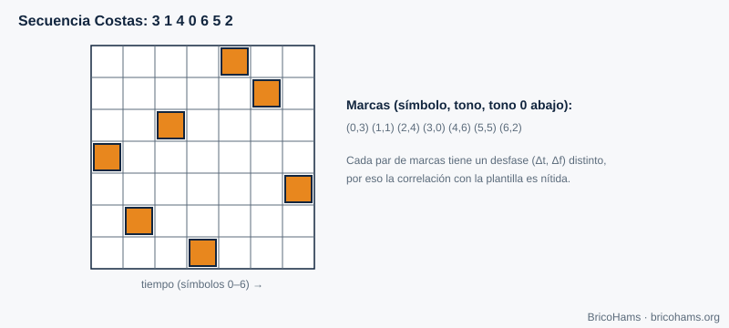
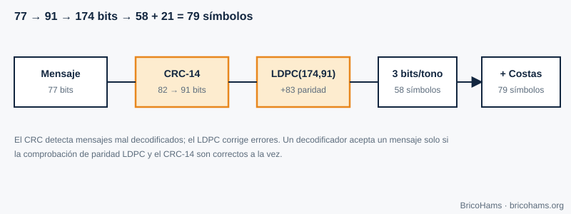
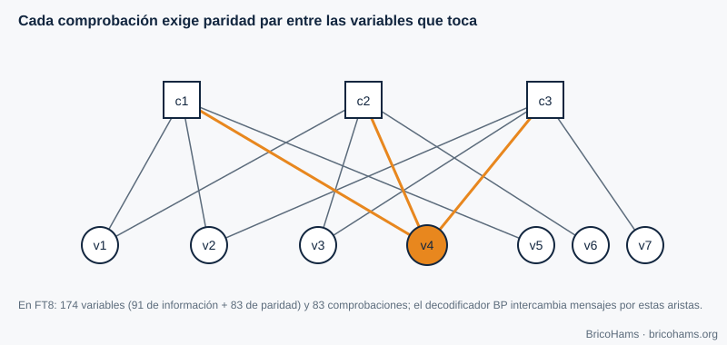

[ES](../es/08-tramas-y-codificacion.md) · [EN](../en/08-tramas-y-codificacion.md) · [FR](../fr/08-tramas-y-codificacion.md) · [PT](../pt/08-tramas-y-codificacion.md)

# 8. Tramas e codificação

## Objetivos

- Explicar para que servem as palavras de sincronismo e as matrizes Costas.
- Calcular um CRC e compreender o que deteta.
- Descrever como um código LDPC corrige erros e o que é o grafo de Tanner.
- Seguir o caminho de uma mensagem FT8 de 77 bits até 79 símbolos.

## 8.1 Sincronismo de trama

Embora o relógio UTC dê uma ideia de quando começa o intervalo, o recetor deve localizar com precisão o início e a frequência da mensagem. Inclui-se um padrão conhecido (uma **palavra de sincronismo**) e correlaciona-se com o sinal recebido. Um bom padrão tem uma autocorrelação com um único pico forte.

O FT8 usa três blocos de 7 símbolos, nas posições 0–6, 36–42 e 72–78, seguindo uma **matriz Costas**: a sequência de tons 3, 1, 4, 0, 6, 5, 2.

*Figura 14: Matriz Costas.*

Numa matriz Costas, para cada par de marcas o deslocamento relativo (tempo, frequência) é único. Por isso, se se desloca o modelo um símbolo ou um tom, quase todas as marcas falham: o pico de correlação é nítido em ambos os eixos (tempo e frequência) ao mesmo tempo. 21 dos 79 símbolos são sincronismo.

## 8.2 Deteção de erros: CRC

Um **CRC (verificação de redundância cíclica)** divide a mensagem, vista como um polinómio binário, por um polinómio gerador e acrescenta o resto. O recetor repete a conta: se não coincidir, a mensagem está danificada. O FT8 usa um **CRC de 14 bits** com o polinómio `0x2757` sobre 82 bits (os 77 da mensagem mais 5 zeros), e acrescenta os 14 bits no fim: 77 + 14 = 91 bits.

Um CRC de 14 bits deixa passar uma mensagem corrompida aleatória com probabilidade 2⁻¹⁴ ≈ 6·10⁻⁵ (1 em 16 384). É pouco, mas com centenas de candidatos por intervalo não é zero; por isso convém verificar também se o texto descodificado faz sentido.

*Figura 16: Fluxo de codificação (CRC e LDPC).*

## 8.3 Correção de erros: LDPC (174, 91)

Um código de bloco (*n*, *k*) converte *k* bits de informação em *n* bits transmitidos. Com *n* = 174 e *k* = 91, a **taxa** é 91/174 ≈ 0,52: envia-se quase o dobro dos bits, mas com essa redundância o recetor pode reconstruir a mensagem mesmo com muitos bits errados.

Um **código LDPC** define-se por uma matriz de verificação de paridade *H* esparsa (poucos uns). Cada linha é uma **equação de paridade**: os bits que toca devem somar zero (módulo 2). O FT8 tem 83 equações (174 − 91) e cada bit participa em exatamente 3 delas.

O **grafo de Tanner** desenha essa matriz: nós de variável (bits), nós de verificação (equações) e uma aresta por cada 1 de *H*.

*Figura 15: Grafo de Tanner.*

**Descodificação por propagação de crenças (BP).** O desmodulador não entrega zeros e uns duros, mas **probabilidades** (razões de verosimilhança logarítmica, LLR) para cada bit. Trocam-se mensagens pelas arestas: cada variável avisa as suas verificações do que acredita; cada verificação diz às variáveis que valor deveriam ter para que a paridade bata certo. Após várias iterações, as crenças convergem; se todas as verificações se cumprirem e o CRC coincidir, a mensagem é válida.

**Exemplo.** O FT8 anuncia descodificações até ≈ −21 dB de SNR em 2,5 kHz (valor orientativo; depende da implementação). Um esquema sem codificação precisaria de bastante mais SNR para uma BER aceitável (capítulo 3): a redundância compra vários dB de limiar.

## 8.4 Do bit ao tom

Os 174 bits agrupam-se de 3 em 3: 58 símbolos de dados, cada um com 8 tons possíveis. Com os 21 símbolos Costas são 79 símbolos de 0,16 s. O FT4 segue o mesmo princípio com 87 símbolos de dados, 4×4 símbolos Costas e uma máscara XOR de aleatorização (para evitar padrões repetidos).

## Como o BricoHams o faz

- Tabelas e dimensões: [`src/modes/ft8-tables.js`](../../../src/modes/ft8-tables.js) (`LDPC_N = 174`, `LDPC_K = 91`, `LDPC_M = 83`).
- CRC e LDPC (`computeCrc`, `addCrc`, `encode174`, `ldpcCheck`, `bpDecode`): [`src/modes/ft8-ldpc.js`](../../../src/modes/ft8-ldpc.js).
- Empacotamento do texto da mensagem em 77 bits: [`src/modes/ft8-message.js`](../../../src/modes/ft8-message.js).
- Testes: [`test/unit/ft8.test.js`](../../../test/unit/ft8.test.js).

## Exercícios

1. Que fração dos símbolos FT8 é sincronismo?
2. Quantos bits de paridade acrescenta o LDPC(174, 91)?
3. Se a probabilidade de erro de bit for 0,1, qual é a probabilidade de 3 bits seguidos estarem certos?
4. Porque é que um CRC não pode corrigir erros mas um LDPC pode?

### Soluções

1. 21 / 79 ≈ **26,6 %**.
2. 174 − 91 = **83**.
3. 0,9³ = **0,729**.
4. O CRC apenas oferece um resumo para verificar; não tem redundância estruturada suficiente para localizar os erros. O LDPC distribui a redundância em equações sobrepostas que permitem estimar que bits falham.

**Leitura recomendada:** Collins et al., *Software-Defined Radio for Engineers*, ch. 8 (Frame Synchronization and Channel Coding).
