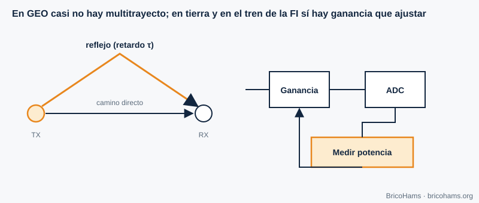

[ES](../es/09-canal-y-ecualizacion.md) · [EN](../en/09-canal-y-ecualizacion.md) · [FR](../fr/09-canal-y-ecualizacion.md) · [PT](../pt/09-canal-y-ecualizacion.md)

# 9. Canal e equalização

## Objetivos

- Descrever o canal do QO-100 e compará-lo com um terrestre.
- Estimar o Doppler de um satélite geoestacionário.
- Compreender multipercurso, equalização e controlo automático de ganho (AGC).

## 9.1 Um canal quase ideal

A ligação QO-100 é de linha de vista, com um transponder em órbita geoestacionária a cerca de 36 000 km. O canal parece-se muito com um **canal AWGN** (ruído branco gaussiano aditivo): atenuação fixa, atraso constante e ruído. Os seus impedimentos reais são pequenos:

- **Atenuação atmosférica e chuva** a 10,489 GHz: de décimas a poucos dB com chuva intensa.
- **Perda por apontamento** (capítulo 11).
- **Polarização**: um LNB e um feed mal orientados perdem sinal.
- **Interferências** de ligações terrestres, e a saturação do transponder por sinais fortes.

## 9.2 Doppler em órbita geoestacionária

O desvio Doppler é *Δf = f·v/c*. Um satélite GEO não está totalmente quieto: as suas pequenas oscilações diárias de inclinação produzem velocidades radiais da ordem de metros por segundo, no máximo. Com *v* = 1 m/s (ilustrativo):

- a 10,489 GHz: Δf ≈ 10,489·10⁹ / 3·10⁸ ≈ **35 Hz**;
- a 2,4 GHz: ≈ **8 Hz**.

Face aos ±kHz de deriva do LNB, é desprezável, e por isso o BricoHams mede apenas a correção por baliza e não calcula efemérides Doppler. Em satélites LEO (centenas de km), pelo contrário, o Doppler chega a dezenas de kHz.

## 9.3 Multipercurso e equalização

Em terra, o sinal chega por caminhos com atrasos diferentes; as suas cópias somam-se com fases diferentes e produzem **desvanecimentos seletivos em frequência**. Um **equalizador** estima a resposta do canal (com um padrão de treino ou às cegas) e aplica um filtro inverso. No QO-100 o trajeto espacial não tem multipercurso significativo; o único eco possível é o reflexo próximo do prato.

*Figura 27: Multipercurso e AGC.*

## 9.4 Controlo automático de ganho

O **AGC** ajusta o ganho do recetor para que o sinal use bem a gama do ADC: nem tão baixo que se perca no ruído de quantização, nem tão alto que sature. No QO-100 o AGC pode ser uma armadilha: a baliza, forte, faz baixar o ganho e reduz o sinal fraco. Os recetores SDR usam, por isso, ganho manual ou AGC com constantes de tempo lentas.

**Exemplo.** Se a baliza chegar a −50 dBFS e o ruído a −90 dBFS, há 40 dB de margem sobre o ruído e 50 dB até à saturação; um sinal FT8 a −85 dBFS sobrevive. Se subir o ganho 20 dB, a baliza passa a −30 dBFS: ainda cabe, mas um vizinho forte (um sinal SSB 10 dB mais forte) já aproximaria a saturação.

## Como o BricoHams o faz

- A estação não usa Doppler: só corrige por baliza ([`src/beacon/`](../../../src/beacon/README.md)).
- O nível de receção e o áudio são normalizados em [`src/webrtc/rx-audio.js`](../../../src/webrtc/rx-audio.js).
- O perfil de receção (filtro e DSP): [`src/modes/rx-profile.js`](../../../src/modes/rx-profile.js).
- Detalhes do canal no guia [`docs/help/qo100-fundamentos.md`](../../help/qo100-fundamentos.md).

## Exercícios

1. Δf a 10,489 GHz com *v* = 3 m/s.
2. Que atraso de ida e volta em voz (com um único salto)?
3. Porque não se usa AGC rápido na FI do QO-100?
4. Duas cópias com atrasos 0 e 1 µs. A que frequência cai o primeiro nulo?

### Soluções

1. 3 × 35 = **≈ 105 Hz**.
2. Cada salto ≈ 0,25 s; ida e volta ≈ **0,5 s**.
3. A baliza, muito mais forte, faria o AGC baixar o ganho de todo o espectro e os sinais fracos perder-se-iam.
4. Nulo quando o atraso é meio ciclo: 1/(2 × 1 µs) = **500 kHz**.

**Leitura recomendada:** Collins et al., *Software-Defined Radio for Engineers*, ch. 9 (Channel Estimation and Equalization).
