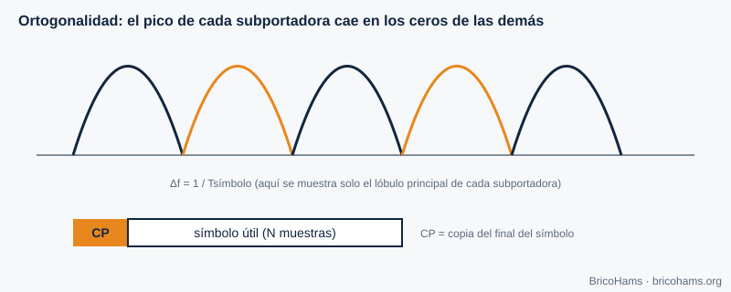
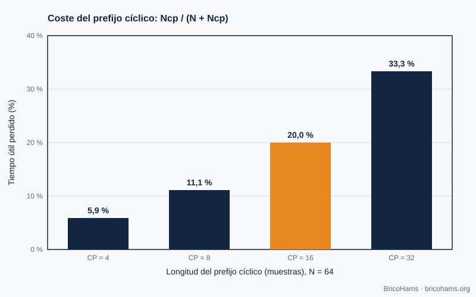

[ES](../es/10-ofdm.md) · [EN](../en/10-ofdm.md) · [FR](../fr/10-ofdm.md) · [PT](../pt/10-ofdm.md)

# 10. OFDM

## Objetivos

- Compreender a ideia das subportadoras ortogonais e do prefixo cíclico.
- Calcular o custo do prefixo.
- Saber porque a banda estreita do QO-100 não usa OFDM e onde aparece (banda larga, DATV).

## 10.1 A ideia

Um sinal de banda larga sofre desvanecimentos seletivos em frequência. O OFDM reparte os dados por muitas **subportadoras** estreitas e lentas, de modo que cada uma vê um canal quase plano. As subportadoras estão separadas exatamente *Δf = 1/T* (sendo *T* a duração útil do símbolo), assim os máximos de cada uma caem nos zeros das outras (**ortogonalidade**) e não se interferem mesmo que os seus espectros se sobreponham.

*Figura 28: Subportadoras OFDM.*

O emissor gera todas as subportadoras de uma vez com uma **FFT inversa** de *N* pontos; o recetor separa-as com uma FFT. Isso explica porque o OFDM é prático em software.

## 10.2 Prefixo cíclico

Antes de cada símbolo copia-se o final do próprio símbolo (**prefixo cíclico, CP**). Se o atraso do multipercurso for menor do que o CP, a interferência entre símbolos desaparece e o canal reduz-se a um fator complexo por subportadora, fácil de equalizar. O custo é a eficiência: a sobrecarga é *CP / (N + CP)*.

*Figura 25: Sobrecarga do prefixo cíclico OFDM.*

Com *N* = 64:

| CP | Sobrecarga |
|---|---|
| 4 | 5,9 % |
| 8 | 11,1 % |
| 16 | **20 %** |
| 32 | 33,3 % |

## 10.3 E o QO-100?

- **Banda estreita (NB, 500 kHz)**: os seus sinais (SSB, CW, FT8) são estreitos (≤ 3 kHz) e o canal espacial é plano; não há seletividade em frequência que o OFDM compense. O FT8 é, além disso, muito mais eficiente com a sua FSK de 50 Hz de largura e um código forte.
- **Banda larga (WB, ≈ 8 MHz)**: transporta televisão digital de radioamador (DATV) com a norma de televisão por satélite DVB-S2, que usa **modulação de portadora única** (QPSK/8PSK) e um LDPC mais longo. O OFDM aparece sobretudo em transmissões terrestres (DVB-T) ou em Wi-Fi. Consulte a informação atual da AMSAT-DL e da BATC para os parâmetros em vigor.

A lição geral é de engenharia: escolhe-se a modulação que se adapta ao canal. Num canal quase AWGN, de potência limitada, uma portadora única com boa codificação é mais simples e mais eficiente.

## Como o BricoHams o faz

O BricoHams não implementa OFDM. A parte de banda larga fica fora do âmbito do repositório; a estação centra-se na banda estreita. O que se relaciona com o espectro:

- Visualização do espectro de FI: [`src/webrtc/spectrum.js`](../../../src/webrtc/spectrum.js) e [`src/web/public/scope-math.js`](../../../src/web/public/scope-math.js).
- Plano de banda da NB: [`src/modes/bandplan.js`](../../../src/modes/bandplan.js).
- A FFT que os descodificadores FT8/FT4 usam: [`src/modes/ft8-fft.js`](../../../src/modes/ft8-fft.js).

## Exercícios

1. Com *N* = 64 e CP = 16, quantas amostras tem cada símbolo transmitido?
2. Se o símbolo durar 3,2 µs úteis, quanto vale Δf?
3. Qual é a sobrecarga com *N* = 128 e CP = 16?
4. Porque o FT8 não precisa de equalizador?

### Soluções

1. 64 + 16 = **80**.
2. 1 / 3,2 µs = **312,5 kHz**.
3. 16 / 144 = **11,1 %**.
4. Cada tom dura 0,16 s e o canal é plano em 50 Hz; a deteção não coerente por energia não precisa de estimar a resposta.

**Leitura recomendada:** Collins et al., *Software-Defined Radio for Engineers*, ch. 10 (Orthogonal Frequency Division Multiplexing).
