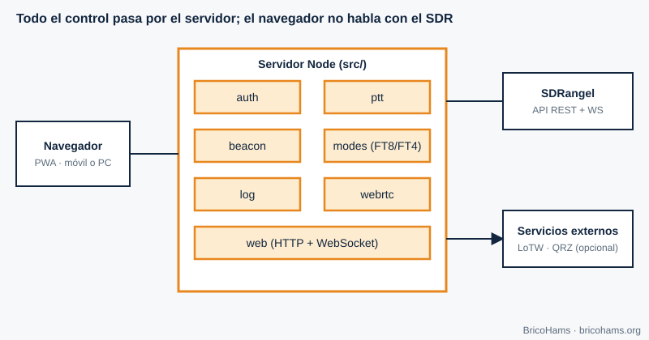
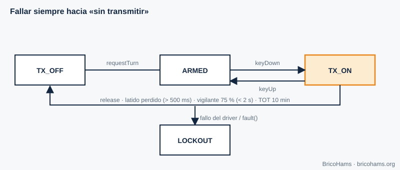
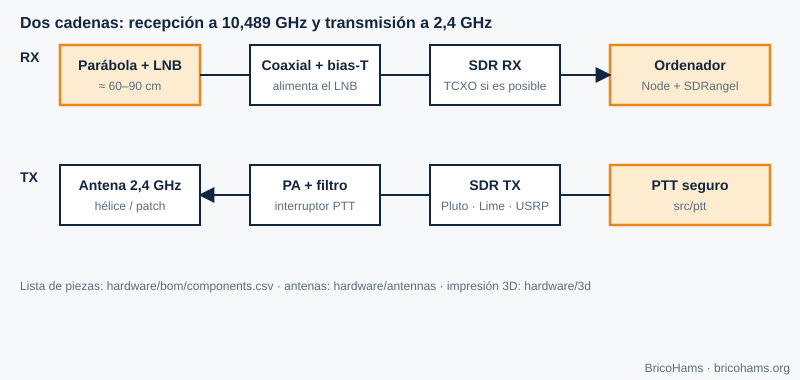

[ES](../es/11-aplicaciones-qo100.md) · [EN](../en/11-aplicaciones-qo100.md) · [FR](../fr/11-aplicaciones-qo100.md) · [PT](../pt/11-aplicaciones-qo100.md)

# 11. Aplicações no QO-100: a estação BricoHams

## Objetivos

- Ver como todos os conceitos se integram numa estação completa.
- Conhecer cada módulo do BricoHams, a sua responsabilidade e a sua segurança.
- Orientar-se para construir a sua própria estação com a pasta `hardware/`.

## 11.1 Arquitetura

*Figura 18: Arquitetura BricoHams.*

O navegador (uma PWA) nunca fala com o SDR: fá-lo o servidor Node (`src/`), que orquestra o SDRangel através da sua API REST e do seu WebSocket. Autenticação com Google (OpenID Connect) e lista de utilizadores autorizados; todo o tráfego vai cifrado.

| Módulo | Responsabilidade | Código |
|---|---|---|
| `auth` | Início de sessão (OIDC), sessões, funções | [`src/auth/`](../../../src/auth/) |
| `ptt` | Turno exclusivo, batimento, tempo máximo de TX, auditoria | [`src/ptt/`](../../../src/ptt/README.md) |
| `beacon` | Correção por baliza (capítulo 7) | [`src/beacon/`](../../../src/beacon/README.md) |
| `modes` | Sintonia, FT8/FT4/CW, RIT/XIT, memórias | [`src/modes/`](../../../src/modes/README.md) |
| `sdrangel` | Cliente e driver de PTT para o SDRangel | [`src/sdrangel/`](../../../src/sdrangel/index.js) |
| `webrtc` | Áudio de RX/TX e tramas de espectro | [`src/webrtc/`](../../../src/webrtc/index.js) |
| `log` | Diário de estação, ADIF, LoTW e QRZ | [`src/log/`](../../../src/log/index.js) |
| `web` | Interface PWA | [`src/web/public/`](../../../src/web/public/index.html) |

## 11.2 PTT com segurança

Transmitir mal pode danificar equipamentos, interferir com o resto do transponder ou violar a licença. A máquina de estados de [`src/ptt/`](../../../src/ptt/index.js) está desenhada para **falhar para «não transmitir»**.

*Figura 19: Máquina de estados do PTT.*

- Um único titular do turno de cada vez.
- O navegador envia um **batimento (heartbeat) a cada 500 ms**; se deixar de chegar, um vigilante corta antes de o tempo limite expirar (a 75 %, sempre abaixo de 2 s).
- **TOT** (tempo máximo de transmissão): por omissão 10 minutos.
- Se o driver não confirmar «desligado», o estado passa a **LOCKOUT**; só um proprietário com um código de utilização única pode sair dele.
- Cada transmissão fica registada; se não puder ser registada, não se transmite.

Fundamentação: [`docs/adr/0005-ptt-fail-safe-state-machine.md`](../../adr/0005-ptt-fail-safe-state-machine.md).

## 11.3 Correção por baliza

O módulo `beacon` mede o espectro de poucos em poucos segundos e, se detetar a baliza com SNR suficiente, corrige a frequência de receção e de transmissão. Assim o LNB barato converte-se, na prática, numa referência estável.

## 11.4 Registo de contactos: ADIF, LoTW e QRZ

Cada contacto é guardado em SQLite (módulo `node:sqlite` do Node). Exporta-se em **ADIF 3.1** com os campos de satélite necessários para o LoTW (`PROP_MODE=SAT`, `SAT_NAME=QO-100`, bandas de 13 cm na subida e 3 cm na descida). O envio para o LoTW usa a ferramenta TQSL (o certificado é gerido pelo utilizador) e o do QRZ Logbook usa a sua API com uma chave guardada cifrada. Detalhes: [`docs/help/log-lotw-qrz.md`](../../help/log-lotw-qrz.md).

## 11.5 Escuta pública com OpenWebRX

O plugin de [`plugins/openwebrx/`](../../../plugins/openwebrx/README.md) acrescenta marcadores e ajuda de deslocamento ao OpenWebRX+, é de **só receção** e não tem nenhum caminho para a transmissão.

## 11.6 Calculadoras

Para dimensionar a sua estação: prato, LNB, hélice, apontamento e deriva do LNB calculam-se em [`services/qo100-calculators/`](../../../services/qo100-calculators/README.md).

## 11.7 Construa a sua estação

*Figura 21: Mapa de construção da estação.*

1. **Receção**: prato (≥ 80 cm recomendado), LNB (idealmente com TCXO), coaxial, injetor de polarização, SDR da lista. Guia: [`docs/help/construir-tu-estacion.md`](../../help/construir-tu-estacion.md), [`hardware/antennas/dish.md`](../../../hardware/antennas/dish.md) e [`hardware/antennas/lnb-y-referencias.md`](../../../hardware/antennas/lnb-y-referencias.md).
2. **Transmissão**: SDR de TX, atenuador, PA linear com filtro, antena de hélice ([`helix-2g4.md`](../../../hardware/antennas/helix-2g4.md)) ou patch ([`poty-patch.md`](../../../hardware/antennas/poty-patch.md)); peças impressas em 3D em [`hardware/3d/`](../../../hardware/3d/README.md).
3. **Medidas antes de radiar**: medidor de potência e carga fictícia são imprescindíveis. Comece com a potência mínima e verifique o seu sinal no recetor.
4. **Instalação do software**: [`docs/help/instalacion-linux.md`](../../help/instalacion-linux.md), [`instalacion-windows.md`](../../help/instalacion-windows.md) ou [`instalacion-raspberry-pi.md`](../../help/instalacion-raspberry-pi.md).
5. **Primeiro arranque**: [`docs/help/primera-puesta-en-marcha.md`](../../help/primera-puesta-en-marcha.md).

SDRangel, OpenWebRX+, TQSL, QRZ e os fabricantes de hardware são projetos e empresas independentes; o BricoHams apenas interopera com eles e nenhum o apoia.

## Exercícios

1. Porque é o servidor, e não o navegador, que controla o SDR?
2. Com `heartbeatTimeoutMs` = 2000 ms, quando corta o vigilante?
3. Se a baliza se desviar +1500 Hz e a zona morta for 2 Hz, corrige-se? O que se aplica ao TX?
4. Que campos tornam um ADIF válido para satélites no LoTW?

### Soluções

1. Para que as credenciais, o controlo do PTT e a lógica de segurança não dependam de um cliente que possa falhar ou ser manipulado.
2. A 75 %: **1,5 s**.
3. Sim (1500 > 2). RX = FI + 1500 Hz; TX = subida nominal − 1500 Hz (quando está inativo).
4. `PROP_MODE=SAT`, `SAT_NAME=QO-100`, `BAND`, `BAND_RX`, `FREQ` e `FREQ_RX`.

**Leitura recomendada:** Collins et al., *Software-Defined Radio for Engineers*, ch. 11 (Applications for Software-Defined Radio).
